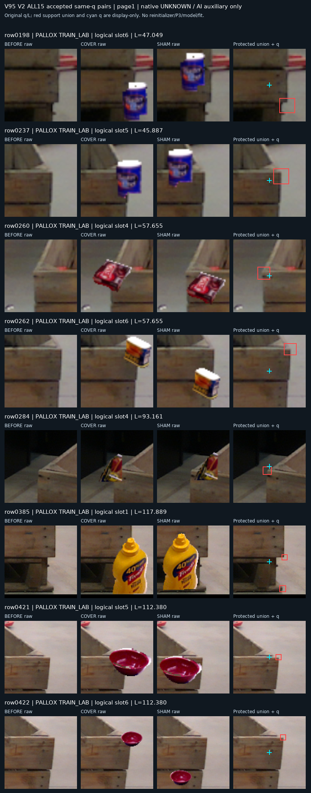
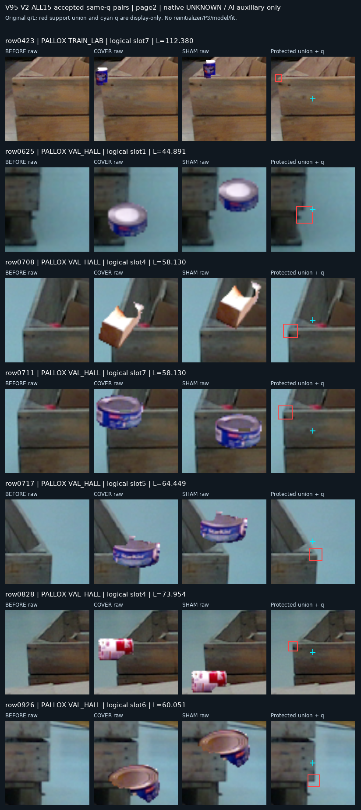

# V95 고정 query 가림·대조 실험

원문: [query_visibility_same_q_counterfactual_20261023_v95/ROOT_READOUT_KO.html](../../archive/task-2/pallet-keypoint-visibility/query_visibility_same_q_counterfactual_20261023_v95/ROOT_READOUT_KO.html)

원 HTML SHA256: `646649acfd9e00d6ff0326b3d7fcaee60247f3b7016e12c82200729fe523198c`

원 img ordinal 1–2 / 2. 원 순서 유지; 이미지 pixel decode/모델/평가 재실행 없음.

## 원 이미지 1

원문 직전 heading

```text
실제 15쌍 전체 crop
```

원 alt

```text
고정 순서 1~8쌍
```



## 원 이미지 2

원문 직전 heading

```text
실제 15쌍 전체 crop
```

원 alt

```text
고정 순서 나머지 7쌍
```


