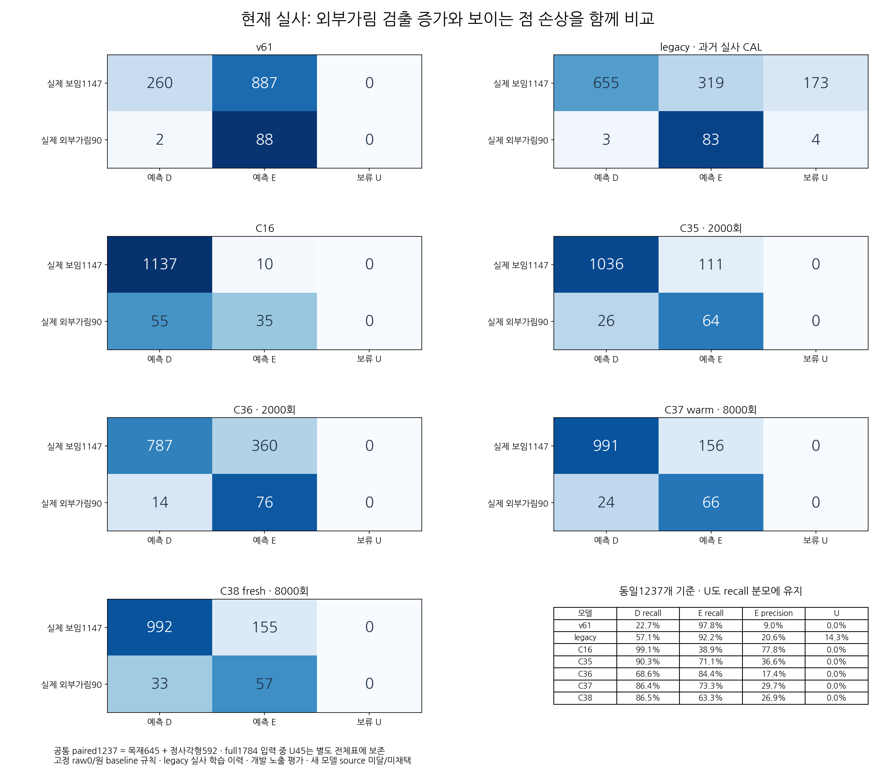
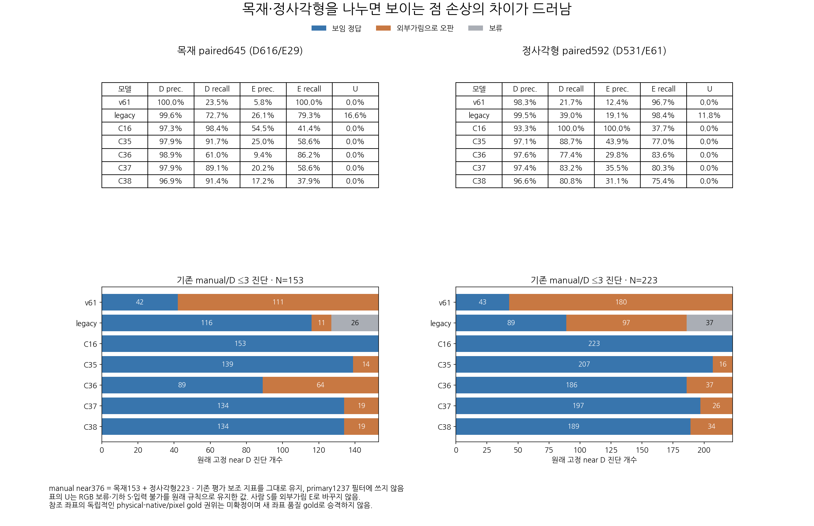
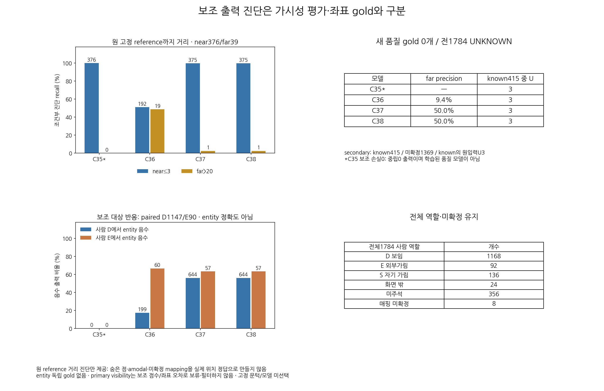

# 초기 키포인트 외부가림 평가 · 보고서 초안

원문: [query_visibility_separated_frozen_current_benchmark_20261024_v156/report_draft_agent/ROOT_READOUT_DRAFT.html](../../archive/task-2/pallet-keypoint-visibility/query_visibility_separated_frozen_current_benchmark_20261024_v156/report_draft_agent/ROOT_READOUT_DRAFT.html)

원 HTML SHA256: `bf2e77a7a69e1dbf14247d6509ecc5c6559fb0a30acd21a9bc255c0a973517b0`

원 img ordinal 1–3 / 3. 원 순서 유지; 이미지 pixel decode/모델/평가 재실행 없음.

## 원 이미지 1

원문 직전 heading

```text
정사각형 paired592
```

원 alt

```text
전체1237에 대한7모델 D/E/U 혼동행렬
```

원 HTML caption

```text
실제 생성·view QA 완료. 색은 행별 비율, 숫자는 원래 개수입니다.
```

경로 대응 참고: 보존 HTML의 상대 src를 원 상위 폴더들에 대입했을 때 C manifest에서 유일하게 일치한 파일입니다. 원 HTML은 바꾸지 않았으며, 과거 HTML 작성 시점의 별도 이미지 bytes까지 인증했다는 뜻은 아닙니다. 원 경로·대응 근거·현재 source SHA는 추가 manifest에 남겼습니다.



## 원 이미지 2

원문 직전 heading

```text
좌표가 가까웠던 기존376개 진단에서도 손상이 남습니다
```

원 alt

```text
목재 정사각형 지표와 고정near376 오판
```

원 HTML caption

```text
재질별 precision/recall/U와 기존 near 진단을 함께 표시했습니다.
```

경로 대응 참고: 보존 HTML의 상대 src를 원 상위 폴더들에 대입했을 때 C manifest에서 유일하게 일치한 파일입니다. 원 HTML은 바꾸지 않았으며, 과거 HTML 작성 시점의 별도 이미지 bytes까지 인증했다는 뜻은 아닙니다. 원 경로·대응 근거·현재 source SHA는 추가 manifest에 남겼습니다.



## 원 이미지 3

원문 직전 heading

```text
위치 품질·대상 판별의 보조 출력은 어디까지 알 수 있나
```

원 alt

```text
조건부 reference 거리 및 entity 음수 반응과 전체 주석 분모
```

원 HTML caption

```text
주 가시성 결과, 참조 거리 진단, entity 반응의 권위를 구분했습니다.
```

경로 대응 참고: 보존 HTML의 상대 src를 원 상위 폴더들에 대입했을 때 C manifest에서 유일하게 일치한 파일입니다. 원 HTML은 바꾸지 않았으며, 과거 HTML 작성 시점의 별도 이미지 bytes까지 인증했다는 뜻은 아닙니다. 원 경로·대응 근거·현재 source SHA는 추가 manifest에 남겼습니다.


