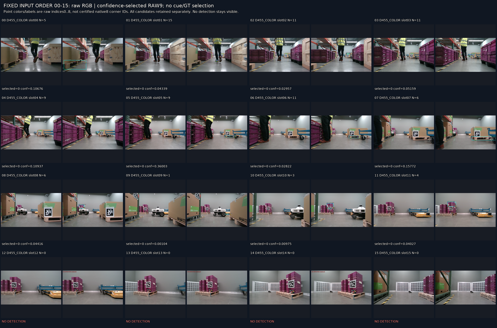
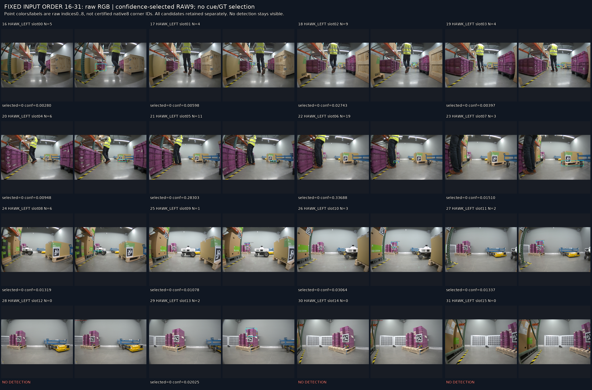
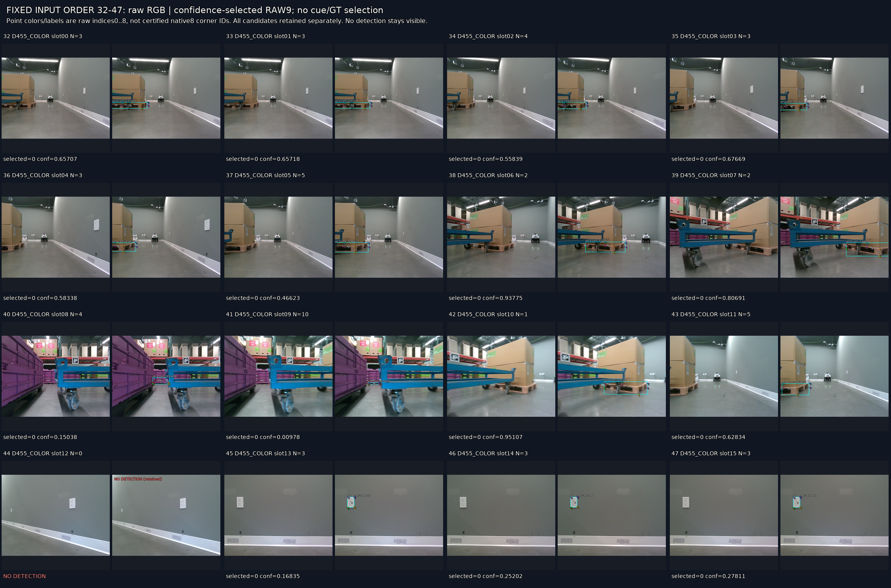

# V72 공개 R2B 초기 추론 점검

원문: [query_visibility_cue_occlusion_20261023_v72/public_pallet_initializer/VISUAL_REVIEW/RESULTS_KO.html](../../archive/task-2/pallet-keypoint-visibility/query_visibility_cue_occlusion_20261023_v72/public_pallet_initializer/VISUAL_REVIEW/RESULTS_KO.html)

원 HTML SHA256: `733937dadb1f25e49692249db87f6a26935300ee1ba2d8c9253ca005ce652ebb`

원 img ordinal 1–4 / 4. 원 순서 유지; 이미지 pixel decode/모델/평가 재실행 없음.

## 원 이미지 1

원문 직전 heading

```text
고정48프레임 전체: 원본 / confidence 선택 raw9
```

원 alt

```text
고정순서 page1
```



## 원 이미지 2

원문 직전 heading

```text
고정48프레임 전체: 원본 / confidence 선택 raw9
```

원 alt

```text
고정순서 page2
```



## 원 이미지 3

원문 직전 heading

```text
고정48프레임 전체: 원본 / confidence 선택 raw9
```

원 alt

```text
고정순서 page3
```



## 원 이미지 4

원문 직전 heading

```text
기존 cue8행: 고정 좌표를 옮기지 않은 대응 진단
```

원 alt

```text
고정cue 원본과 선택출력
```


