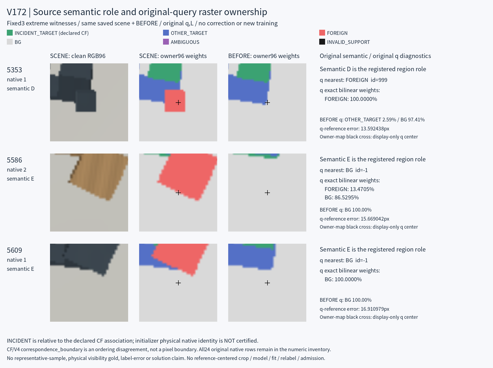

# V172 · native 가시성과 query 소속 의미 점검

원문: [query_visibility_source_mask_semantics_audit_20261024_v172/ROOT_READOUT_KO.html](../../archive/task-2/pallet-keypoint-visibility/query_visibility_source_mask_semantics_audit_20261024_v172/ROOT_READOUT_KO.html)

원 HTML SHA256: `07930af88d98ec01f5c331456e5805a3dde938709a8df387af3834189ee15d00`

원 img ordinal 1–1 / 1. 원 순서 유지; 이미지 pixel decode/모델/평가 재실행 없음.

## 원 이미지 1

원문 직전 heading

```text
선택된 3개 경계 사례
```

원 alt

```text
고정3행 원 RGB96, SCENE와 BEFORE 소속 도표, semantic과 q 진단을 구분한 과학 도표
```

원 HTML caption

```text
고정3행 도표. B와 root가 각각 tools.view_image로 실제1장(3행)을 확인했습니다. 원 RGB·표시 소속 맵과 수치가 구분되어 있습니다. 보고서 HTML은 브라우저에서 실행하지 않았습니다.
```


