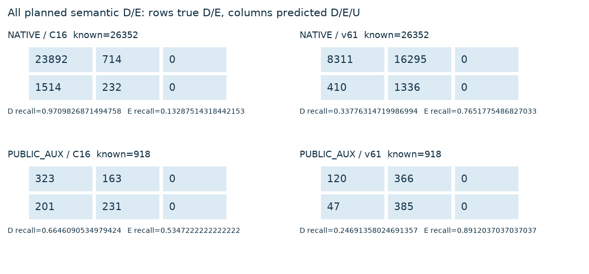
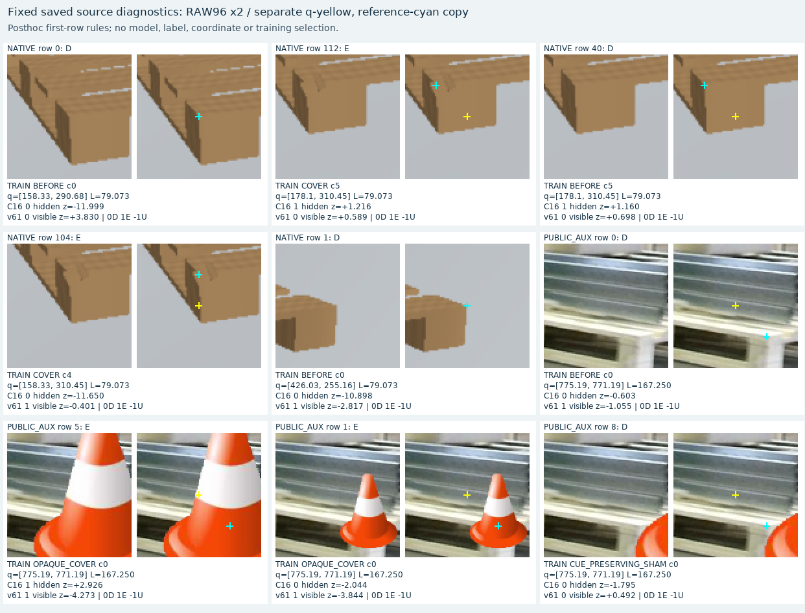

# V129 source 고정 baseline

원문: [query_visibility_registered_native_diversity_20261023_v129/saved_source_baseline_evaluation_v1/READOUT_KO.html](../../archive/task-2/pallet-keypoint-visibility/query_visibility_registered_native_diversity_20261023_v129/saved_source_baseline_evaluation_v1/READOUT_KO.html)

원 HTML SHA256: `03d0ed1bdd4ac16be31daae8ec81637ae4d410ccf7be9a24279db120ac744163`

원 img ordinal 1–2 / 2. 원 순서 유지; 이미지 pixel decode/모델/평가 재실행 없음.

## 원 이미지 1

원문 직전 heading

```text
등록 합성 다양성 + 공개 실사 AUX: 고정 source 진단
```



## 원 이미지 2

원문 직전 heading

```text
등록 합성 다양성 + 공개 실사 AUX: 고정 source 진단
```


