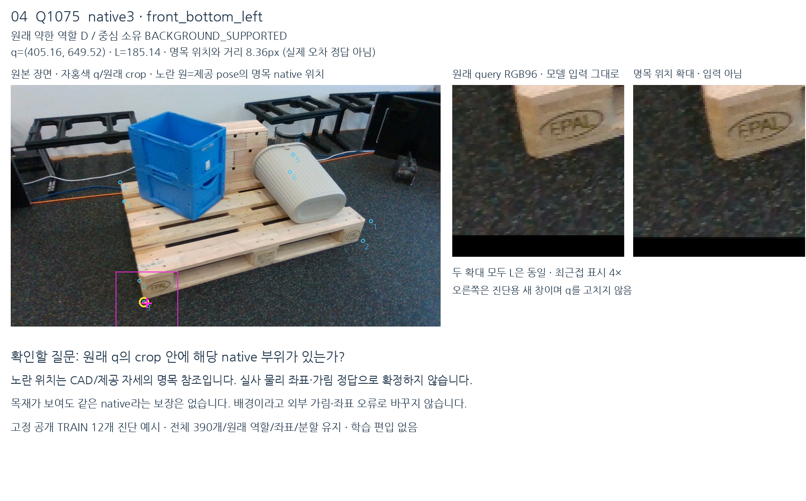
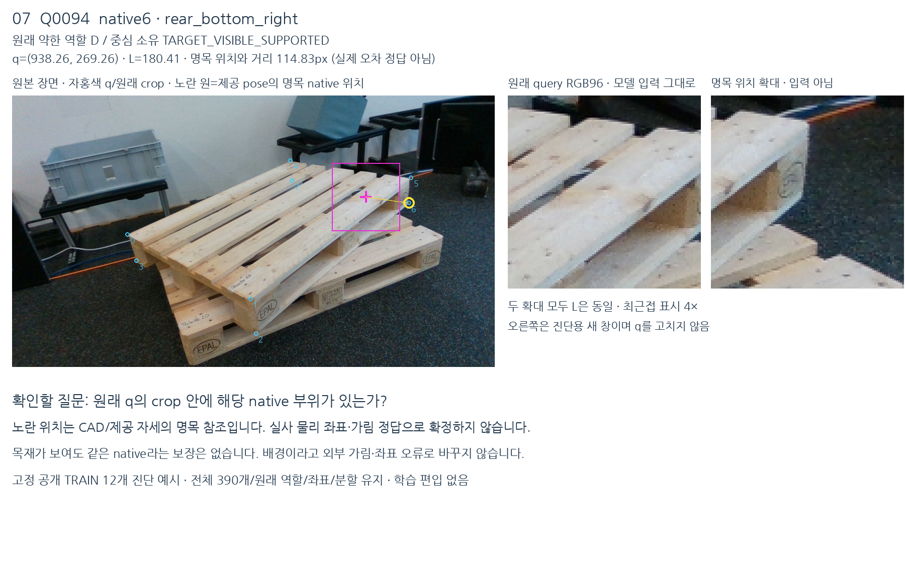
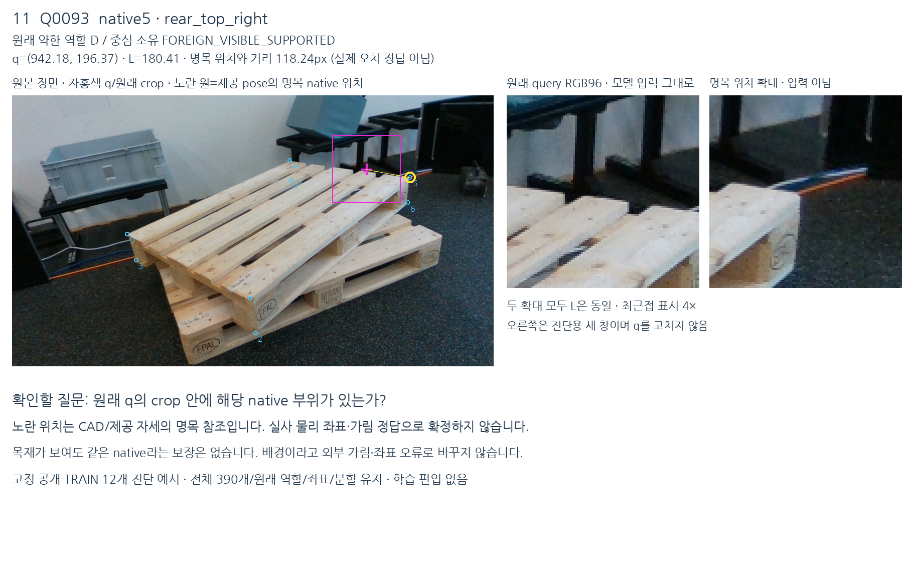
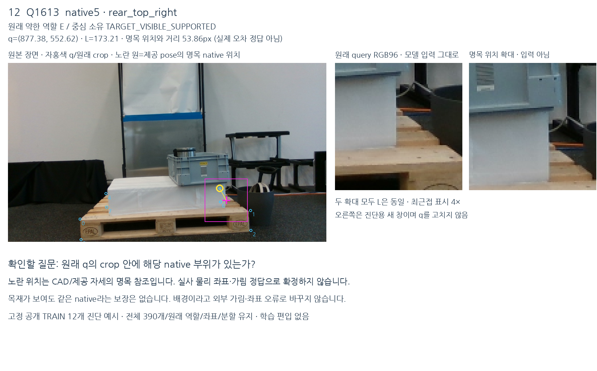

# native 부위와 초기 crop 대조 · V159

원문: [query_visibility_native_part_support_feasibility_20261024_v159/ROOT_READOUT_KO.html](../../archive/task-2/pallet-keypoint-visibility/query_visibility_native_part_support_feasibility_20261024_v159/ROOT_READOUT_KO.html)

원 HTML SHA256: `877759f72d077b6f892d7c685ef2f675ae5127f7942e01599a597b5e8484440b`

원 img ordinal 1–4 / 4. 원 순서 유지; 이미지 pixel decode/모델/평가 재실행 없음.

## 원 이미지 1

원문 직전 heading

```text
Q1075: 중심은 바닥이어도 모서리는 보임
```



## 원 이미지 2

원문 직전 heading

```text
Q94: 목재가 보여도 원하는 부위와 다름
```



## 원 이미지 3

원문 직전 heading

```text
Q93: 보이는 native 부위와 초기 중심이 다름
```



## 원 이미지 4

원문 직전 heading

```text
Q1613: 중심 목재와 native E가 양립
```


