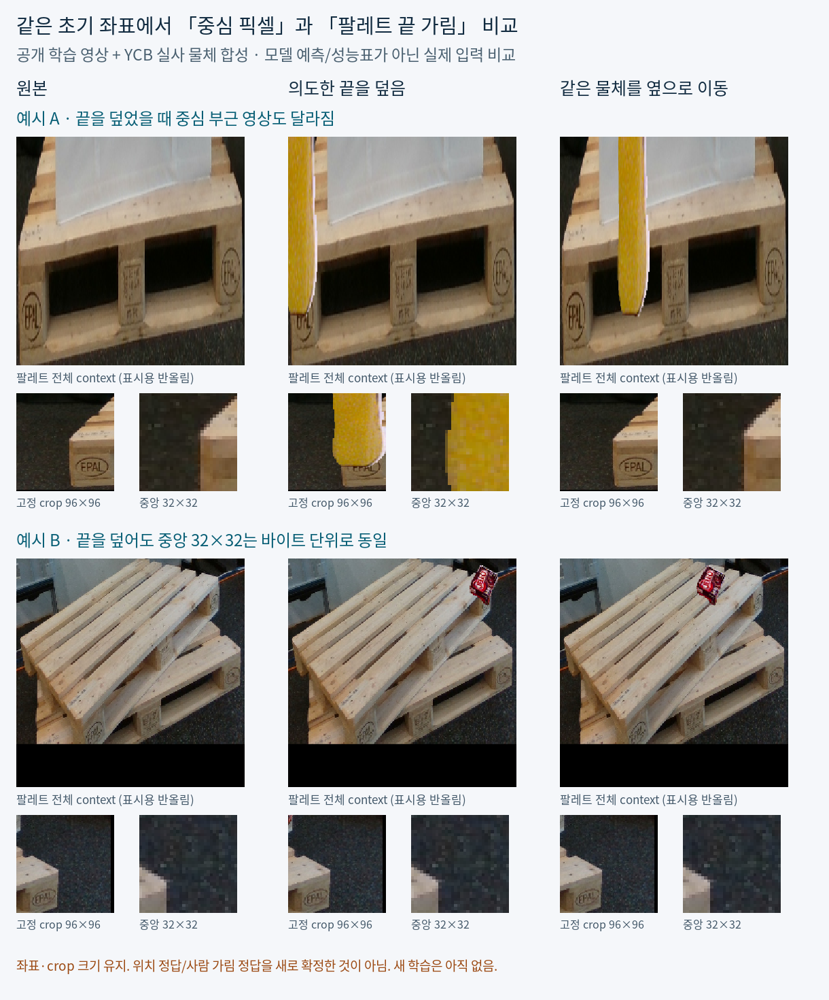

# V164·V165 공개 TRAIN 입력 단계 결과

원문: [query_visibility_native_part_counterfactual_20261024_v164/provenance/BEFORE_TEMPORAL_CAPTION_CORRECTION/ROOT_READOUT_KO.html](../../archive/task-2/pallet-keypoint-visibility/query_visibility_native_part_counterfactual_20261024_v164/provenance/BEFORE_TEMPORAL_CAPTION_CORRECTION/ROOT_READOUT_KO.html)

원 HTML SHA256: `0205f600ccbca97456c1adcaa681eae49c28f98a1c492be8aaae8cd24e1c3f54`

원 img ordinal 1–1 / 1. 원 순서 유지; 이미지 pixel decode/모델/평가 재실행 없음.

## 원 이미지 1

원문 직전 heading

```text
실제 입력에서 확인한 것과 남은 한계
```

원 alt

```text
원래 q를 고정한 부위 가림 입력 예시와 보존된 실패
```

경로 대응 참고: 보존 HTML의 상대 src를 원 상위 폴더들에 대입했을 때 C manifest에서 유일하게 일치한 파일입니다. 원 HTML은 바꾸지 않았으며, 과거 HTML 작성 시점의 별도 이미지 bytes까지 인증했다는 뜻은 아닙니다. 원 경로·대응 근거·현재 source SHA는 추가 manifest에 남겼습니다.


