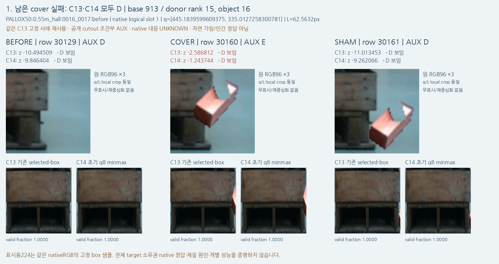
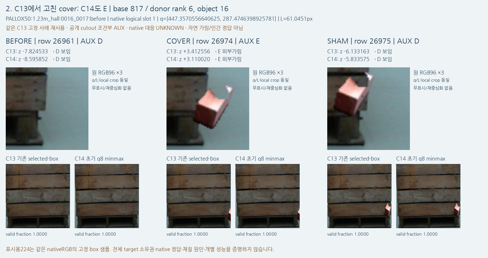
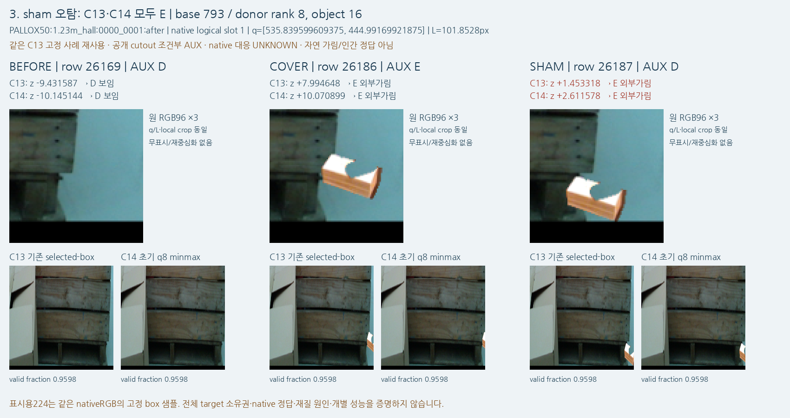

# C13 → C14 공개 고정3 관찰

원문: [query_visibility_consistent_query_context_20261023_v119/source_visual_followup/SAVED_PUBLIC_FIXED3_C13_C14_KO.html](../../archive/task-2/pallet-keypoint-visibility/query_visibility_consistent_query_context_20261023_v119/source_visual_followup/SAVED_PUBLIC_FIXED3_C13_C14_KO.html)

원 HTML SHA256: `3b3d9d0e07c563f4f6eec0a74e5a79fd7c80aebde7ff50e8652b5e0bc28ae7fc`

원 img ordinal 1–3 / 3. 원 순서 유지; 이미지 pixel decode/모델/평가 재실행 없음.

## 원 이미지 1

원문 직전 heading

```text
1. REMAINING_VAL_COVER_FALSE_D
```

원 alt

```text
같은 고정 triplet의 C13/C14 logit 및 원 local96, old/new target224
```



## 원 이미지 2

원문 직전 heading

```text
2. VAL_C12_COVER_D_TO_C13_E_FIX
```

원 alt

```text
같은 고정 triplet의 C13/C14 logit 및 원 local96, old/new target224
```



## 원 이미지 3

원문 직전 heading

```text
3. VAL_C13_SHAM_FALSE_E
```

원 alt

```text
같은 고정 triplet의 C13/C14 logit 및 원 local96, old/new target224
```


