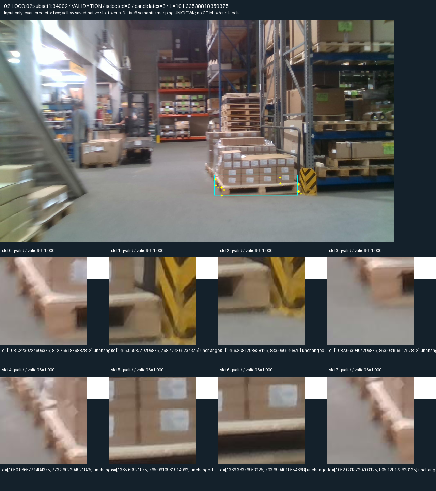
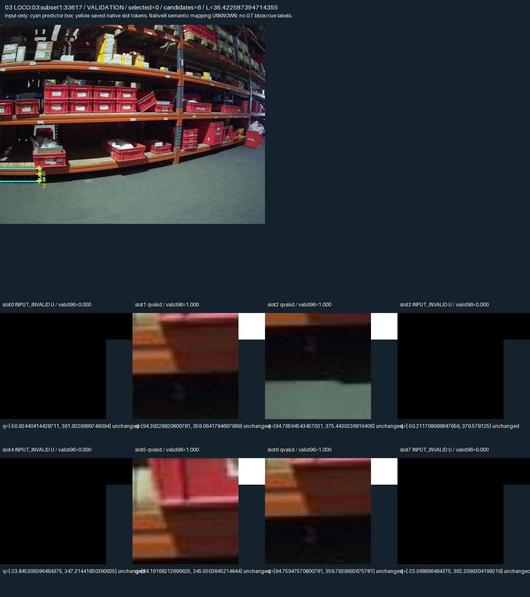
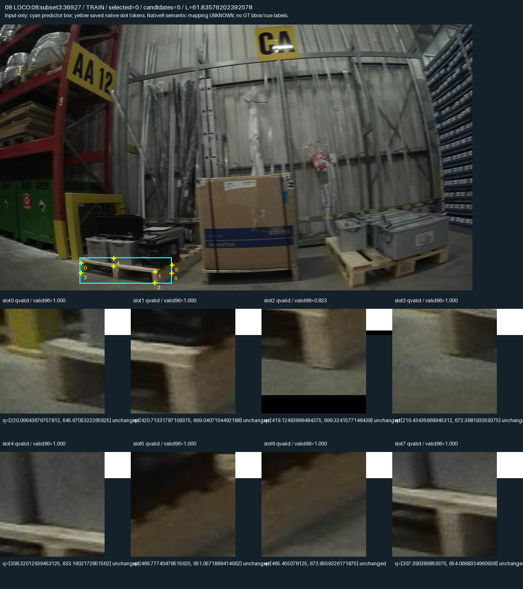
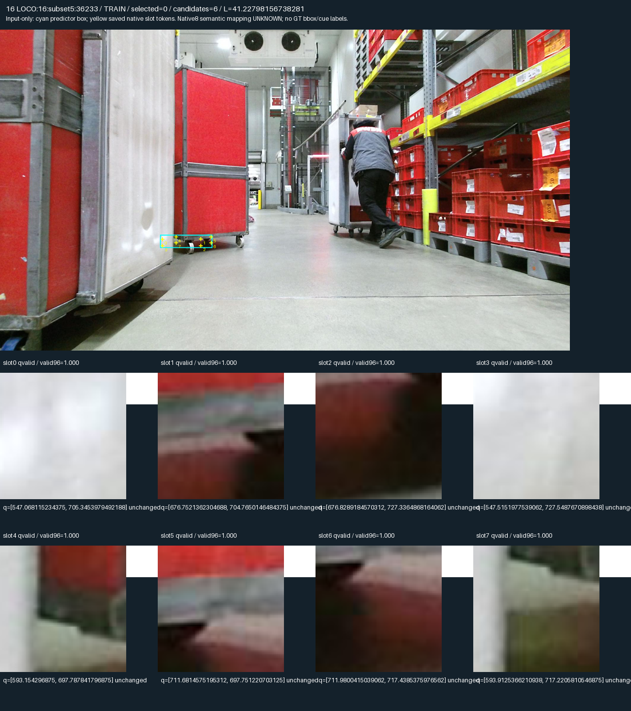
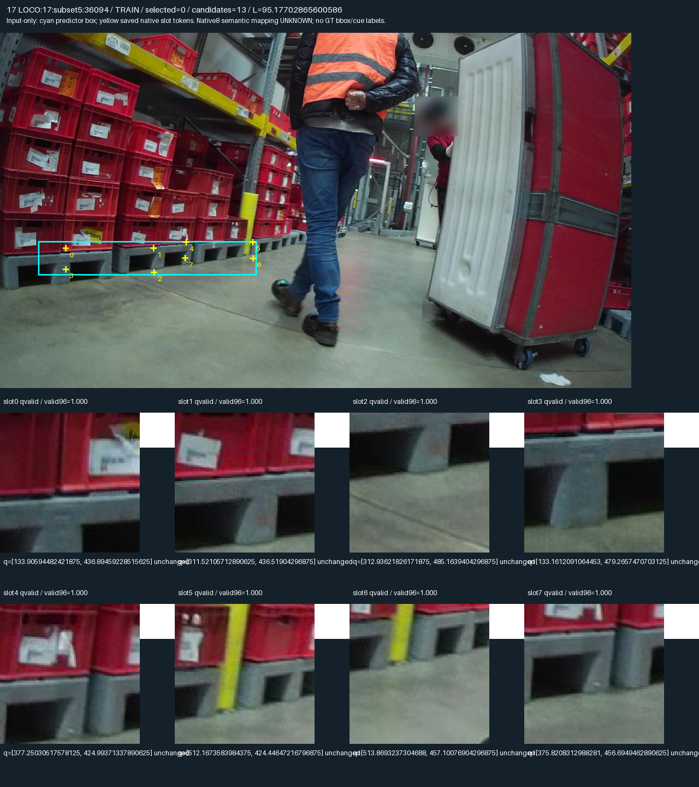
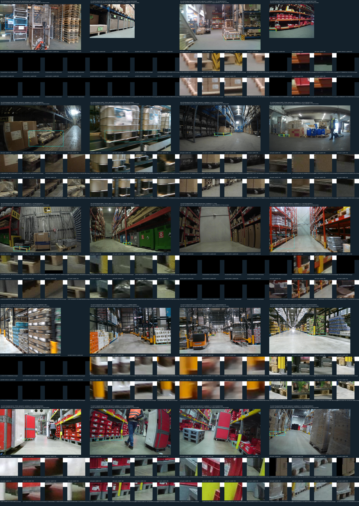

# V92 공개 팔레트 원 query crop 검토

원문: [query_visibility_flat_pallet_cue_bridge_20261023_v92/source_audit_report/SOURCE_QUERY_PROGRESS_KO.html](../../archive/task-2/pallet-keypoint-visibility/query_visibility_flat_pallet_cue_bridge_20261023_v92/source_audit_report/SOURCE_QUERY_PROGRESS_KO.html)

원 HTML SHA256: `27306d56d15eba4dc2d60f4291b45b9ee57550c4bc6b5dc9f0baa0ac73f99785`

원 img ordinal 1–6 / 6. 원 순서 유지; 이미지 pixel decode/모델/평가 재실행 없음.

## 원 이미지 1

원문 직전 heading

```text
Visible wooden structure
```

원 alt

```text
Original full image and8 frozen query crops, frame02
```

원 HTML caption

```text
상자를 실은 전경 목재 팔레트의 발·상판·포크 구멍은 보입니다. 일부 crop은 모서리보다 기둥·상자·빈 공간을 함께 봅니다. 부위가 crop에 없다는 관찰만으로 외부 가림을 만들 수 없습니다.원본 PNG 열기 ↗
```



## 원 이미지 2

원문 직전 heading

```text
Rack region · no clear pallet target
```

원 alt

```text
Original full image and8 frozen query crops, frame03
```

원 HTML caption

```text
선택 영역이 선반·붉은 통·바닥에 놓여 있고 일부 q는 영상 밖입니다. 원하는 팔레트가 가려졌다는 근거가 아니라, target 대응과 입력 유효성부터 미확인인 사례입니다.원본 PNG 열기 ↗
```



## 원 이미지 3

원문 직전 heading

```text
Pallet structure · crop boundary
```

원 alt

```text
Original full image and8 frozen query crops, frame08
```

원 HTML caption

```text
발·포크 구멍 경계가 보이지만 q 위치에 따라 바닥이나 crop 경계가 포함됩니다. padding·crop MISS와 실제 foreign occluder를 구분해야 하며, 보이는 구조도 native slot 대응을 증명하지는 않습니다.원본 PNG 열기 ↗
```



## 원 이미지 4

원문 직전 heading

```text
Wheeled cart · target uncertainty
```

원 alt

```text
Original full image and8 frozen query crops, frame16
```

원 HTML caption

```text
전체 장면은 바퀴 달린 운반 카트를 보여 줍니다. 유효한 crop이 있어도 팔레트 target을 보았다는 뜻은 아닙니다. 이 부근의 물체·빈 공간을 팔레트의 외부 가림으로 부를 수 없습니다.원본 PNG 열기 ↗
```



## 원 이미지 5

원문 직전 heading

```text
Multiple pallets · repeated cues
```

원 alt

```text
Original full image and8 frozen query crops, frame17
```

원 HTML caption

```text
나란한 팔레트와 반복된 발·포크 구멍이 보입니다. 물리 구조의 존재는 관찰할 수 있으나, 어느 instance의 어느 기대 부위인지 모호합니다. cue 대응이 없으면 D/E/S는 UNKNOWN입니다.원본 PNG 열기 ↗
```



## 원 이미지 6

원문 직전 heading

```text
Multiple pallets · repeated cues
```

원 alt

```text
All20 original fixed source figures contact
```


