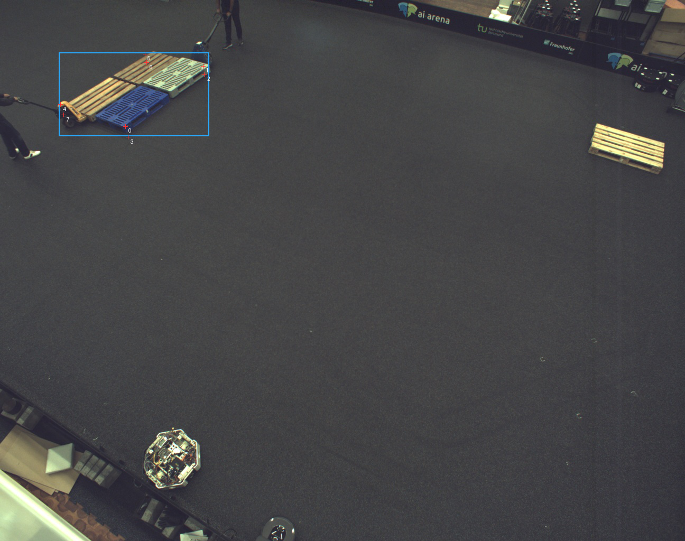
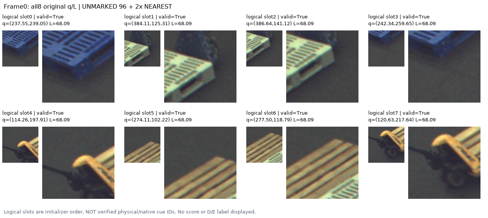
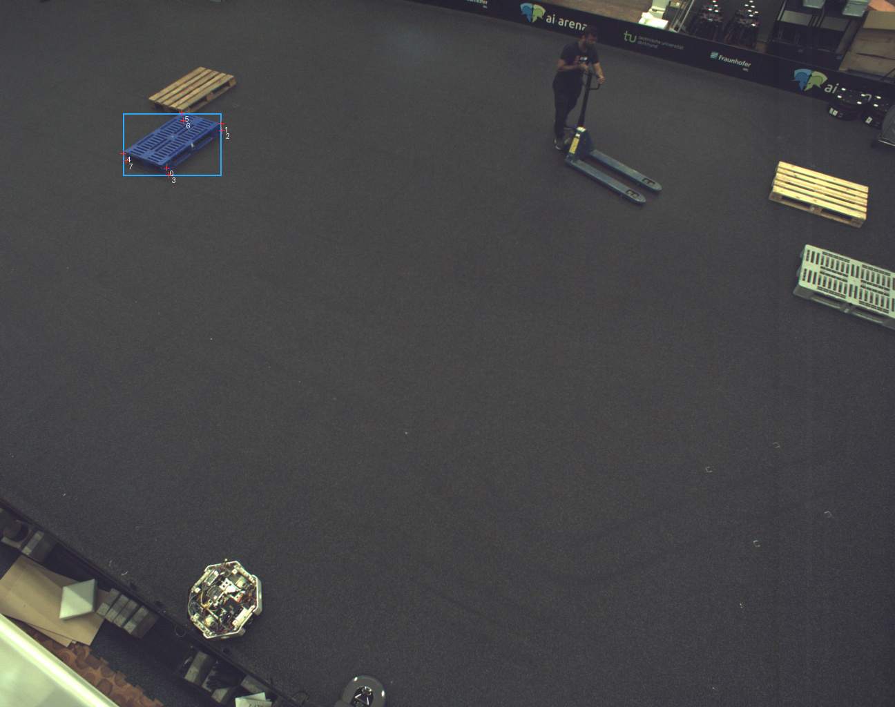
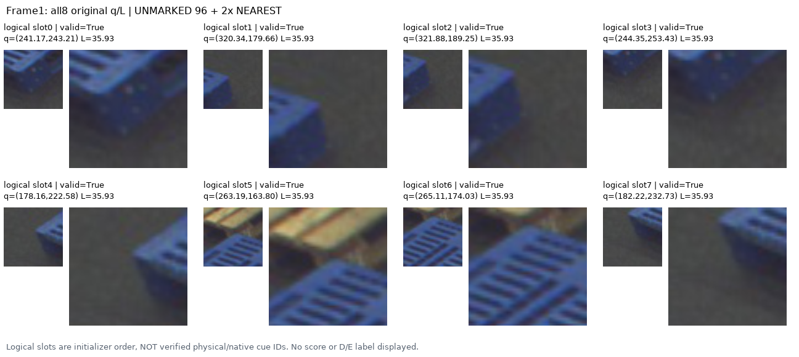
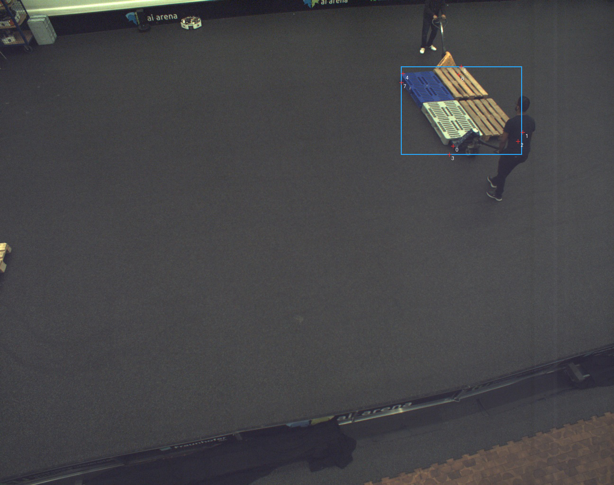
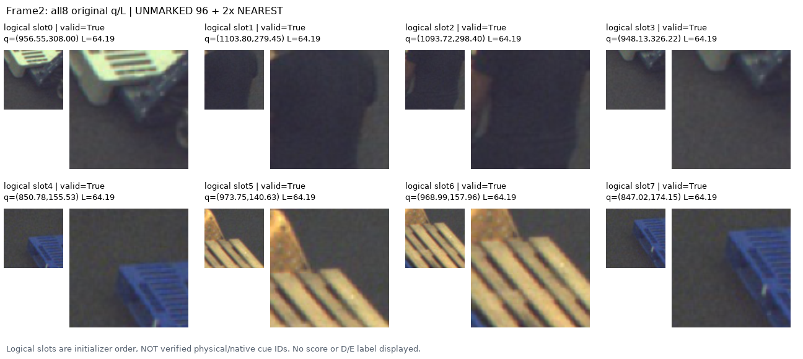
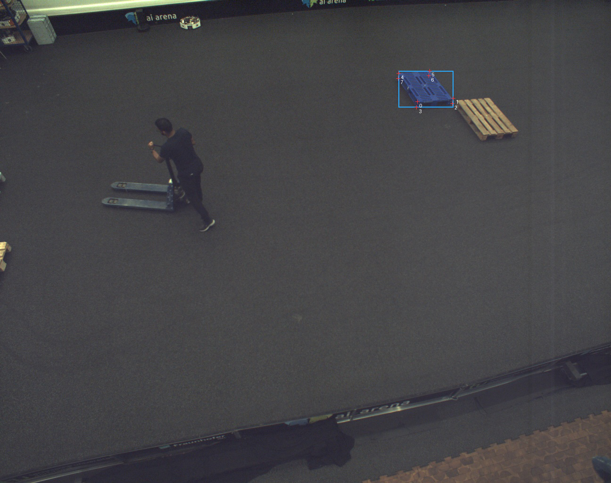
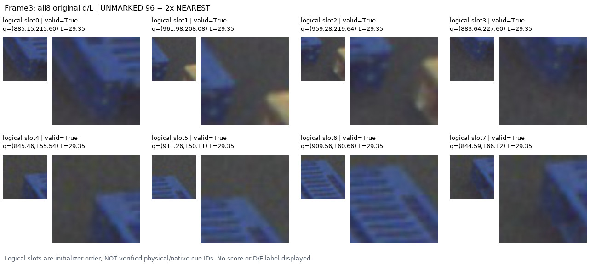

# 고정32 query 실제 영상 검토

원문: [query_visibility_public_flat_pallet_queries_20261023_v104/visual_query_review/ACTUAL_VISUAL_READOUT_KO.html](../../archive/task-2/pallet-keypoint-visibility/query_visibility_public_flat_pallet_queries_20261023_v104/visual_query_review/ACTUAL_VISUAL_READOUT_KO.html)

원 HTML SHA256: `7d6cd36da8c50d590ff0a6161d853f7c85f8daa08579909927cff92a94c70eb4`

원 img ordinal 1–8 / 8. 원 순서 유지; 이미지 pixel decode/모델/평가 재실행 없음.

## 원 이미지 1

원문 직전 heading

```text
Frame0: 원래8개 전부
```

원 alt

```text
Frame0 original q context
```



## 원 이미지 2

원문 직전 heading

```text
Frame0: 원래8개 전부
```

원 alt

```text
Frame0 all8 unmarked crops
```



## 원 이미지 3

원문 직전 heading

```text
Frame1: 원래8개 전부
```

원 alt

```text
Frame1 original q context
```



## 원 이미지 4

원문 직전 heading

```text
Frame1: 원래8개 전부
```

원 alt

```text
Frame1 all8 unmarked crops
```



## 원 이미지 5

원문 직전 heading

```text
Frame2: 원래8개 전부
```

원 alt

```text
Frame2 original q context
```



## 원 이미지 6

원문 직전 heading

```text
Frame2: 원래8개 전부
```

원 alt

```text
Frame2 all8 unmarked crops
```



## 원 이미지 7

원문 직전 heading

```text
Frame3: 원래8개 전부
```

원 alt

```text
Frame3 original q context
```



## 원 이미지 8

원문 직전 heading

```text
Frame3: 원래8개 전부
```

원 alt

```text
Frame3 all8 unmarked crops
```


