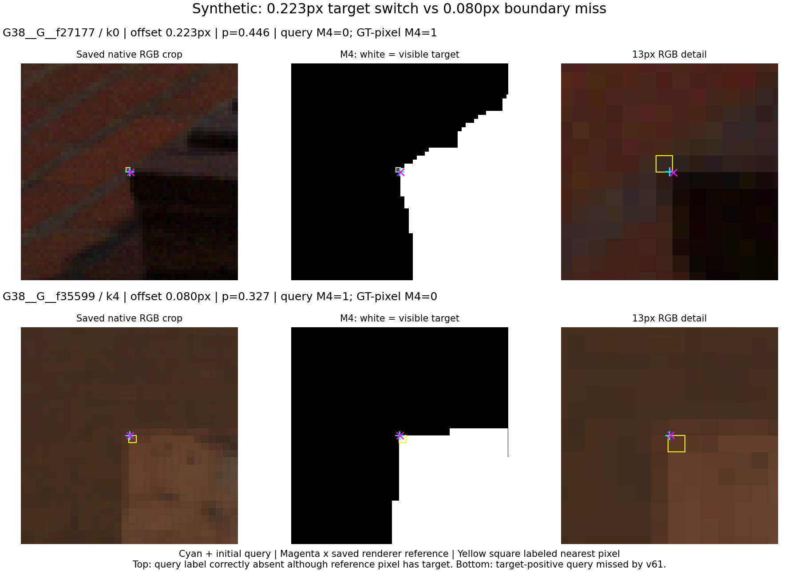
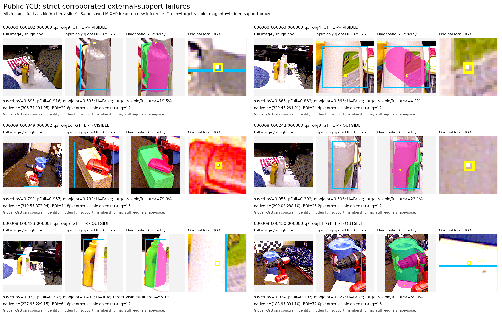
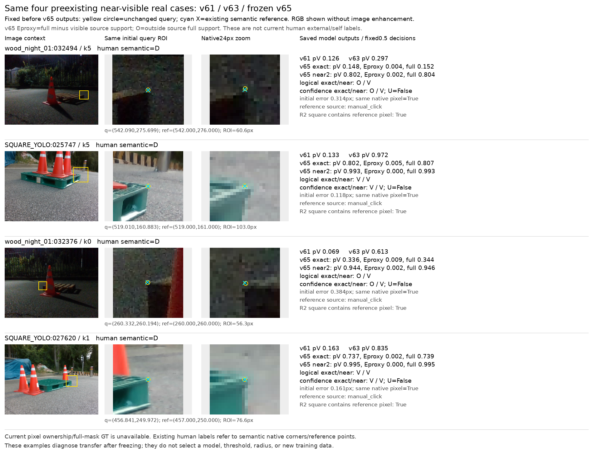
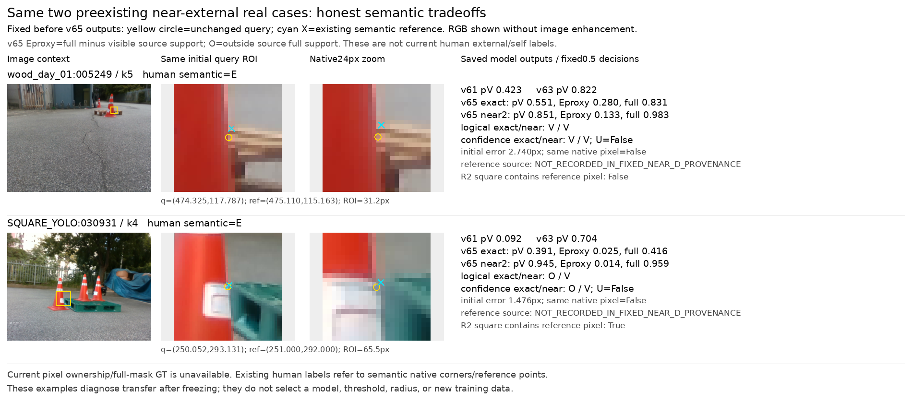

# 팔레트 query visibility 진단·source 확장

원문: [query_visibility_amodal_global_20261022_v65/RESULTS_KO.html](../../archive/task-2/pallet-keypoint-visibility/query_visibility_amodal_global_20261022_v65/RESULTS_KO.html)

원 HTML SHA256: `9647646d3f8c210fced3e1592804f6b14c27a25237c85f23e275c83e0b173855`

원 img ordinal 1–5 / 5. 원 순서 유지; 이미지 pixel decode/모델/평가 재실행 없음.

## 원 이미지 1

원문 직전 heading

```text
좌표 오차가 3px 이하인데도 실패하는 이유
```

원 alt

```text
합성 crop 목표 차이와 실제 실패
```



## 원 이미지 2

원문 직전 heading

```text
수동 좌표·오차≤3px·보이는 점만
```

원 alt

```text
v61과 기존v63의 실제 팔레트 개선과 잔여 오류
```


## 원 이미지 3

원문 직전 heading

```text
SOURCE 비교 개선 통과
```

원 alt

```text
공개 실사 가림 실패 전체형태 crop
```



## 원 이미지 4

원문 직전 heading

```text
사전에 고정한 실제 crop의 v65 판정
```

원 alt

```text
동일 고정4개 실사 crop의 v61/v63/v65
```



## 원 이미지 5

원문 직전 heading

```text
고정한 외부 가림 사례의 tradeoff
```

원 alt

```text
같은2개 semantic외부가림 실제crop
```


