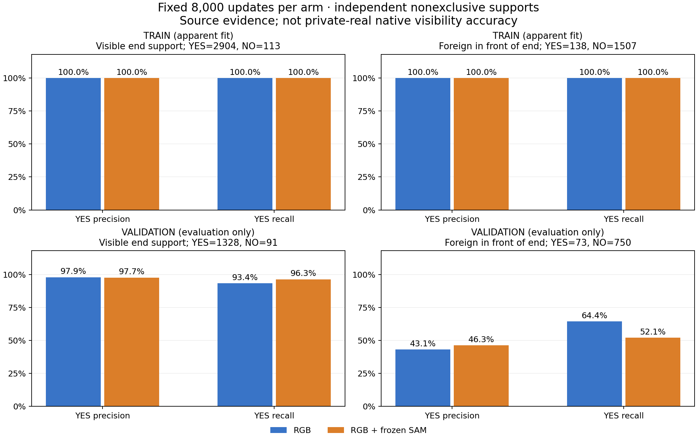

# V181 고정 crop RGB/SAM 비교

원문: [query_visibility_local_support_raw_head_20261024_v181/ROOT_READOUT_KO.html](../../archive/task-2/pallet-keypoint-visibility/query_visibility_local_support_raw_head_20261024_v181/ROOT_READOUT_KO.html)

원 HTML SHA256: `7c5834432b50331b6d3e2f72b32290e8cb3fb7b775afac63dc8ee7f6118ed4a2`

원 img ordinal 1–1 / 1. 원 순서 유지; 이미지 pixel decode/모델/평가 재실행 없음.

## 원 이미지 1

원문 직전 heading

```text
해당 부위가 보이는 증거와 외부 물체의 앞 가림
```

원 alt

```text
소스 학습 및 검증에서 두 모델의 부위 보임과 외부 앞 가림 precision recall
```


