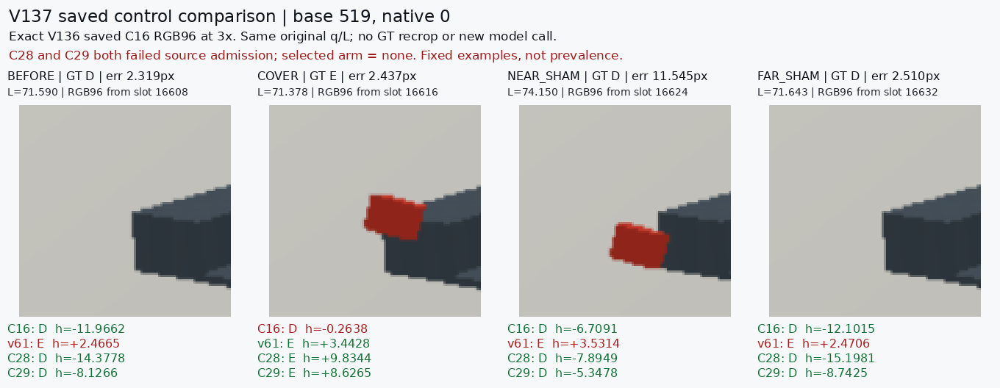
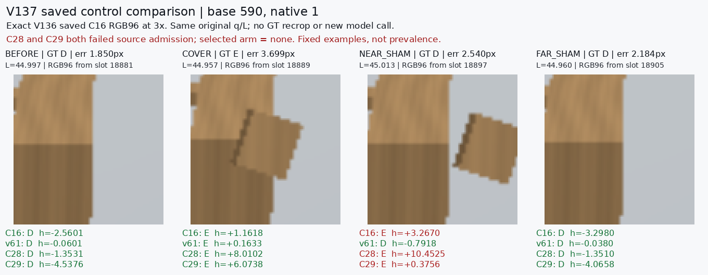

# V137 fixed saved crop controls

원문: [query_visibility_continuous_source_coverage_control_20261024_v137/saved_control_crop_comparison/INDEX.html](../../archive/task-2/pallet-keypoint-visibility/query_visibility_continuous_source_coverage_control_20261024_v137/saved_control_crop_comparison/INDEX.html)

원 HTML SHA256: `fe9b25d99b1690d6f52749e2b26e3536389e67625ce57ed8b8e5a725960467c1`

원 img ordinal 1–2 / 2. 원 순서 유지; 이미지 pixel decode/모델/평가 재실행 없음.

## 원 이미지 1

원문 직전 heading

```text
Base 519
```



## 원 이미지 2

원문 직전 heading

```text
Base 590
```


