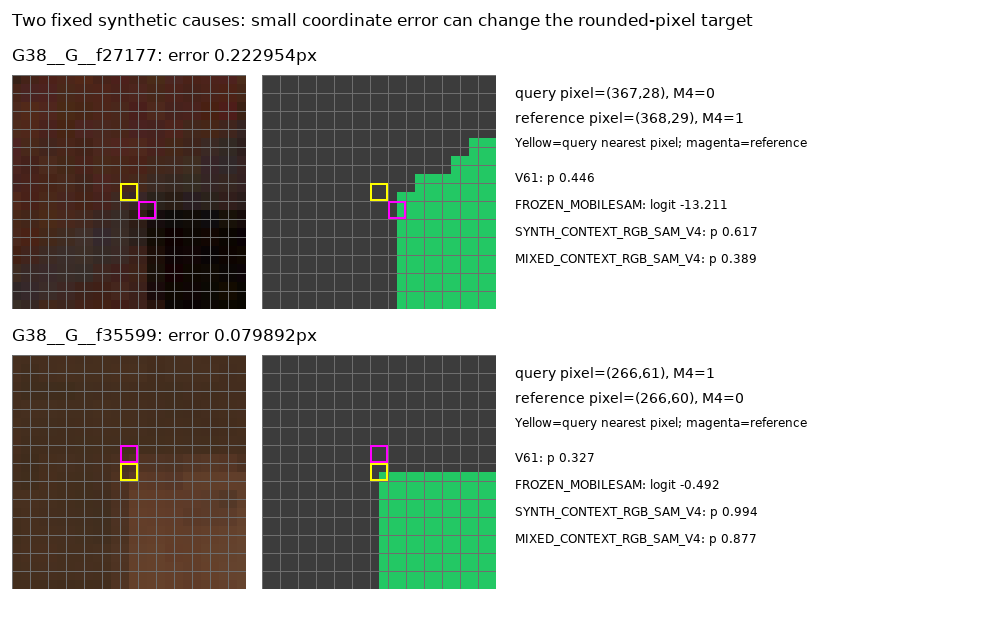
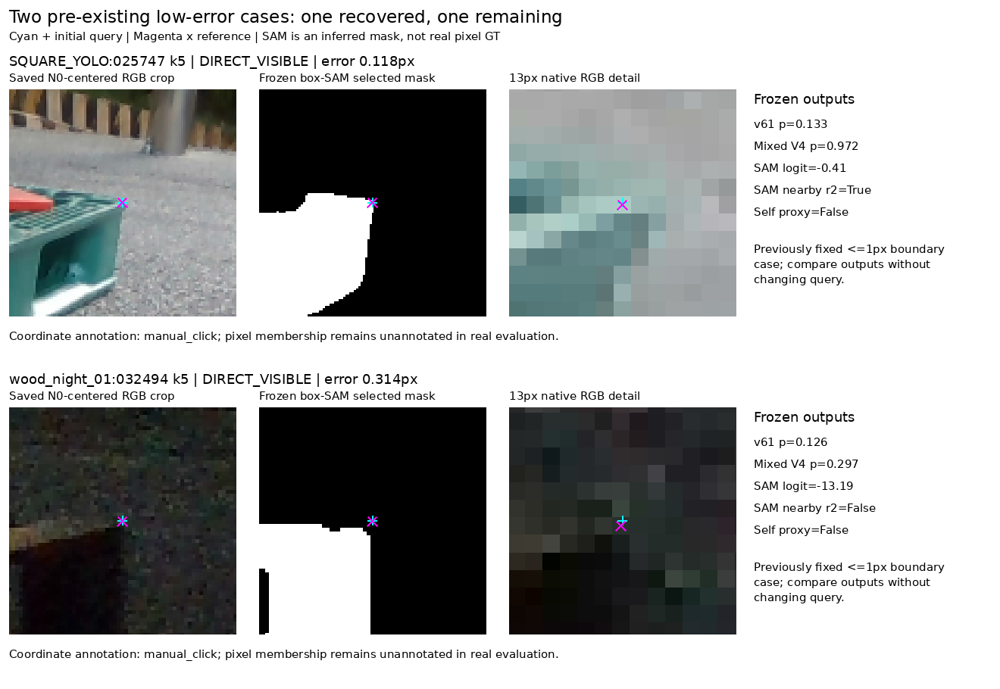
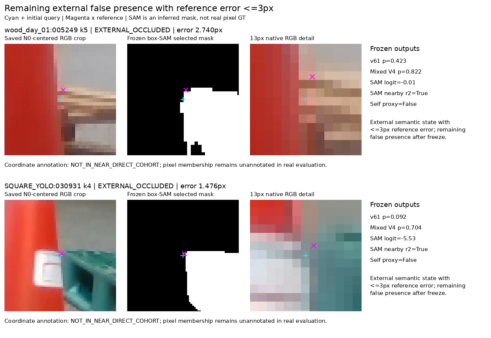

# Query visibility v63 결과

원문: [query_visibility_public_real_20261022_v63/RESULTS_KO.html](../../archive/task-2/pallet-keypoint-visibility/query_visibility_public_real_20261022_v63/RESULTS_KO.html)

원 HTML SHA256: `a21386792164a2b09a0bcd3a77214c5e5dd662c411964659b38f6db0c127c8c4`

원 img ordinal 1–3 / 3. 원 순서 유지; 이미지 pixel decode/모델/평가 재실행 없음.

## 원 이미지 1

원문 직전 heading

```text
목표 차이와 실제 학습 한계
```



## 원 이미지 2

원문 직전 heading

```text
같은 저오차 실사 crop의 개선과 잔여 오류
```



## 원 이미지 3

원문 직전 heading

```text
외부 가림과 자기 가림의 잔여 문제
```


