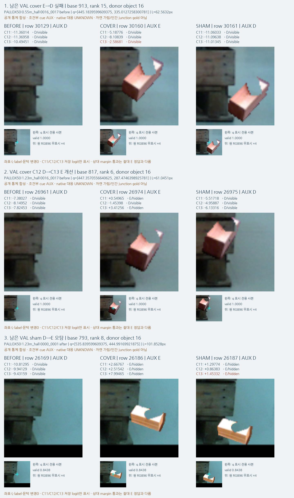
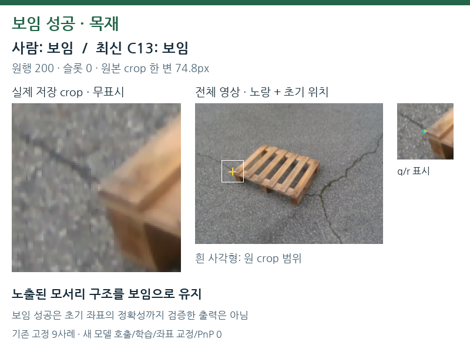
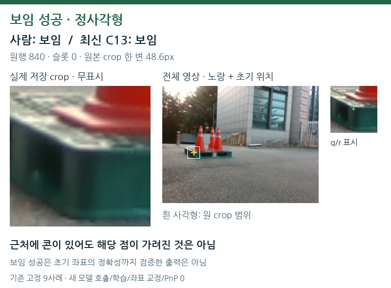
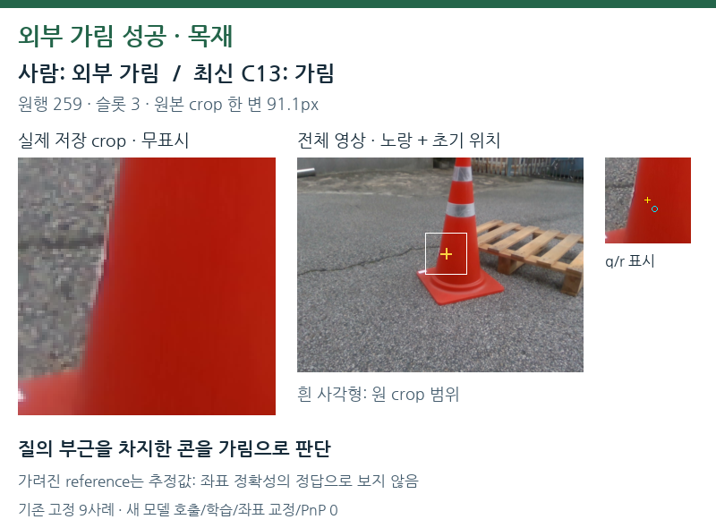
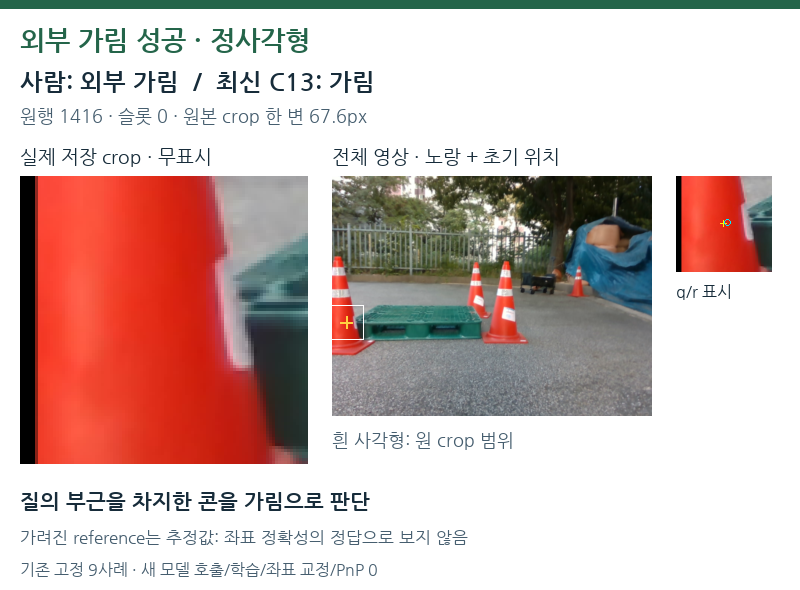
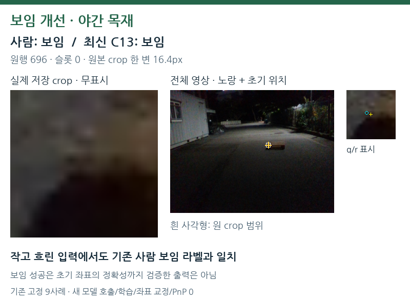
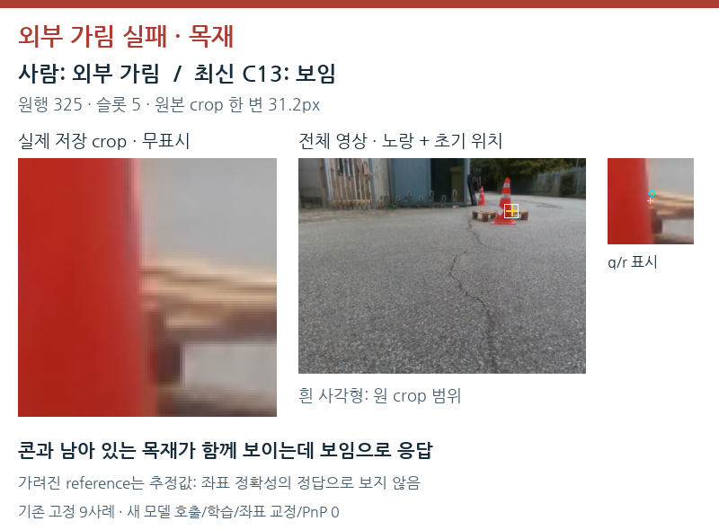
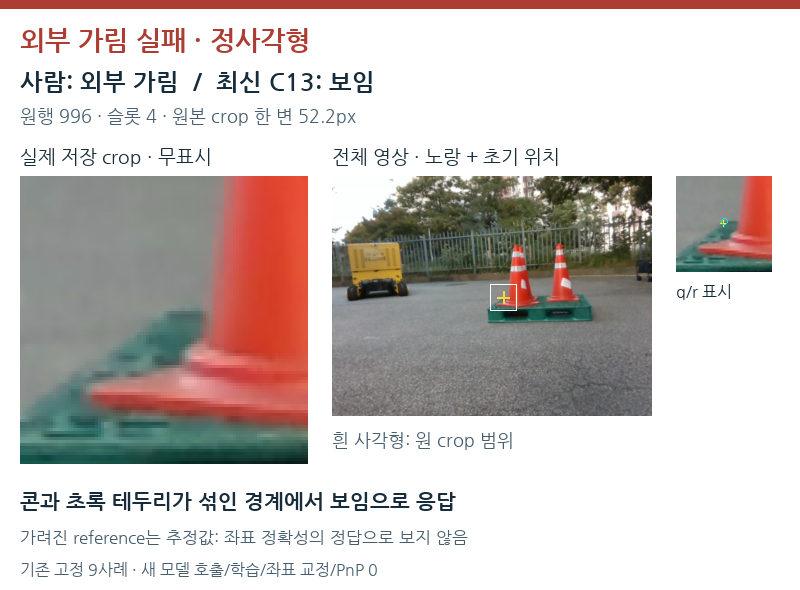
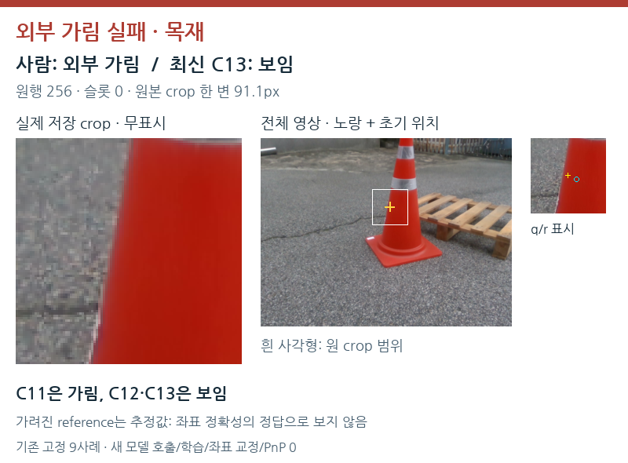
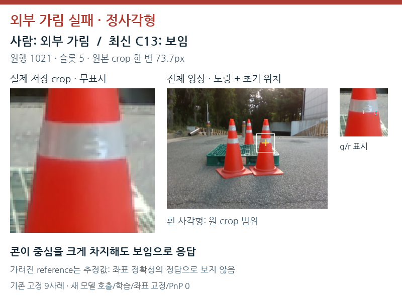

# 최신 C13: 실제 성공·실패와 남은 문제

원문: [query_visibility_same_material_query_head_20261023_v118/visual_followup/SAVED_C13_VISUAL_REVIEW_KO.html](../../archive/task-2/pallet-keypoint-visibility/query_visibility_same_material_query_head_20261023_v118/visual_followup/SAVED_C13_VISUAL_REVIEW_KO.html)

원 HTML SHA256: `0d83f0d6c11a1309f9945fd2ba2bdd0331c6ed790354f9a463a0892af7c17606`

원 img ordinal 1–11 / 11. 원 순서 유지; 이미지 pixel decode/모델/평가 재실행 없음.

## 원 이미지 1

원문 직전 heading

```text
성공과 실패를 나란히 보기
```

원 alt

```text
보임 성공·가림 성공·혼합 경계 실패·콘 중심 실패의 실제 crop 네 사례
```


## 원 이미지 2

원문 직전 heading

```text
공개 source: 가린 경우와 옆에 물체만 둔 경우
```

원 alt

```text
공개 동일 재질 대조의 가림 누락·개선·단서 보존 오탐 세 triplet
```



## 원 이미지 3

원문 직전 heading

```text
1. 보임 성공 · 목재
```

원 alt

```text
보임 성공 · 목재 · 원행200
```

원 HTML caption

```text
wood_day_01:002010 · 원행 200 · C13 저장 z=-13.52692
```



## 원 이미지 4

원문 직전 heading

```text
2. 보임 성공 · 정사각형
```

원 alt

```text
보임 성공 · 정사각형 · 원행840
```

원 HTML caption

```text
SQUARE_YOLO:024276 · 원행 840 · C13 저장 z=-9.00784
```



## 원 이미지 5

원문 직전 heading

```text
3. 외부 가림 성공 · 목재
```

원 alt

```text
외부 가림 성공 · 목재 · 원행259
```

원 HTML caption

```text
wood_day_01:004294 · 원행 259 · C13 저장 z=0.83117
```



## 원 이미지 6

원문 직전 heading

```text
4. 외부 가림 성공 · 정사각형
```

원 alt

```text
외부 가림 성공 · 정사각형 · 원행1416
```

원 HTML caption

```text
SQUARE_YOLO:029727 · 원행 1416 · C13 저장 z=0.59612
```



## 원 이미지 7

원문 직전 heading

```text
5. 보임 개선 · 야간 목재
```

원 alt

```text
보임 개선 · 야간 목재 · 원행696
```

원 HTML caption

```text
wood_night_01:031671 · 원행 696 · C13 저장 z=-0.95992
```



## 원 이미지 8

원문 직전 heading

```text
6. 외부 가림 실패 · 목재
```

원 alt

```text
외부 가림 실패 · 목재 · 원행325
```

원 HTML caption

```text
wood_day_01:005249 · 원행 325 · C13 저장 z=-5.73914
```



## 원 이미지 9

원문 직전 heading

```text
7. 외부 가림 실패 · 정사각형
```

원 alt

```text
외부 가림 실패 · 정사각형 · 원행996
```

원 HTML caption

```text
SQUARE_YOLO:027085 · 원행 996 · C13 저장 z=-10.23165
```



## 원 이미지 10

원문 직전 heading

```text
8. 외부 가림 실패 · 목재
```

원 alt

```text
외부 가림 실패 · 목재 · 원행256
```

원 HTML caption

```text
wood_day_01:004294 · 원행 256 · C13 저장 z=-1.85653
```



## 원 이미지 11

원문 직전 heading

```text
9. 외부 가림 실패 · 정사각형
```

원 alt

```text
외부 가림 실패 · 정사각형 · 원행1021
```

원 HTML caption

```text
SQUARE_YOLO:027503 · 원행 1021 · C13 저장 z=-2.17790
```


