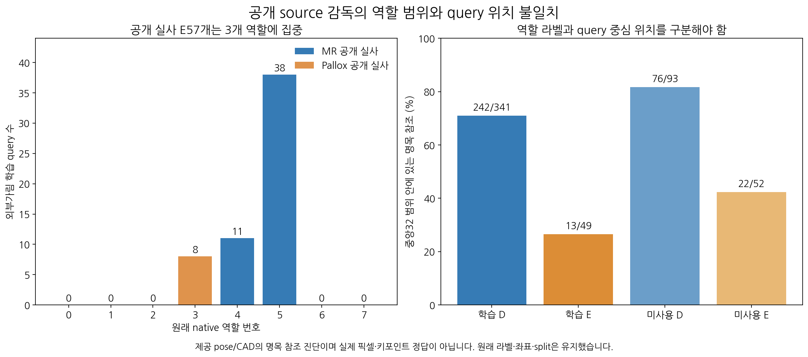
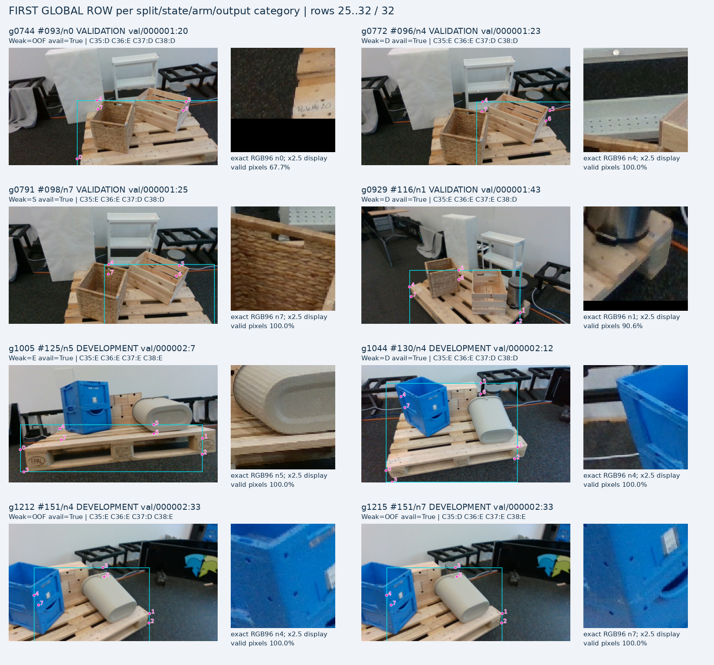
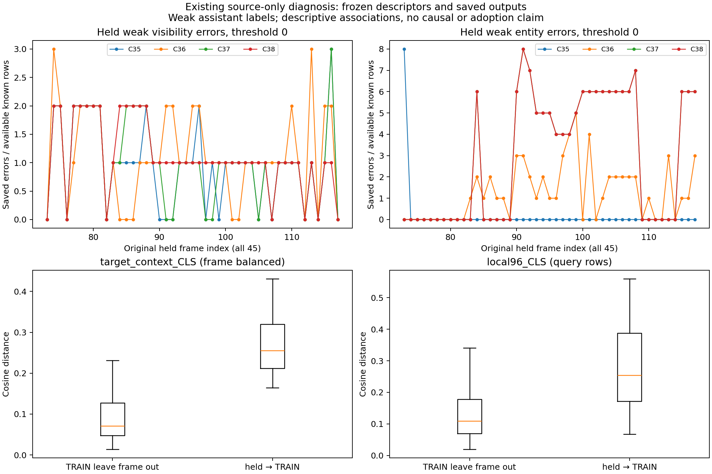
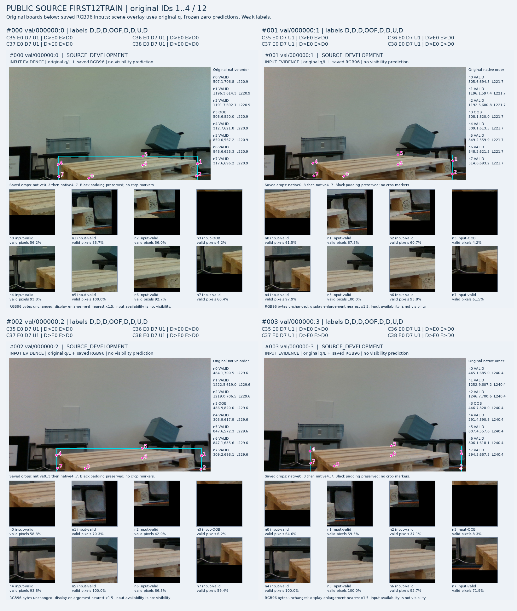
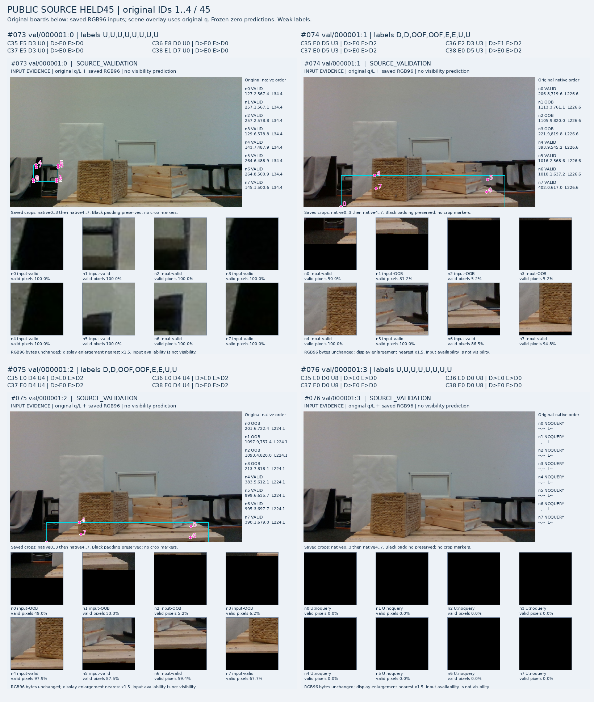

# V157 source query/label 진단

원문: [query_visibility_source_context_label_generalization_20261024_v157/ROOT_READOUT_KO.html](../../archive/task-2/pallet-keypoint-visibility/query_visibility_source_context_label_generalization_20261024_v157/ROOT_READOUT_KO.html)

원 HTML SHA256: `84eb8399d9575493fbeb37a62c20903f6edc9561e2d7ac07edc14319d6628f76`

원 img ordinal 1–5 / 5. 원 순서 유지; 이미지 pixel decode/모델/평가 재실행 없음.

## 원 이미지 1

원문 직전 heading

```text
공개 학습자료의 역할 가시성과 query 위치 상태를 구분해야 합니다
```

원 alt

```text
source 역할 및 query 라벨 범위
```



## 원 이미지 2

원문 직전 heading

```text
실제 query crop과 역할 라벨의 목표 차이
```

원 alt

```text
역할D와 query위치차이 포함 source사례
```



## 원 이미지 3

원문 직전 heading

```text
단순 라벨 차이만 남은 것은 아닙니다
```

원 alt

```text
source feature coverage 및 저장오류
```



## 원 이미지 4

원문 직전 heading

```text
실제 학습·미사용 장면
```

원 alt

```text
첫학습4장
```



## 원 이미지 5

원문 직전 heading

```text
실제 학습·미사용 장면
```

원 alt

```text
미사용첫4장
```


