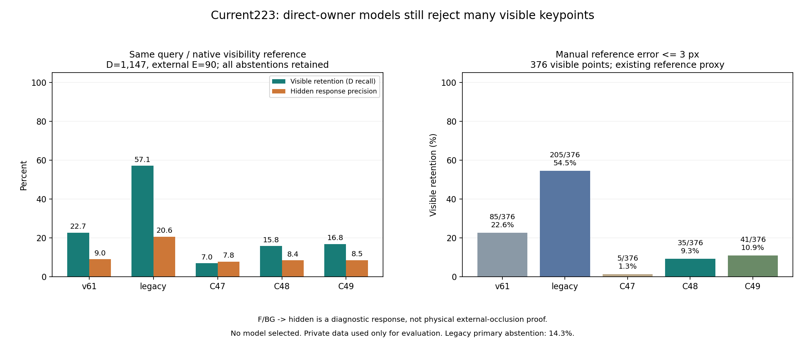
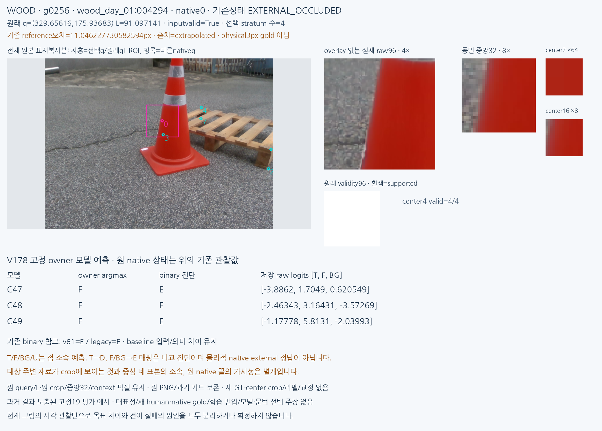
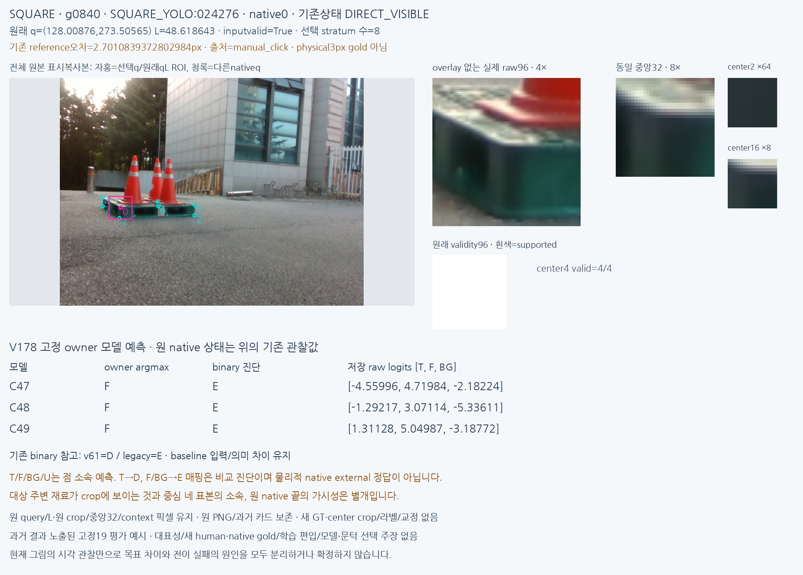
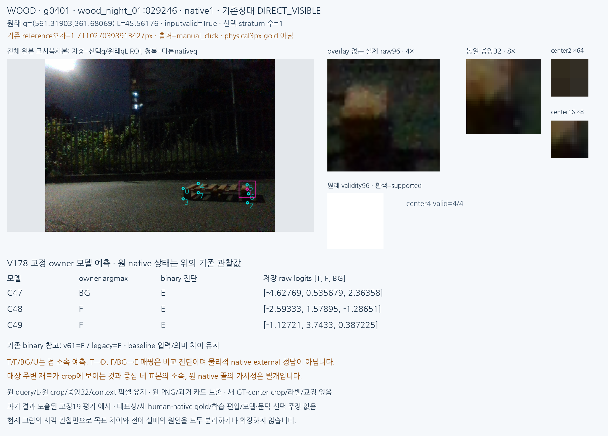
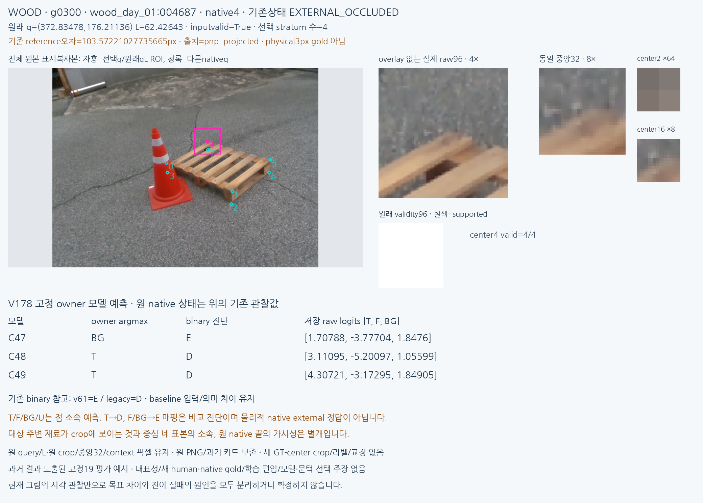

# V178 동결 사용자 평가

원문: [query_visibility_direct_owner_frozen_current_benchmark_20261024_v178/ROOT_READOUT_KO.html](../../archive/task-2/pallet-keypoint-visibility/query_visibility_direct_owner_frozen_current_benchmark_20261024_v178/ROOT_READOUT_KO.html)

원 HTML SHA256: `853aadddff948d43be9c306fb472722eb35ddbdf41f0ce59808dde28e4cdb697`

원 img ordinal 1–5 / 5. 원 순서 유지; 이미지 pixel decode/모델/평가 재실행 없음.

## 원 이미지 1

원문 직전 heading

```text
초기 query 소속 모델: 사용자 평가에서는 아직 실패
```



## 원 이미지 2

원문 직전 heading

```text
고정 사례 g256
```



## 원 이미지 3

원문 직전 heading

```text
고정 사례 g840
```



## 원 이미지 4

원문 직전 heading

```text
고정 사례 g401
```



## 원 이미지 5

원문 직전 heading

```text
고정 사례 g300
```


