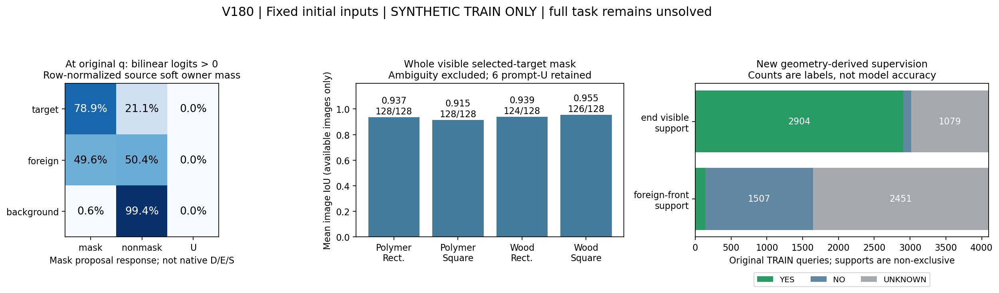
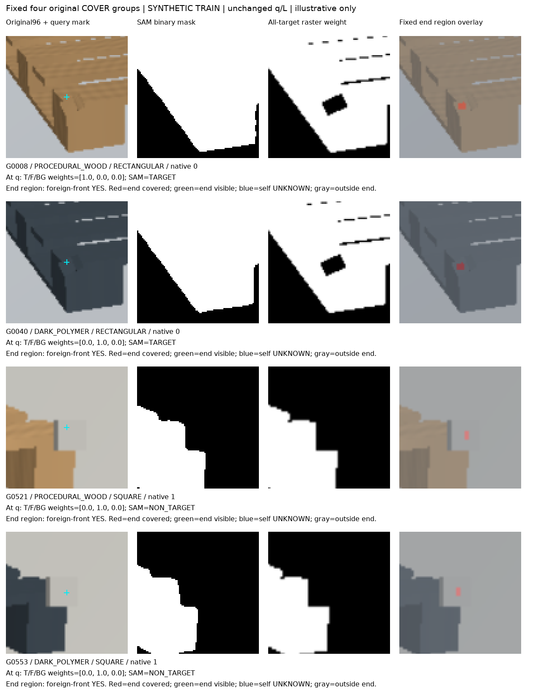

# V180 합성 TRAIN SAM·영역 감독 진단

원문: [query_visibility_frozen_sam_source_baseline_20261024_v180/ROOT_READOUT_KO.html](../../archive/task-2/pallet-keypoint-visibility/query_visibility_frozen_sam_source_baseline_20261024_v180/ROOT_READOUT_KO.html)

원 HTML SHA256: `50d9612eb9888f6918dec7a5a94acd75d002e3a143a63f70ccf57a0128245e94`

원 img ordinal 1–2 / 2. 원 순서 유지; 이미지 pixel decode/모델/평가 재실행 없음.

## 원 이미지 1

원문 직전 heading

```text
V180: 동결 SAM 실행과 crop 주변 보임 감독
```



## 원 이미지 2

원문 직전 heading

```text
고정 네 그룹의 COVER 사례
```


