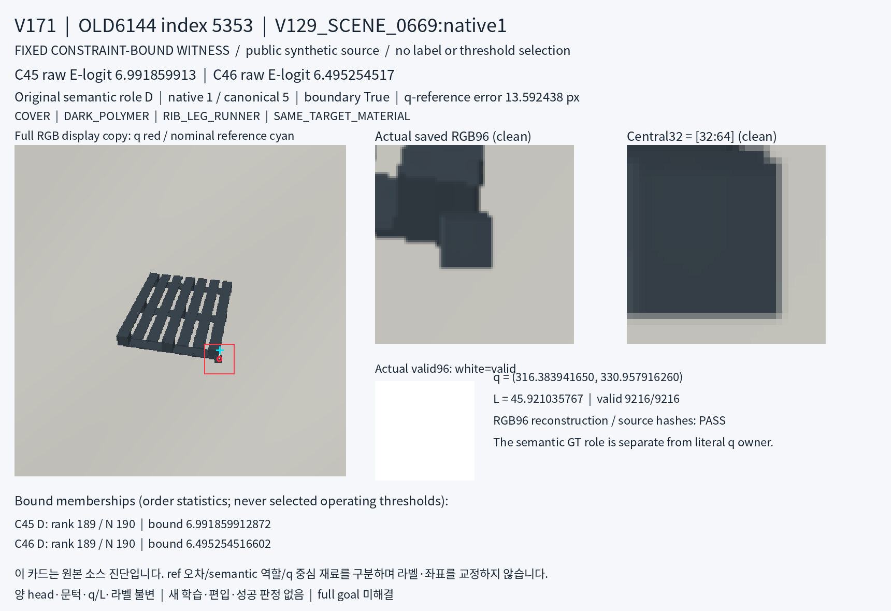
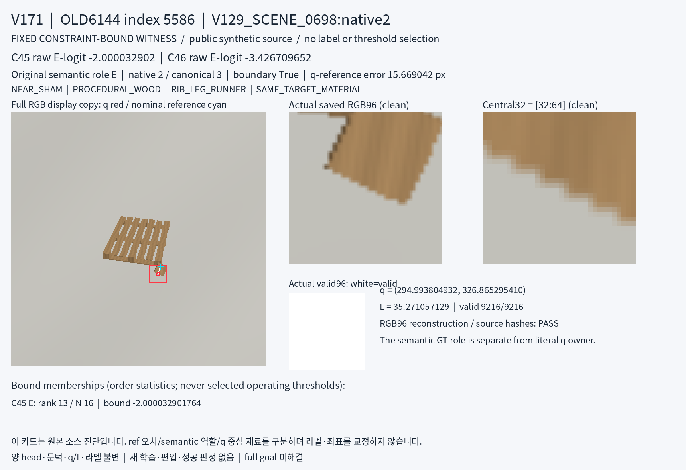
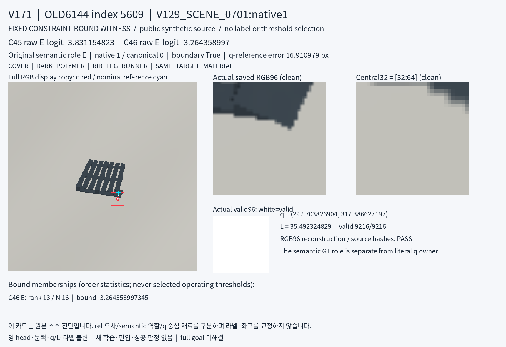

# V171 공개 constraint witness crop 진단

원문: [query_visibility_public_constraint_witness_crops_20261024_v171/ROOT_READOUT_KO.html](../../archive/task-2/pallet-keypoint-visibility/query_visibility_public_constraint_witness_crops_20261024_v171/ROOT_READOUT_KO.html)

원 HTML SHA256: `d87b73b7d083ed891668af8d62bcb76eed4f237bf4e55458ee9f5116429c8738`

원 img ordinal 1–3 / 3. 원 순서 유지; 이미지 pixel decode/모델/평가 재실행 없음.

## 원 이미지 1

원문 직전 heading

```text
5353 · V129_SCENE_0669:native1
```

원 alt

```text
V129_SCENE_0669:native1 원본 scene와 clean 저장 crop forensic 카드
```



## 원 이미지 2

원문 직전 heading

```text
5586 · V129_SCENE_0698:native2
```

원 alt

```text
V129_SCENE_0698:native2 원본 scene와 clean 저장 crop forensic 카드
```



## 원 이미지 3

원문 직전 heading

```text
5609 · V129_SCENE_0701:native1
```

원 alt

```text
V129_SCENE_0701:native1 원본 scene와 clean 저장 crop forensic 카드
```


