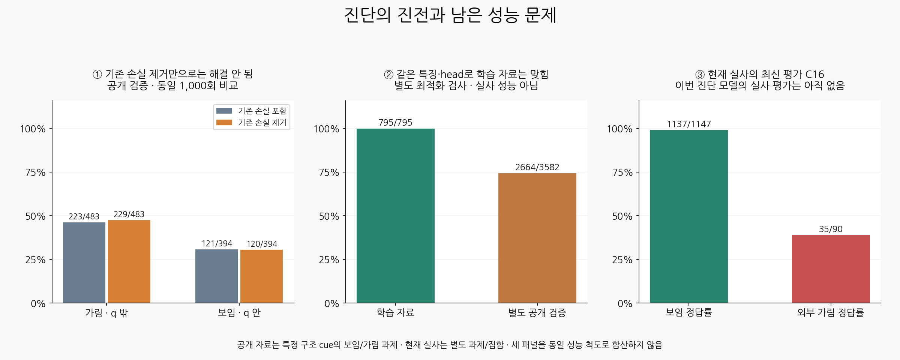

# V126 현재 진전과 성공 가능성

원문: [query_visibility_wide_only_loss_diagnostic_20261023_v126/ROOT_READOUT_KO.html](../../archive/task-2/pallet-keypoint-visibility/query_visibility_wide_only_loss_diagnostic_20261023_v126/ROOT_READOUT_KO.html)

원 HTML SHA256: `36f2f656caef4e531050b83d405b424c67f4d920402aa65f83c42d3216b4b0ff`

원 img ordinal 1–1 / 1. 원 순서 유지; 이미지 pixel decode/모델/평가 재실행 없음.

## 원 이미지 1

원문 직전 heading

```text
원인 진단은 진전됐고, 외부 가림 성능은 아직 부족합니다
```

원 alt

```text
기존 손실 제거 통제, 학습 적합 검사, 현재 실사 성능을 구분한 그래프
```


