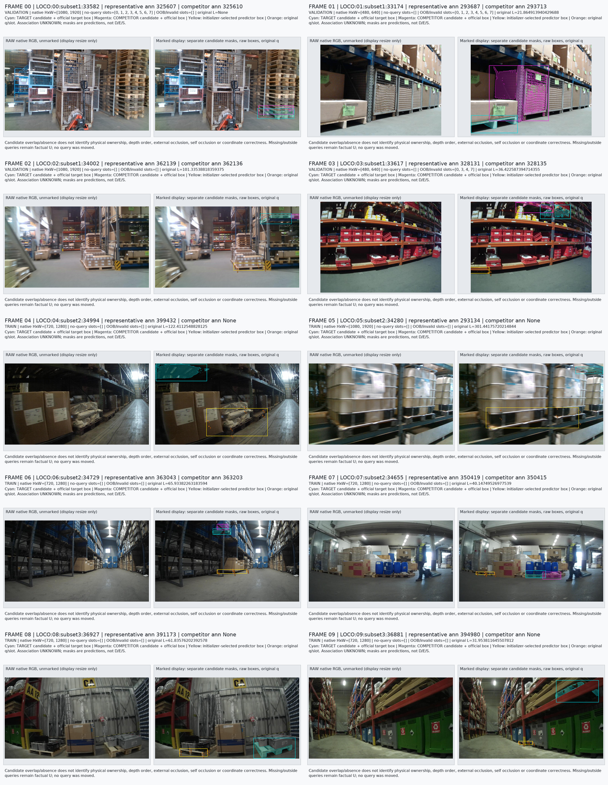
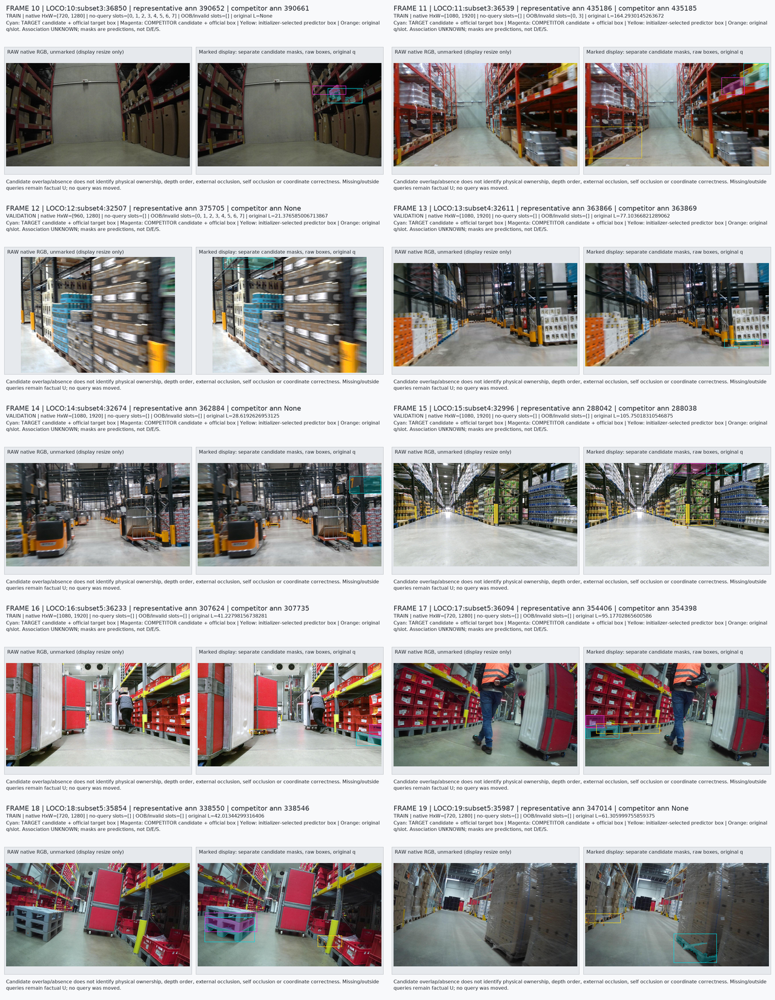
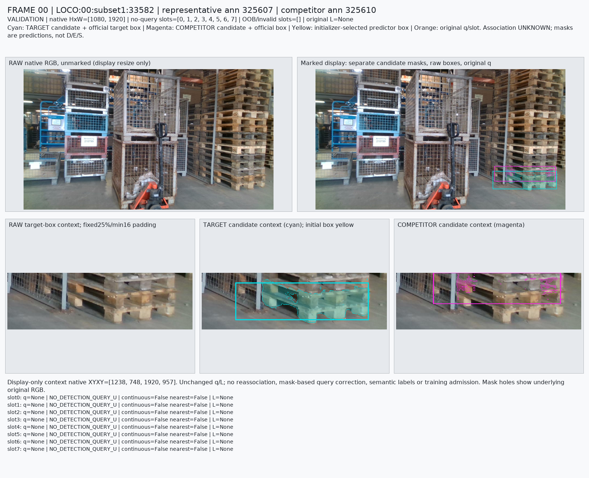
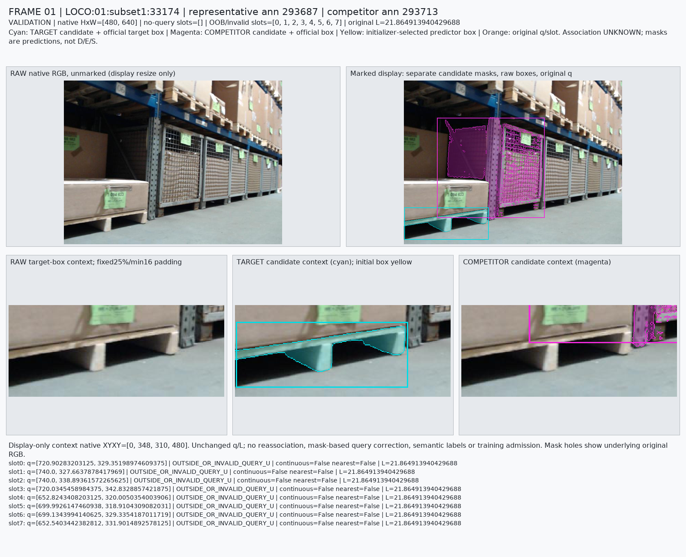
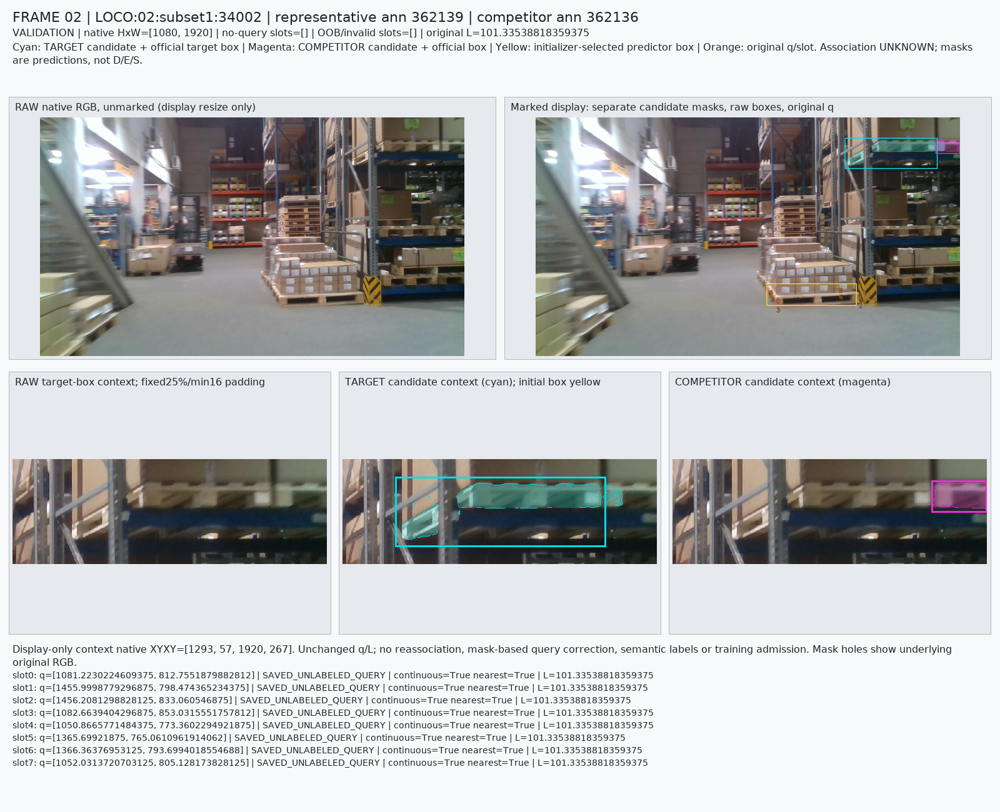
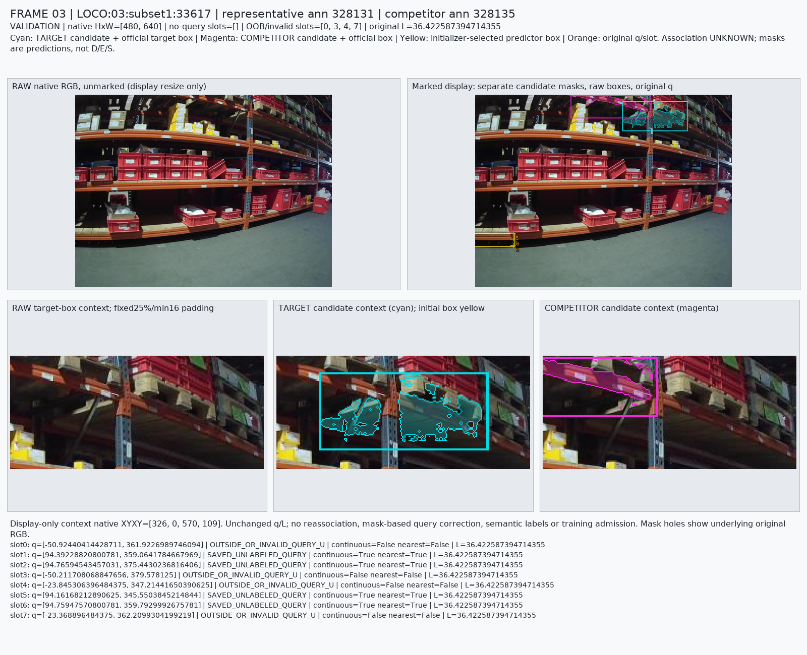
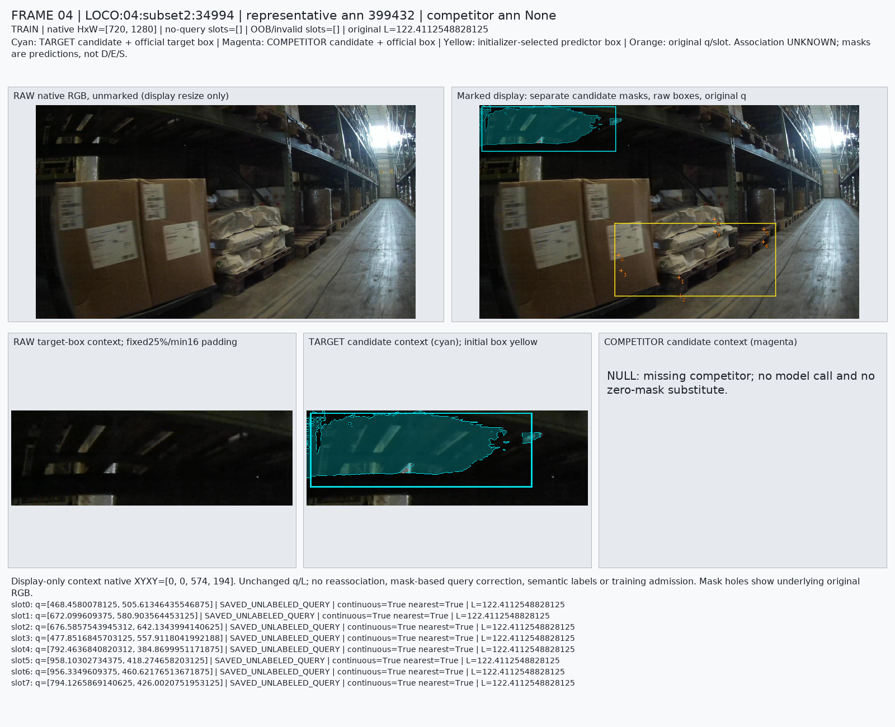
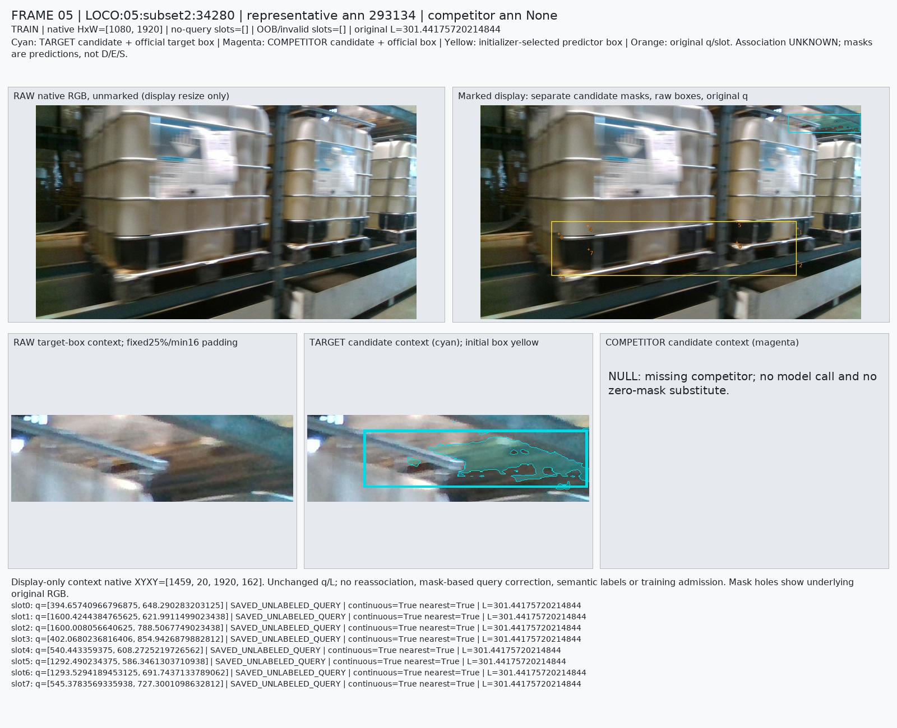

# V115 · 공개 LOCO SAM candidate mask pilot

원문: [query_visibility_loco_annotation_target_masks_20261023_v115/ROOT_READOUT_KO.html](../../archive/task-2/pallet-keypoint-visibility/query_visibility_loco_annotation_target_masks_20261023_v115/ROOT_READOUT_KO.html)

원 HTML SHA256: `8ab5c53e062e8d2133efc54cf20e39032771b2a4282aaba4101f255f54ccf71d`

원 img ordinal 1–8 / 8. 원 순서 유지; 이미지 pixel decode/모델/평가 재실행 없음.

## 원 이미지 1

원문 직전 heading

```text
실제 검토한 전체20프레임
```

원 alt

```text
원래 순서 전체20프레임: 00–09. Raw RGB와 별도의 mask/box/query 표시. 색상은 candidate annotation 분할이며 정답 소유권이 아닙니다.
```

원 HTML caption

```text
원래 순서 전체20프레임: 00–09. Raw RGB와 별도의 mask/box/query 표시. 색상은 candidate annotation 분할이며 정답 소유권이 아닙니다.
```



## 원 이미지 2

원문 직전 heading

```text
실제 검토한 전체20프레임
```

원 alt

```text
원래 순서 전체20프레임: 10–19. Raw RGB와 별도의 mask/box/query 표시. 색상은 candidate annotation 분할이며 정답 소유권이 아닙니다.
```

원 HTML caption

```text
원래 순서 전체20프레임: 10–19. Raw RGB와 별도의 mask/box/query 표시. 색상은 candidate annotation 분할이며 정답 소유권이 아닙니다.
```



## 원 이미지 3

원문 직전 heading

```text
실제 검토한 전체20프레임
```

원 alt

```text
Frame 00 · 우측 목재 적층 하단 target과 그 위 competitor를 각각 분할했다. target의 일부 구멍은 비어 있으나 경계와 겹침의 완전한 정확성은 보장하지 않는다. 초기 검출/query가 없어8개는 기존U 그대로이다.
```

원 HTML caption

```text
Frame 00 · 우측 목재 적층 하단 target과 그 위 competitor를 각각 분할했다. target의 일부 구멍은 비어 있으나 경계와 겹침의 완전한 정확성은 보장하지 않는다. 초기 검출/query가 없어8개는 기존U 그대로이다.
```



## 원 이미지 4

원문 직전 heading

```text
실제 검토한 전체20프레임
```

원 alt

```text
Frame 01 · 좌측 하단 팔레트 면과 뒤쪽 cage를 서로 다른 box로 분할한다. 실제 query8개는 모두 원래 영상 밖이므로 visible/가림 라벨로 승격하지 않는다.
```

원 HTML caption

```text
Frame 01 · 좌측 하단 팔레트 면과 뒤쪽 cage를 서로 다른 box로 분할한다. 실제 query8개는 모두 원래 영상 밖이므로 visible/가림 라벨로 승격하지 않는다.
```



## 원 이미지 5

원문 직전 heading

```text
실제 검토한 전체20프레임
```

원 alt

```text
Frame 02 · target은 우측 위 선반의 팔레트이고 초기 노란 박스/q는 바닥 앞쪽 다른 팔레트에 있다. target 분할에는 선반 지지대 쪽으로 보이는 작은 분리 성분도 포함되어 정밀 ownership gold로 쓸 수 없다.
```

원 HTML caption

```text
Frame 02 · target은 우측 위 선반의 팔레트이고 초기 노란 박스/q는 바닥 앞쪽 다른 팔레트에 있다. target 분할에는 선반 지지대 쪽으로 보이는 작은 분리 성분도 포함되어 정밀 ownership gold로 쓸 수 없다.
```



## 원 이미지 6

원문 직전 heading

```text
실제 검토한 전체20프레임
```

원 alt

```text
Frame 03 · target/competitor는 위 선반의 팔레트·선반 면 주변이며 초기 박스와 일부 유효query는 화면 왼쪽 하단이다. 네 OOB는 유지한다. 어두운 구멍/선반/파편 분할에 불확실성이 있다.
```

원 HTML caption

```text
Frame 03 · target/competitor는 위 선반의 팔레트·선반 면 주변이며 초기 박스와 일부 유효query는 화면 왼쪽 하단이다. 네 OOB는 유지한다. 어두운 구멍/선반/파편 분할에 불확실성이 있다.
```



## 원 이미지 7

원문 직전 heading

```text
실제 검토한 전체20프레임
```

원 alt

```text
Frame 04 · target은 좌측 위 어두운 목재 밑면인데 초기 박스/q는 아래쪽 포대·상자 주변을 잡는다. cyan 큰 영역 안의 슬랫 사이 어두운 부분이 모두 물체인지 확정할 수 없다. competitor는 null 그대로이다.
```

원 HTML caption

```text
Frame 04 · target은 좌측 위 어두운 목재 밑면인데 초기 박스/q는 아래쪽 포대·상자 주변을 잡는다. cyan 큰 영역 안의 슬랫 사이 어두운 부분이 모두 물체인지 확정할 수 없다. competitor는 null 그대로이다.
```



## 원 이미지 8

원문 직전 heading

```text
실제 검토한 전체20프레임
```

원 alt

```text
Frame 05 · target은 우측 위 흐린 목재/선반 부분이며 초기 박스/q는 앞쪽 IBC 컨테이너 하부를 잡는다. cyan 마스크가 작은 연결/분리 성분과 흐린 경계를 포함한다. competitor는 null 그대로이다.
```

원 HTML caption

```text
Frame 05 · target은 우측 위 흐린 목재/선반 부분이며 초기 박스/q는 앞쪽 IBC 컨테이너 하부를 잡는다. cyan 마스크가 작은 연결/분리 성분과 흐린 경계를 포함한다. competitor는 null 그대로이다.
```


