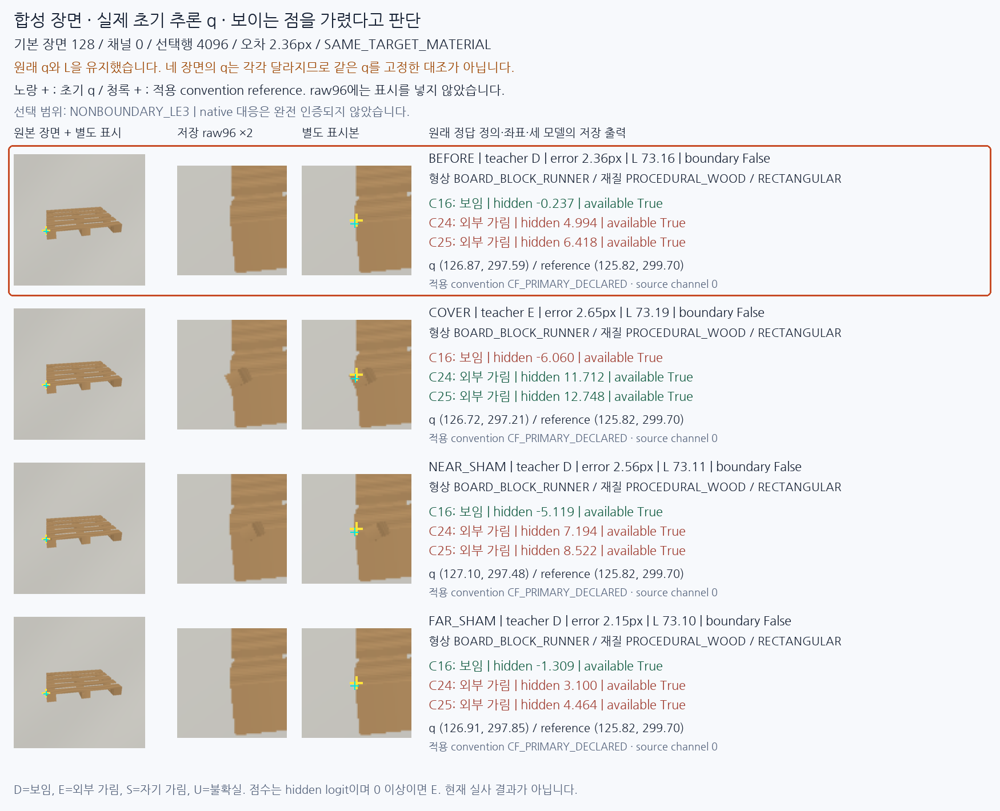
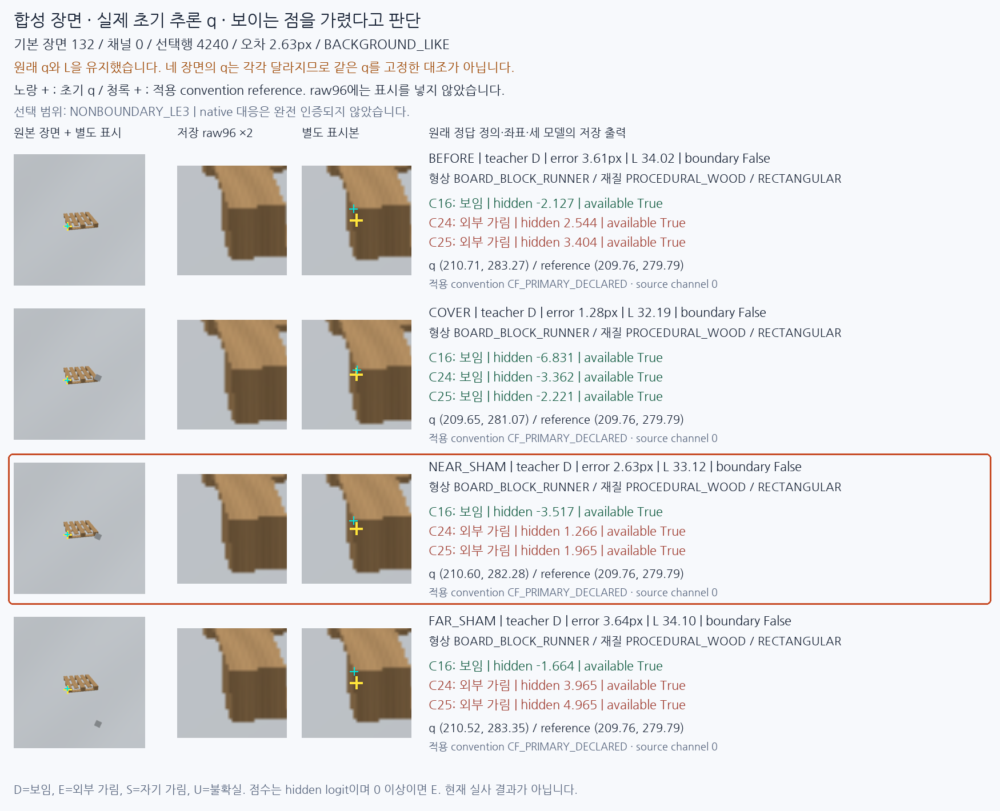
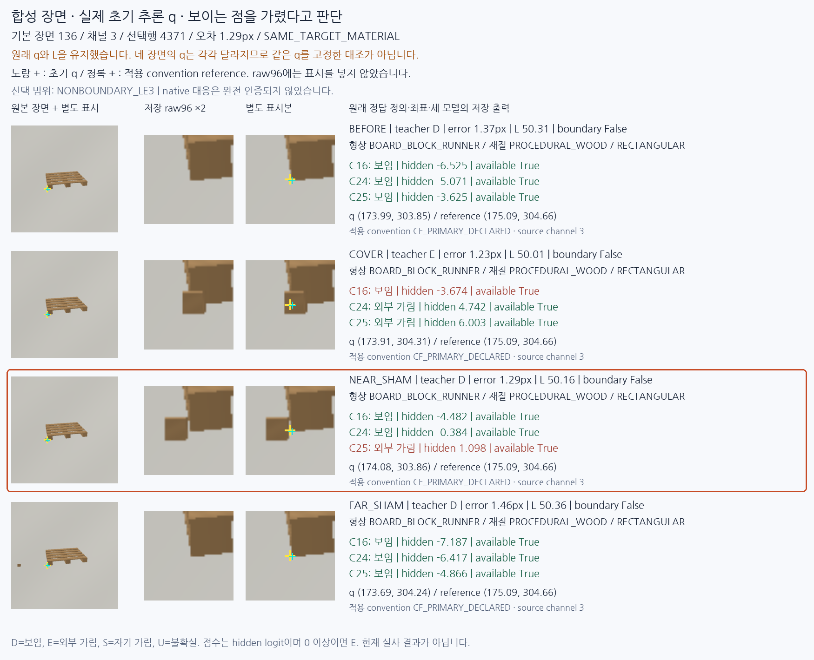
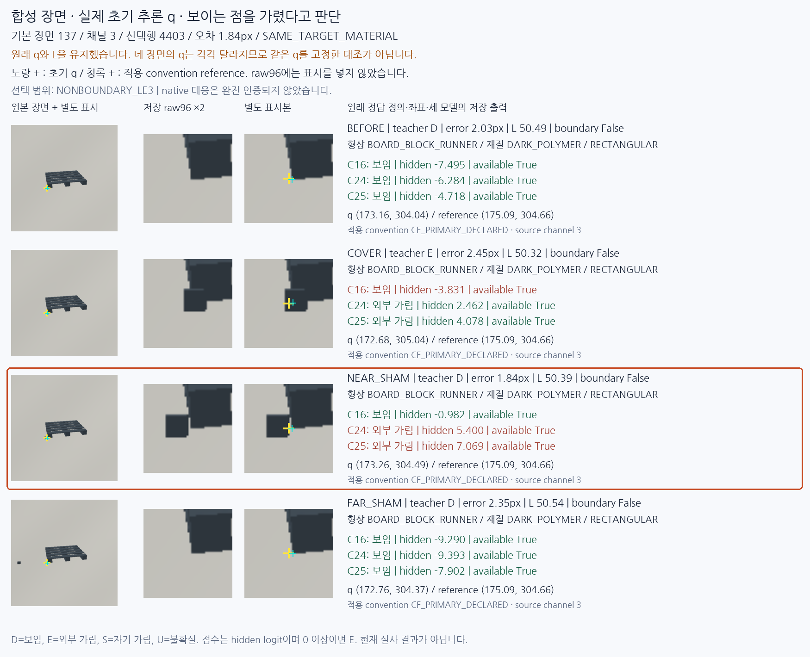
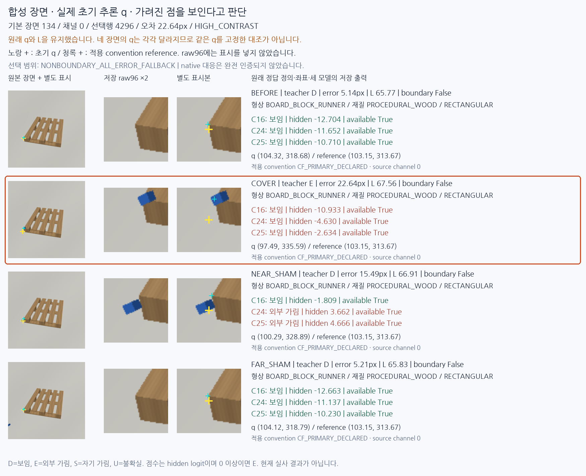
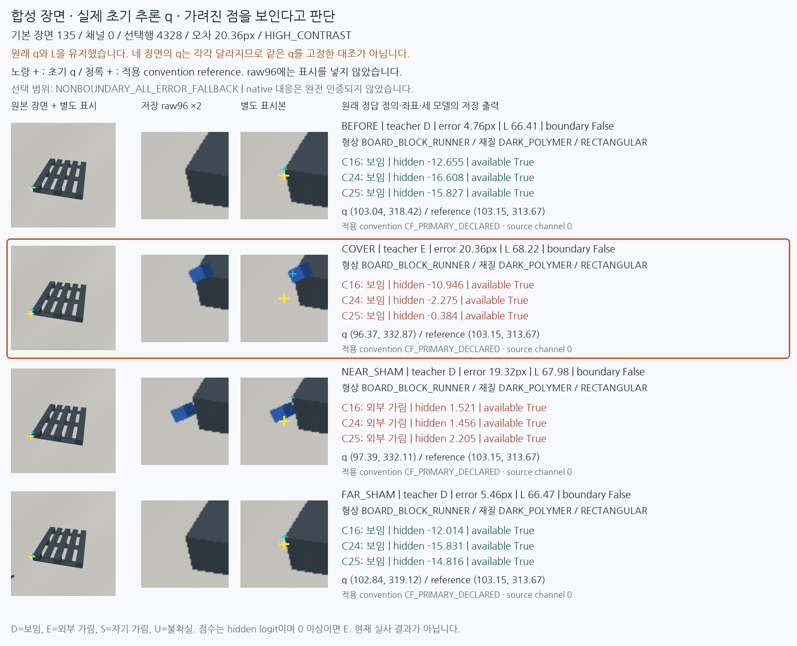
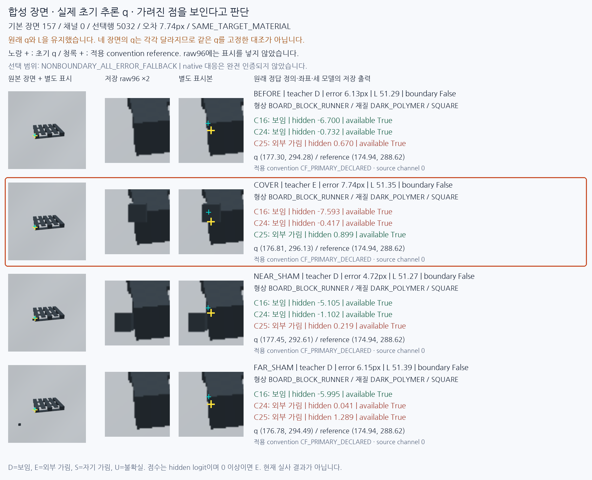
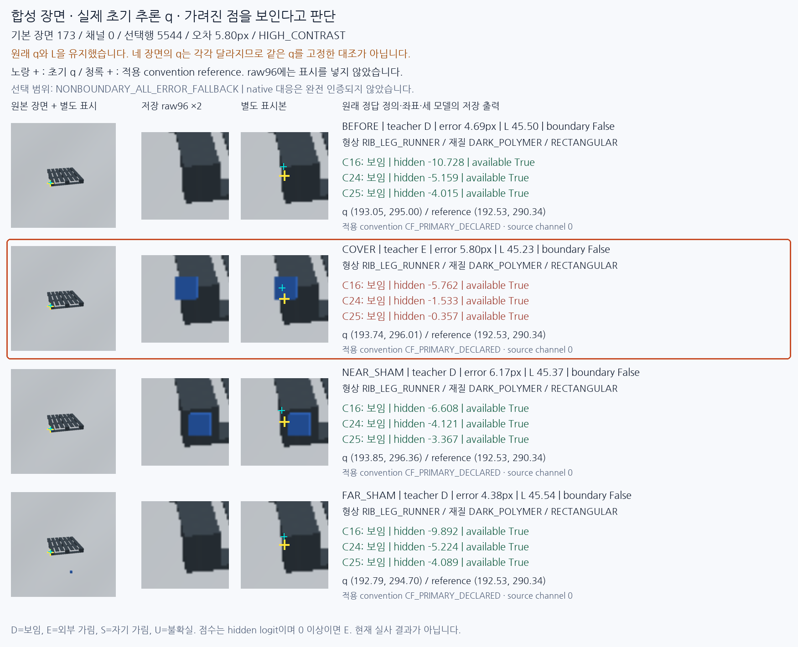

# 합성 입력의 성공·실패 시각 진단

원문: [query_visibility_native_witness_diagnosis_20261024_v134/source_visual_review/READOUT_KO.html](../../archive/task-2/pallet-keypoint-visibility/query_visibility_native_witness_diagnosis_20261024_v134/source_visual_review/READOUT_KO.html)

원 HTML SHA256: `0e67754684e5a08548ea5e33d1c587b0b726c6340aba6d20096f88353d738684`

원 img ordinal 1–8 / 8. 원 순서 유지; 이미지 pixel decode/모델/평가 재실행 없음.

## 원 이미지 1

원문 직전 heading

```text
사례 1 · 기본 장면 128 / 채널 0
```



## 원 이미지 2

원문 직전 heading

```text
사례 2 · 기본 장면 132 / 채널 0
```



## 원 이미지 3

원문 직전 heading

```text
사례 3 · 기본 장면 136 / 채널 3
```



## 원 이미지 4

원문 직전 heading

```text
사례 4 · 기본 장면 137 / 채널 3
```



## 원 이미지 5

원문 직전 heading

```text
사례 5 · 기본 장면 134 / 채널 0
```



## 원 이미지 6

원문 직전 heading

```text
사례 6 · 기본 장면 135 / 채널 0
```



## 원 이미지 7

원문 직전 heading

```text
사례 7 · 기본 장면 157 / 채널 0
```



## 원 이미지 8

원문 직전 heading

```text
사례 8 · 기본 장면 173 / 채널 0
```


