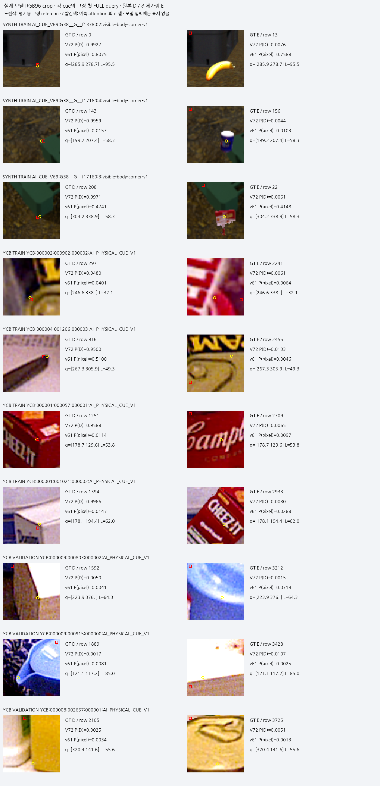
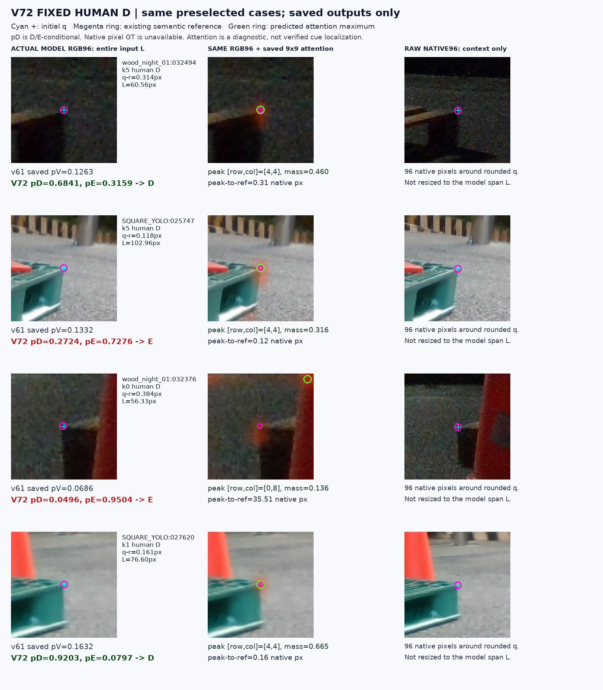
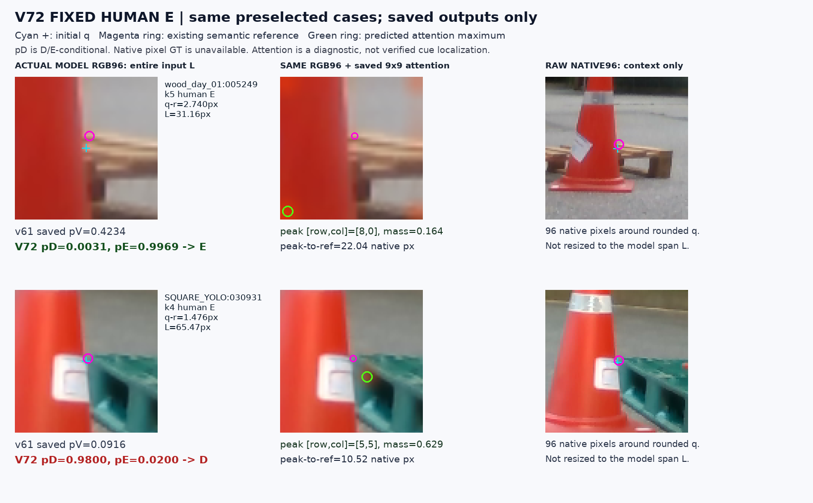
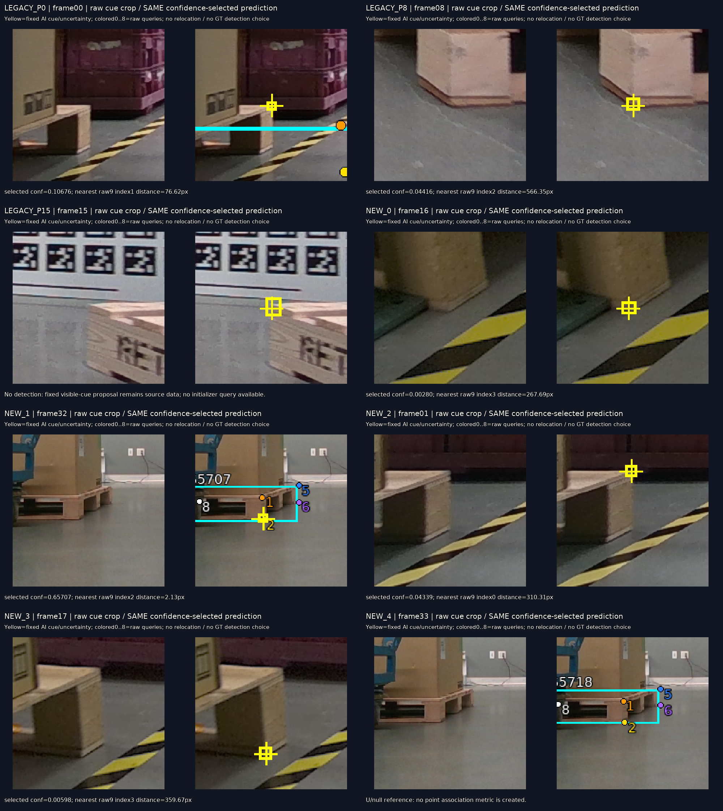

# V72 고정 cue 가림 비교

원문: [query_visibility_cue_occlusion_20261023_v72/provenance/REPORT_V1_BEFORE_FINAL_EVIDENCE/RESULTS_KO.html](../../archive/task-2/pallet-keypoint-visibility/query_visibility_cue_occlusion_20261023_v72/provenance/REPORT_V1_BEFORE_FINAL_EVIDENCE/RESULTS_KO.html.parts.json)

원 HTML SHA256: `20909706ef5499ba1d40e70827e98fe3f4e6bc458700d7e355beed7f5799393d`

원 img ordinal 1–4 / 4. 원 순서 유지; 이미지 pixel decode/모델/평가 재실행 없음.

## 원 이미지 1

원문 직전 heading

```text
실제로 전이됐는가
```

원 HTML caption

```text
각 cue의 고정 첫 FULL query. 실제 모델 RGB96 crop. GT 표시는 렌더링 때만 추가했습니다. 빨간 attention peak는 예측 위치이며 가린 E 위치에는 보조 정답을 주지 않았습니다.
```



## 원 이미지 2

원문 직전 heading

```text
기존 고정 실사 crop 사례
```

원 HTML caption

```text
고정 D 네 사례
```



## 원 이미지 3

원문 직전 heading

```text
기존 고정 실사 crop 사례
```

원 HTML caption

```text
고정 E 두 사례
```



## 원 이미지 4

원문 직전 heading

```text
공개 팔레트 영상에서의 입력 단계 문제
```

원 HTML caption

```text
왼쪽 실제 RGB cue, 오른쪽 같은 confidence 선택의 raw9 출력. GT에 가까운 다른 후보를 고르지 않았습니다.
```



원문 HTML이 큰 경우 링크는 원 SHA를 보존하는 무손실 gzip descriptor를 가리킵니다.
