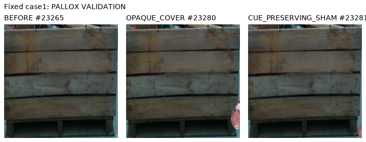

# C9 source 결과

원문: [query_visibility_target_relative_rgb_head_20261023_v108/ROOT_READOUT_KO.html](../../archive/task-2/pallet-keypoint-visibility/query_visibility_target_relative_rgb_head_20261023_v108/ROOT_READOUT_KO.html)

원 HTML SHA256: `7d42b29c4d2a23c8b37a41671555e51a6e9b96892251a24b508f1263276d76a0`

원 img ordinal 1–1 / 1. 원 순서 유지; 이미지 pixel decode/모델/평가 재실행 없음.

## 원 이미지 1

원문 직전 heading

```text
실제 대상 문맥
```


