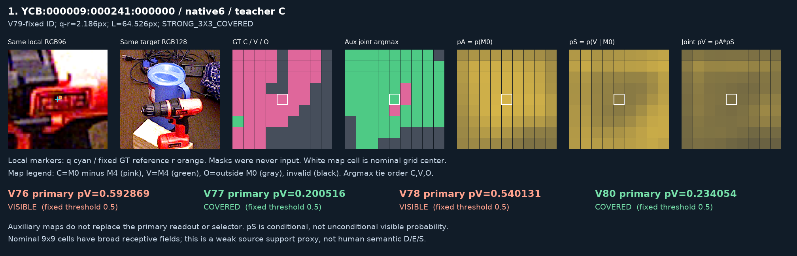
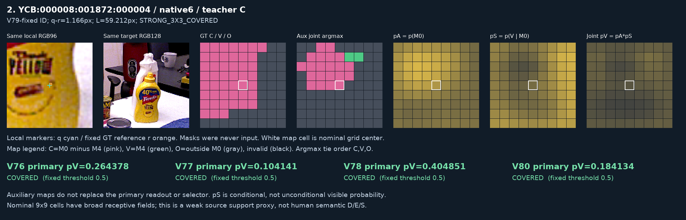
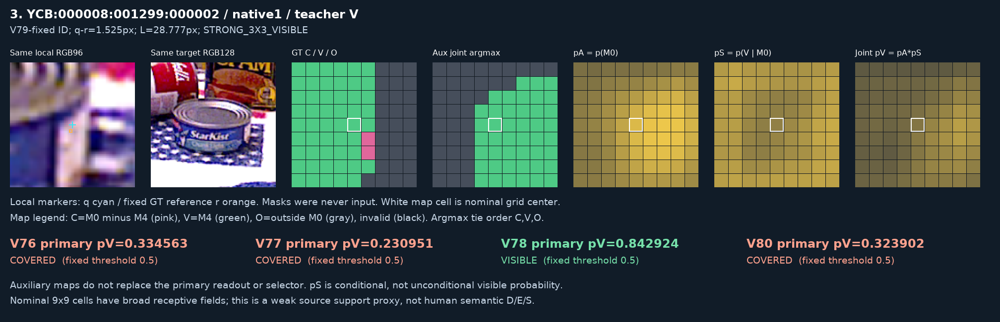
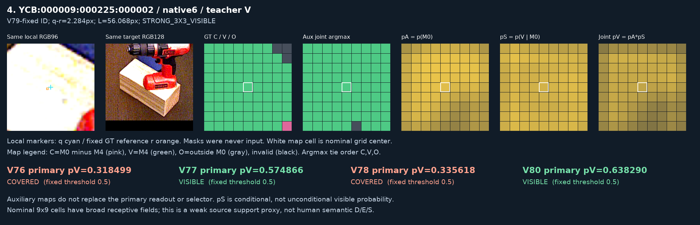

# V80 밀집 보조 감독 결과

원문: [query_visibility_dense_support_20261023_v80/RESULTS_KO.html](../../archive/task-2/pallet-keypoint-visibility/query_visibility_dense_support_20261023_v80/RESULTS_KO.html)

원 HTML SHA256: `f041fc85bdf7700be5b0f1b99a4e9d53a70929aa3f47761d19a889e04fe0e169`

원 img ordinal 1–4 / 4. 원 순서 유지; 이미지 pixel decode/모델/평가 재실행 없음.

## 원 이미지 1

원문 직전 heading

```text
V79에 고정된 같은 네 사례
```

원 alt

```text
고정 source 사례 YCB:000009:000241:000000
```

원 HTML caption

```text
YCB:000009:000241:000000 / native 6: source reference-local COVERED, q-r 2.186px. 결과를 보고 새로 고른 사례가 아닙니다.
```



## 원 이미지 2

원문 직전 heading

```text
V79에 고정된 같은 네 사례
```

원 alt

```text
고정 source 사례 YCB:000008:001872:000004
```

원 HTML caption

```text
YCB:000008:001872:000004 / native 6: source reference-local COVERED, q-r 1.166px. 결과를 보고 새로 고른 사례가 아닙니다.
```



## 원 이미지 3

원문 직전 heading

```text
V79에 고정된 같은 네 사례
```

원 alt

```text
고정 source 사례 YCB:000008:001299:000002
```

원 HTML caption

```text
YCB:000008:001299:000002 / native 1: source reference-local VISIBLE, q-r 1.525px. 결과를 보고 새로 고른 사례가 아닙니다.
```



## 원 이미지 4

원문 직전 heading

```text
V79에 고정된 같은 네 사례
```

원 alt

```text
고정 source 사례 YCB:000009:000225:000002
```

원 HTML caption

```text
YCB:000009:000225:000002 / native 6: source reference-local VISIBLE, q-r 2.284px. 결과를 보고 새로 고른 사례가 아닙니다.
```


