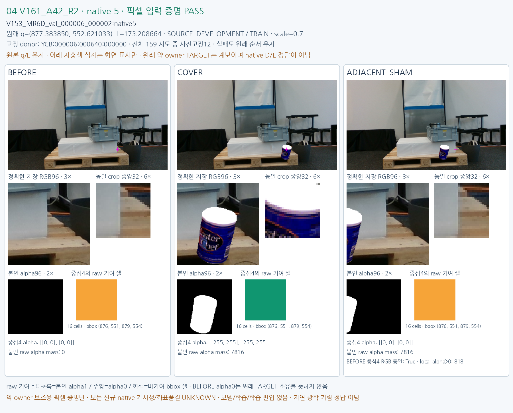

# FIXED12 V161_A42_R2

원문: [query_visibility_public_train_owner_counterfactual_20261024_v161/fixed12_visual_v1/CASE_04_V161_A42_R2.html](../../archive/task-2/pallet-keypoint-visibility/query_visibility_public_train_owner_counterfactual_20261024_v161/fixed12_visual_v1/CASE_04_V161_A42_R2.html)

원 HTML SHA256: `01d7320b28fe252c437b3656010dd6773c4c830e85ba047fd8a6ce9cd2d94d0a`

원 img ordinal 1–1 / 1. 원 순서 유지; 이미지 pixel decode/모델/평가 재실행 없음.

## 원 이미지 1

원문 직전 heading

```text
FIXED12 V161_A42_R2
```

원 alt

```text
BEFORE COVER ADJACENT SHAM same-q source pixels
```


