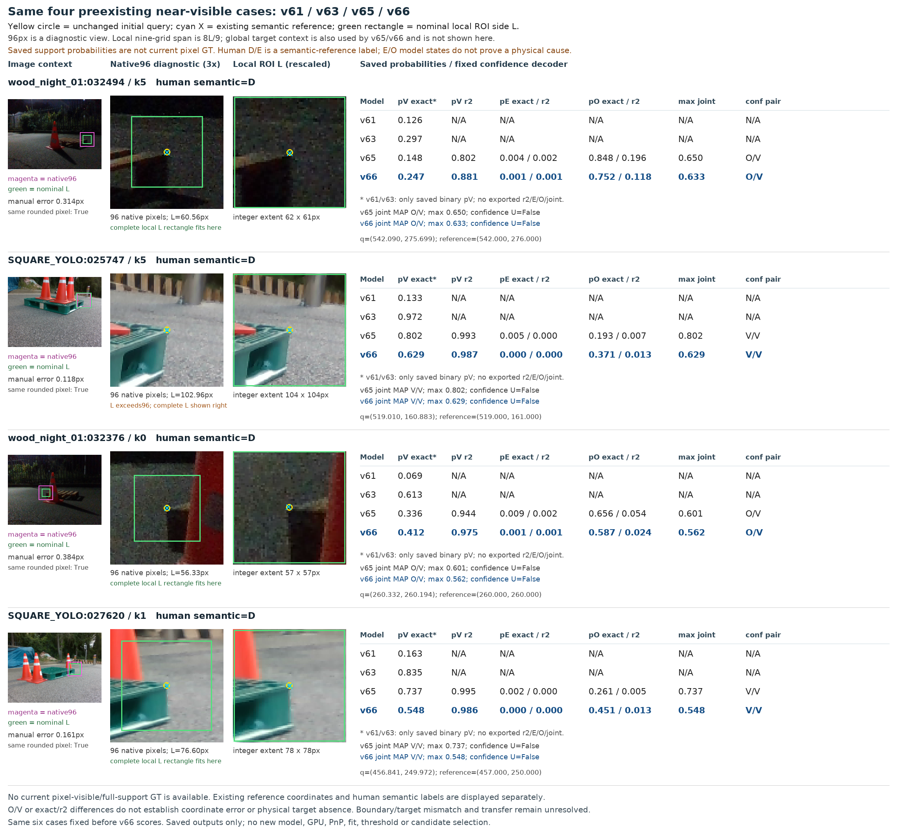
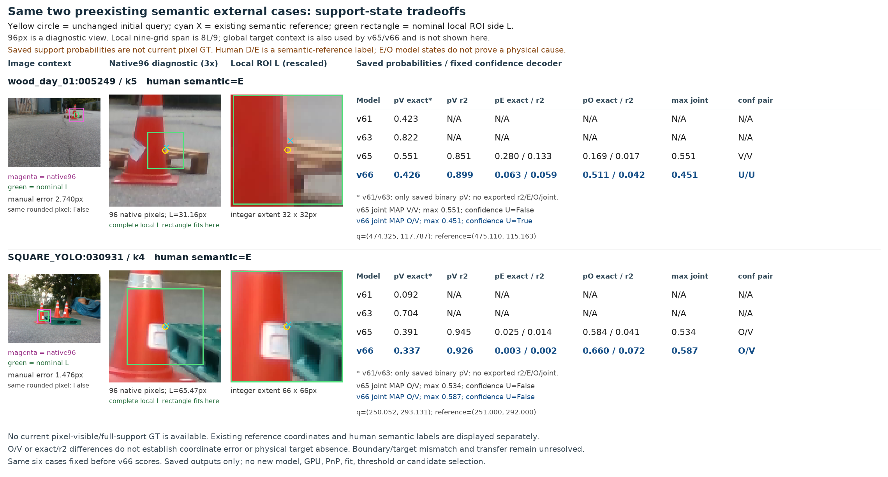

# v66 결과: 가림 판별 전이 보류

원문: [query_visibility_controlled_real_20261022_v66/source_audit/RESULTS_REPORT_QA/CROPS.html](../../archive/task-2/pallet-keypoint-visibility/query_visibility_controlled_real_20261022_v66/source_audit/RESULTS_REPORT_QA/CROPS.html.parts.json)

원 HTML SHA256: `61fab8dade2c013c5ded7230c67f40fdf5f13ee50aff53bb4791fa039ac16843`

원 img ordinal 1–2 / 2. 원 순서 유지; 이미지 pixel decode/모델/평가 재실행 없음.

## 원 이미지 1

원문 직전 heading

```text
고정된 같은 실사 사례의 crop과 저장 확률
```

원 alt

```text
수동 D 네 고정 사례. 밤 목재 두 점의 pV exact는 상승했지만 0.5를 넘지 않았고, 정사각형 두 점은 유지됐습니다. 같은 native 픽셀로 반올림되는 참조여도 실제 픽셀 GT가 없어 OV를 검증된 좌표 오차로 해석하지 않습니다.
```

원 HTML caption

```text
수동 D 네 고정 사례. 밤 목재 두 점의 pV exact는 상승했지만 0.5를 넘지 않았고, 정사각형 두 점은 유지됐습니다. 같은 native 픽셀로 반올림되는 참조여도 실제 픽셀 GT가 없어 OV를 검증된 좌표 오차로 해석하지 않습니다. 원본 크기로 열기
```



## 원 이미지 2

원문 직전 heading

```text
고정된 같은 실사 사례의 crop과 저장 확률
```

원 alt

```text
의미 E 두 고정 사례. 목재는 v66 confidence U/U, 정사각형은 O/V입니다. 이를 confident 외부 가림 인식으로 집계하지 않습니다. v61/v63의 없는 r2/E/O/joint 확률은 N/A로 표시했습니다.
```

원 HTML caption

```text
의미 E 두 고정 사례. 목재는 v66 confidence U/U, 정사각형은 O/V입니다. 이를 confident 외부 가림 인식으로 집계하지 않습니다. v61/v63의 없는 r2/E/O/joint 확률은 N/A로 표시했습니다. 원본 크기로 열기
```



원문 HTML이 큰 경우 링크는 원 SHA를 보존하는 무손실 gzip descriptor를 가리킵니다.
