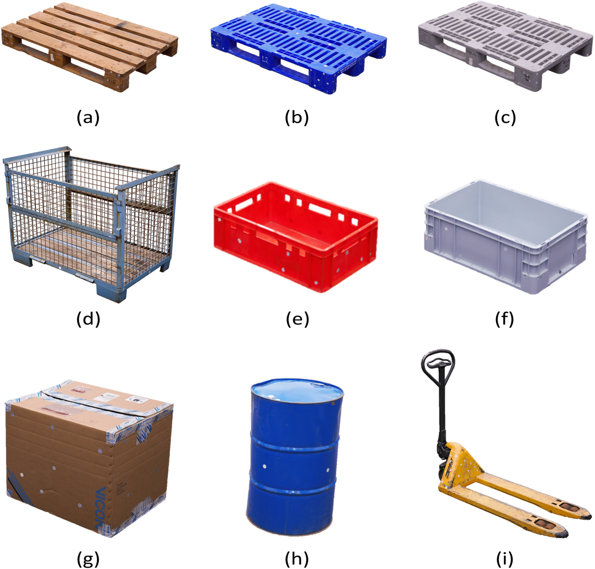
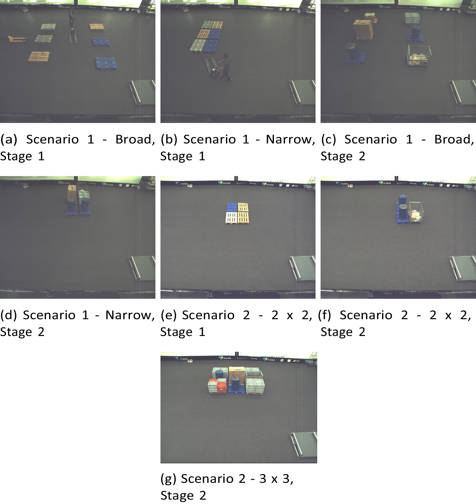
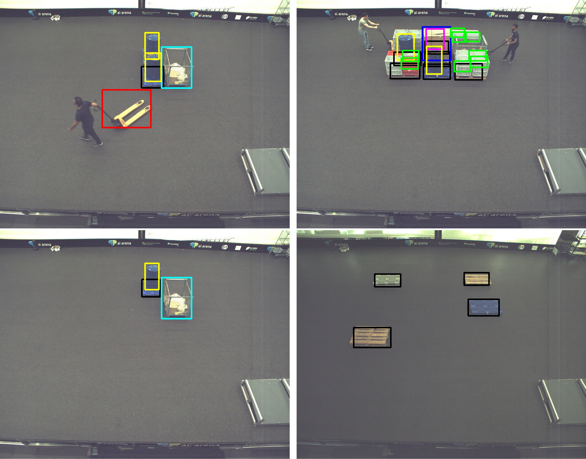

# 추가 공개 팔레트 RGB 소스 검토

원문: [query_visibility_external_only_bounded_prior_20261023_v102/public_real_extension_intake/READOUT_KO.html](../../archive/task-2/pallet-keypoint-visibility/query_visibility_external_only_bounded_prior_20261023_v102/public_real_extension_intake/READOUT_KO.html)

원 HTML SHA256: `b170d46207d3a808733f2ae87b5e07032da20c5300a2c7018c01d41ede8f32db`

원 img ordinal 1–3 / 3. 원 순서 유지; 이미지 pixel decode/모델/평가 재실행 없음.

## 원 이미지 1

원문 직전 heading

```text
새 실제 RGB 후보: TOMIE
```

원 alt

```text
공식 그림 2
```

원 HTML caption

```text
그림 2. 물체 목록: 낮은 목재/위생형 팔레트와 잠재적 외부 물체
```



## 원 이미지 2

원문 직전 heading

```text
새 실제 RGB 후보: TOMIE
```

원 alt

```text
공식 그림 4
```

원 HTML caption

```text
그림 4. 실제 장면: 빈 팔레트와 적재 팔레트, 높은 카메라 시점
```



## 원 이미지 3

원문 직전 heading

```text
새 실제 RGB 후보: TOMIE
```

원 alt

```text
공식 그림 6
```

원 HTML caption

```text
그림 6. 공개 주석 예시: 박스 오버레이가 있어 이 그림 자체는 학습 입력으로 부적절
```


