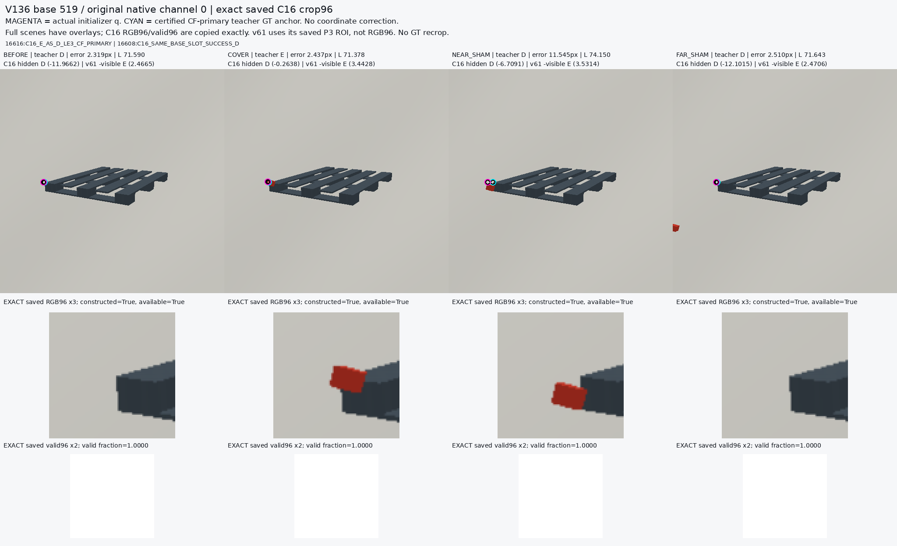
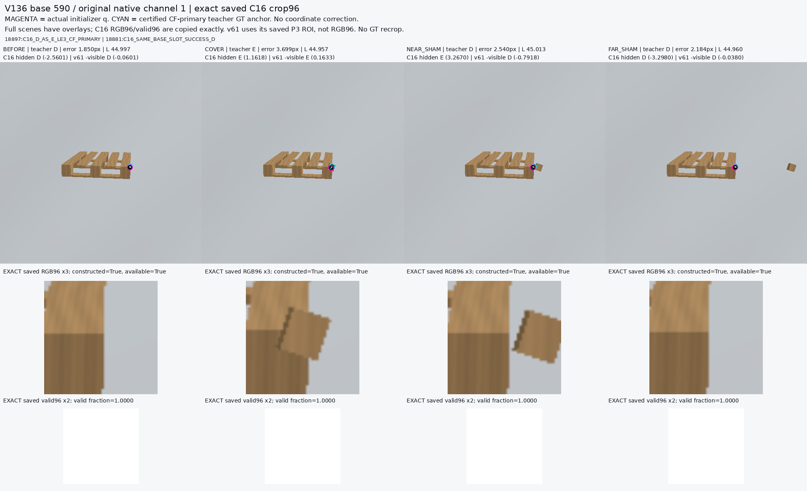
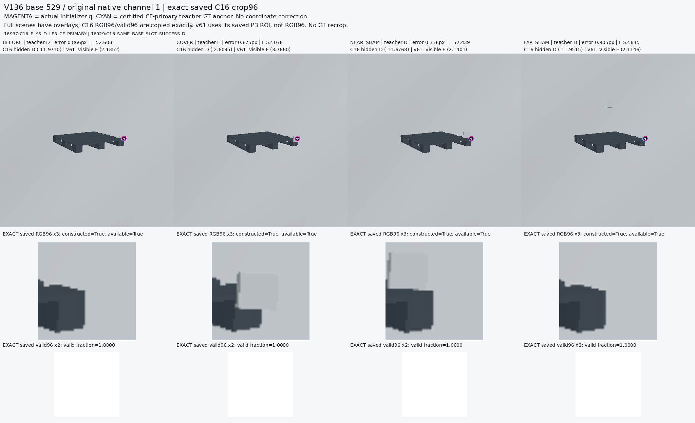
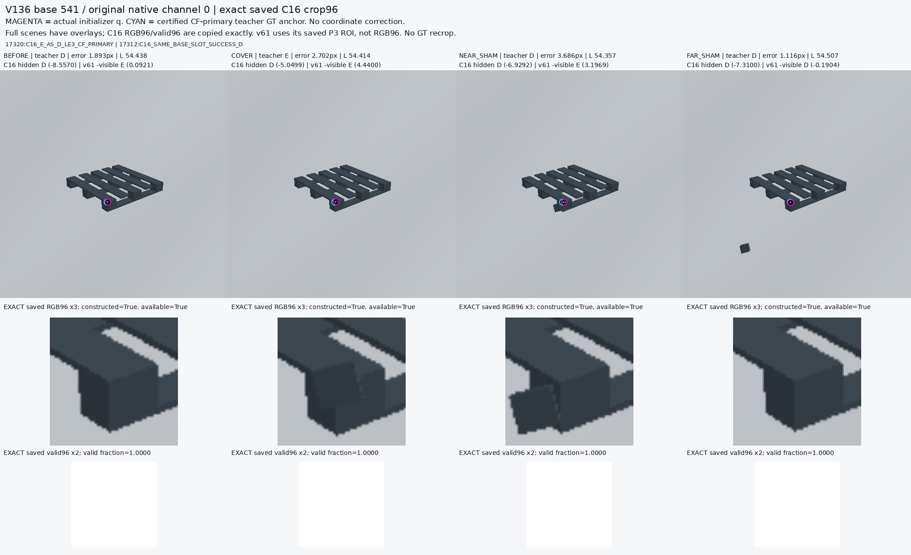

# V136 exact saved actual-query crops

원문: [query_visibility_continuous_native_source_20261024_v136/actual_query_visual_review/saved_gallery_v1/INDEX.html](../../archive/task-2/pallet-keypoint-visibility/query_visibility_continuous_native_source_20261024_v136/actual_query_visual_review/saved_gallery_v1/INDEX.html)

원 HTML SHA256: `593da3bd56809005b7864971b5a51740e606764524cd5e826937cc2ebf74b098`

원 img ordinal 1–4 / 4. 원 순서 유지; 이미지 pixel decode/모델/평가 재실행 없음.

## 원 이미지 1

원문 직전 heading

```text
Base 519, native 0
```



## 원 이미지 2

원문 직전 heading

```text
Base 590, native 1
```



## 원 이미지 3

원문 직전 heading

```text
Base 529, native 1
```



## 원 이미지 4

원문 직전 heading

```text
Base 541, native 0
```


