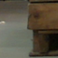
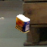
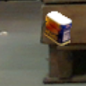
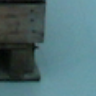
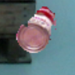
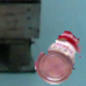

# C6/C7 외부 가림 전용 소스 비교

원문: [query_visibility_external_only_bounded_prior_20261023_v102/report_preparation/provenance/REPORT_V2/ROOT_READOUT_KO.html](../../archive/task-2/pallet-keypoint-visibility/query_visibility_external_only_bounded_prior_20261023_v102/report_preparation/provenance/REPORT_V2/ROOT_READOUT_KO.html)

원 HTML SHA256: `ffae6e325e3f35e78883821b85a92e0b603a8ff55687023de5c6844f52e9fa97`

원 img ordinal 1–6 / 6. 원 순서 유지; 이미지 pixel decode/모델/평가 재실행 없음.

## 원 이미지 1

원문 직전 heading

```text
OLD_TRAIN_FIRST_FAILED_ACCEPTED_TRIPLET
```

원 alt

```text
BEFORE · D 고정 원본 RGB96
```

원 HTML caption

```text
BEFORE · D · index 5808
```



## 원 이미지 2

원문 직전 heading

```text
OLD_TRAIN_FIRST_FAILED_ACCEPTED_TRIPLET
```

원 alt

```text
COVER · E 고정 원본 RGB96
```

원 HTML caption

```text
COVER · E · index 5813
```



## 원 이미지 3

원문 직전 heading

```text
OLD_TRAIN_FIRST_FAILED_ACCEPTED_TRIPLET
```

원 alt

```text
SHAM · D 고정 원본 RGB96
```

원 HTML caption

```text
SHAM · D · index 5814
```



## 원 이미지 4

원문 직전 heading

```text
OLD_VALIDATION_FIRST_FAILED_ACCEPTED_TRIPLET
```

원 alt

```text
BEFORE · D 고정 원본 RGB96
```

원 HTML caption

```text
BEFORE · D · index 23265
```



## 원 이미지 5

원문 직전 heading

```text
OLD_VALIDATION_FIRST_FAILED_ACCEPTED_TRIPLET
```

원 alt

```text
COVER · E 고정 원본 RGB96
```

원 HTML caption

```text
COVER · E · index 23280
```



## 원 이미지 6

원문 직전 heading

```text
OLD_VALIDATION_FIRST_FAILED_ACCEPTED_TRIPLET
```

원 alt

```text
SHAM · D 고정 원본 RGB96
```

원 HTML caption

```text
SHAM · D · index 23281
```


