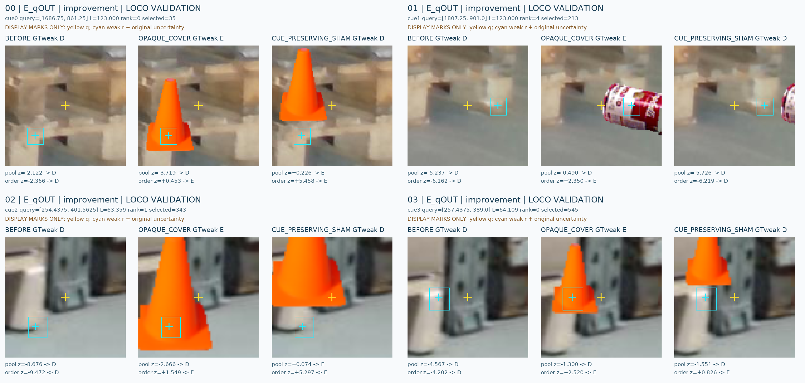
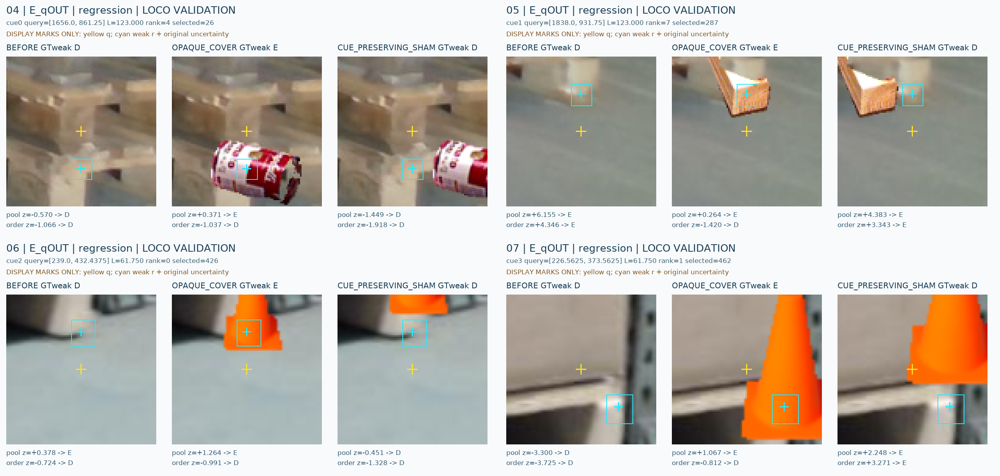
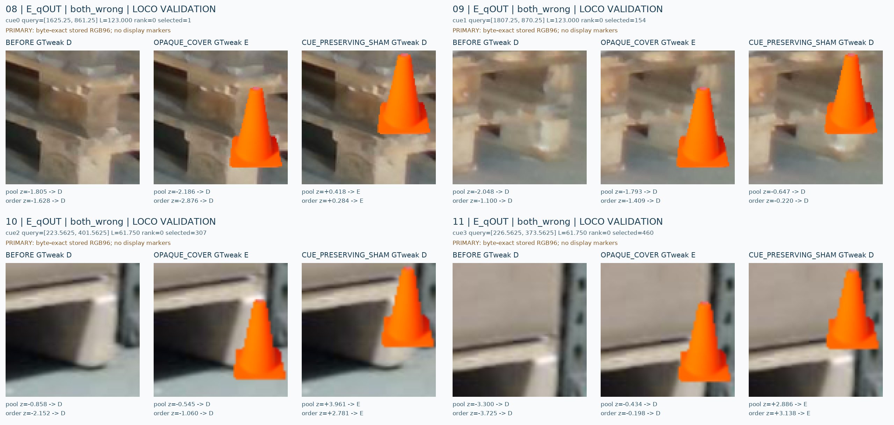
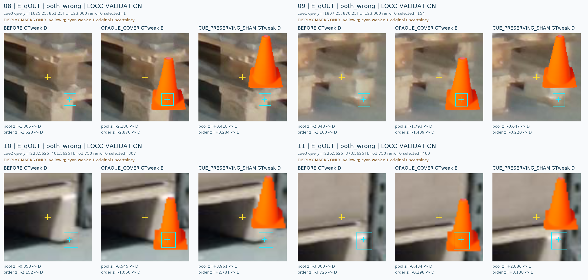
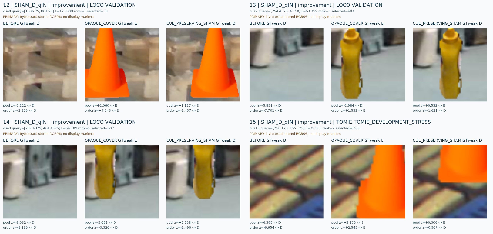
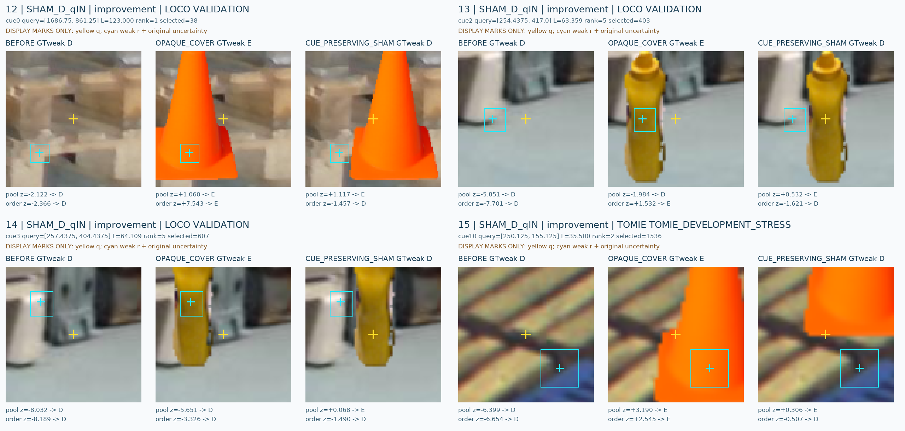
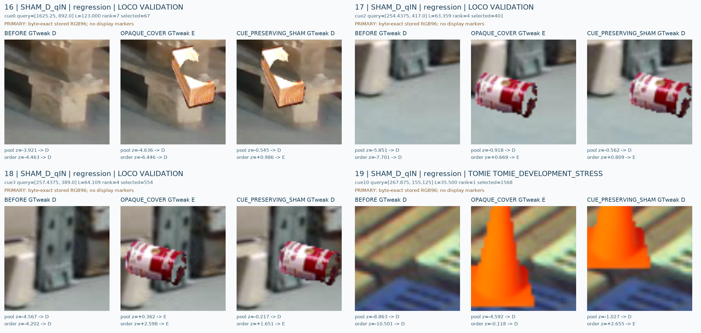
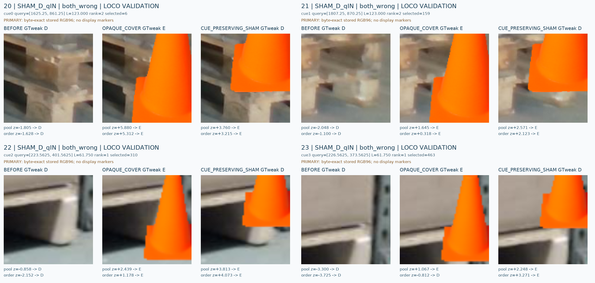
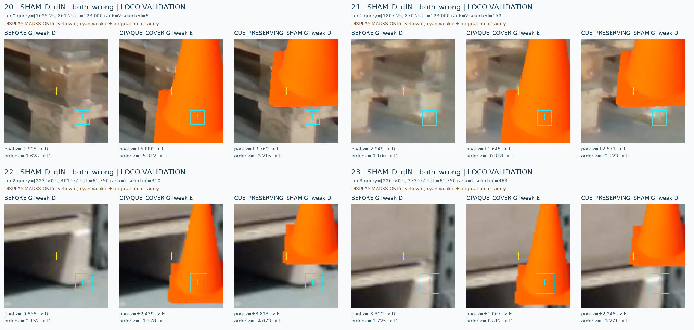

# C19 PUBLIC VAL saved cases

원문: [query_visibility_spatial_stencil_control_20261023_v127/saved_case_gallery/GALLERY_KO.html](../../archive/task-2/pallet-keypoint-visibility/query_visibility_spatial_stencil_control_20261023_v127/saved_case_gallery/GALLERY_KO.html)

원 HTML SHA256: `e3e11dcb4c2862f323ad995b38b0c971012305c5060f0545dee4c28f1fae9fa6`

원 img ordinal 1–12 / 12. 원 순서 유지; 이미지 pixel decode/모델/평가 재실행 없음.

## 원 이미지 1

원문 직전 heading

```text
E_qOUT: improvement (4)
```


## 원 이미지 2

원문 직전 heading

```text
E_qOUT: improvement (4)
```



## 원 이미지 3

원문 직전 heading

```text
E_qOUT: regression (4)
```


## 원 이미지 4

원문 직전 heading

```text
E_qOUT: regression (4)
```



## 원 이미지 5

원문 직전 heading

```text
E_qOUT: both_wrong (4)
```



## 원 이미지 6

원문 직전 heading

```text
E_qOUT: both_wrong (4)
```



## 원 이미지 7

원문 직전 heading

```text
SHAM_D_qIN: improvement (4)
```



## 원 이미지 8

원문 직전 heading

```text
SHAM_D_qIN: improvement (4)
```



## 원 이미지 9

원문 직전 heading

```text
SHAM_D_qIN: regression (4)
```



## 원 이미지 10

원문 직전 heading

```text
SHAM_D_qIN: regression (4)
```


## 원 이미지 11

원문 직전 heading

```text
SHAM_D_qIN: both_wrong (4)
```



## 원 이미지 12

원문 직전 heading

```text
SHAM_D_qIN: both_wrong (4)
```


