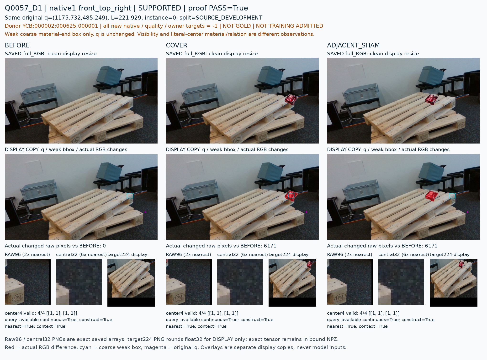

# V185 공개 학습 자료의 부위 가림 정답 준비

원문: [query_visibility_public_part_supervision_readiness_20261024_v185/ROOT_READOUT_KO.html](../../archive/task-2/pallet-keypoint-visibility/query_visibility_public_part_supervision_readiness_20261024_v185/ROOT_READOUT_KO.html)

원 HTML SHA256: `a0eef55a9166eaaaaa7201805702c9a6915d8c3415b3fabf57c9ed72549ba069`

원 img ordinal 1–1 / 1. 원 순서 유지; 이미지 pixel decode/모델/평가 재실행 없음.

## 원 이미지 1

원문 직전 heading

```text
원 crop이 관측 부위를 포함하는가
```

원 alt

```text
Q0057 원 source TRAIN 부위와 고정 crop의 불일치
```


