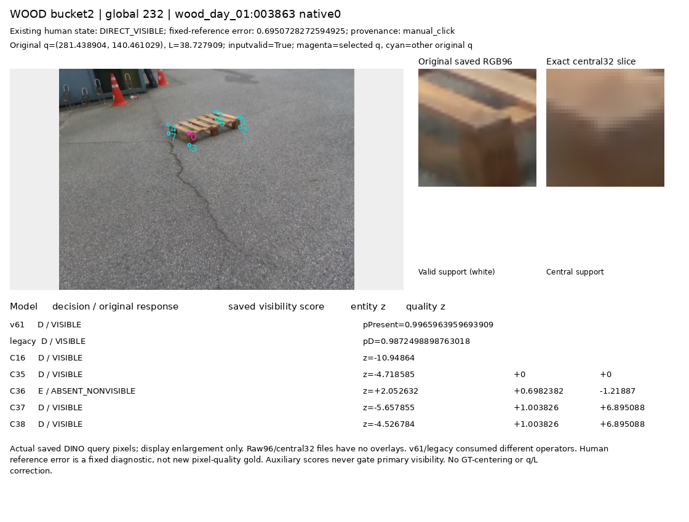
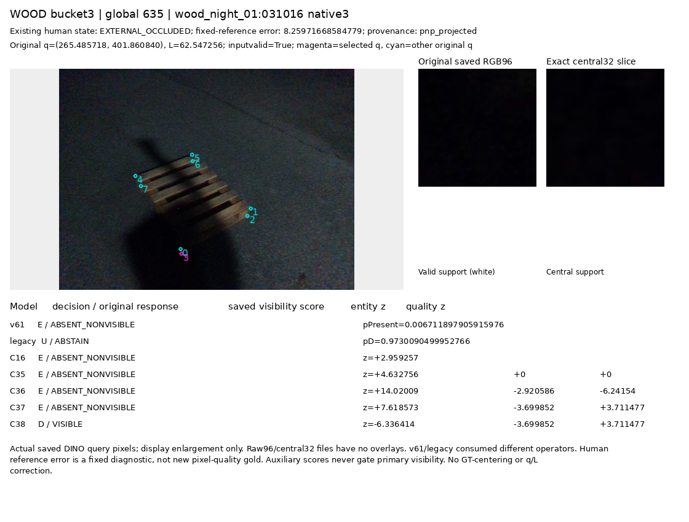
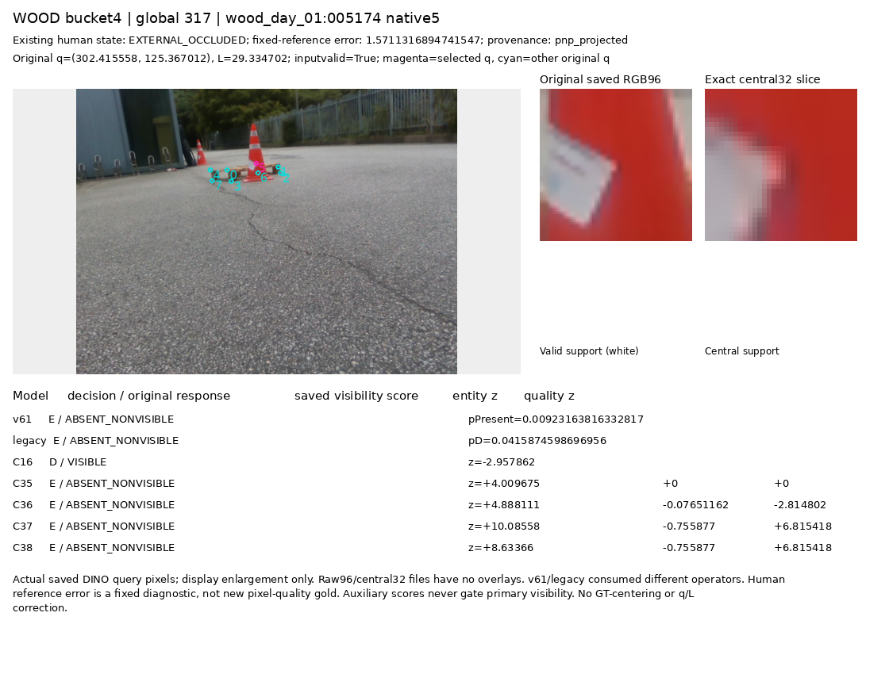
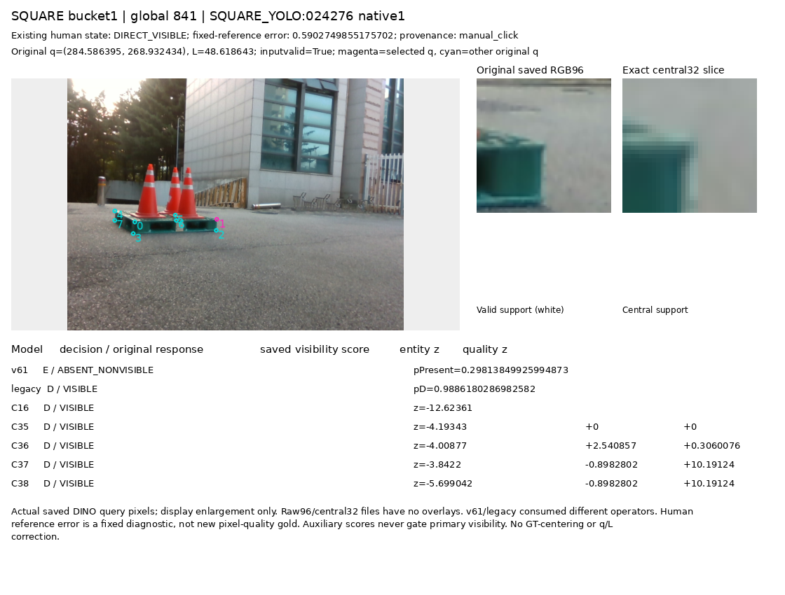
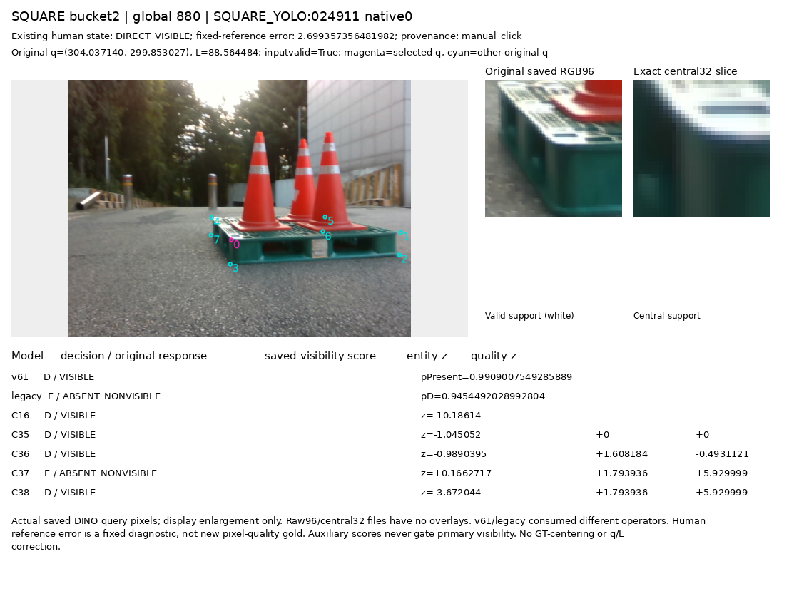
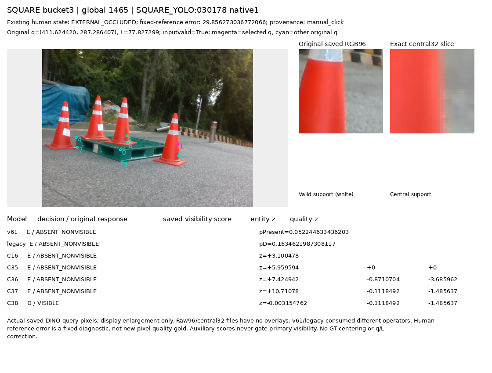
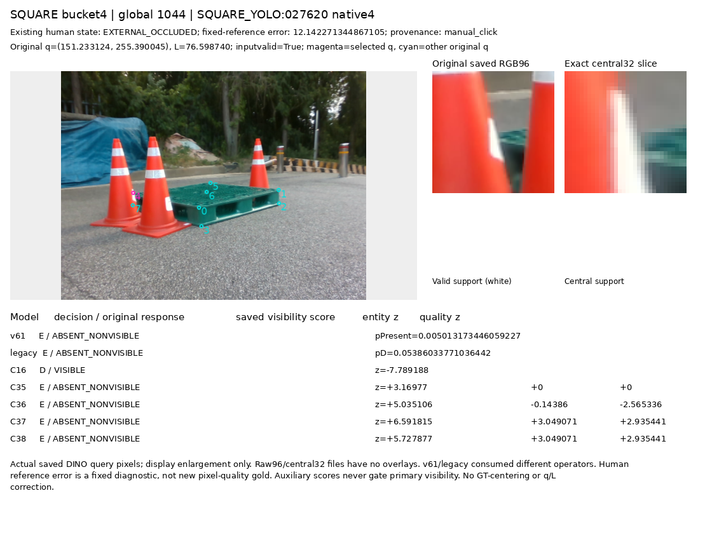

# 초기 키포인트 외부가림 평가 · 보고서 초안

원문: [query_visibility_separated_frozen_current_benchmark_20261024_v156/provenance/BEFORE_FINAL_DRAFT_STATUS_LABEL_CORRECTION/ROOT_READOUT_KO.html](../../archive/task-2/pallet-keypoint-visibility/query_visibility_separated_frozen_current_benchmark_20261024_v156/provenance/BEFORE_FINAL_DRAFT_STATUS_LABEL_CORRECTION/ROOT_READOUT_KO.html)

원 HTML SHA256: `d329b42bcc5b4b795ca692799a4b232fc1a7b8bd8ceec6e52237435924b4311c`

원 img ordinal 1–11 / 11. 원 순서 유지; 이미지 pixel decode/모델/평가 재실행 없음.

## 원 이미지 1

원문 직전 heading

```text
정사각형 paired592
```

원 alt

```text
전체1237에 대한7모델 D/E/U 혼동행렬
```

원 HTML caption

```text
실제 생성·view QA 완료. 색은 행별 비율, 숫자는 원래 개수입니다.
```

경로 대응 참고: 보존 HTML의 상대 src를 원 상위 폴더들에 대입했을 때 C manifest에서 유일하게 일치한 파일입니다. 원 HTML은 바꾸지 않았으며, 과거 HTML 작성 시점의 별도 이미지 bytes까지 인증했다는 뜻은 아닙니다. 원 경로·대응 근거·현재 source SHA는 추가 manifest에 남겼습니다.


## 원 이미지 2

원문 직전 heading

```text
좌표가 가까웠던 기존376개 진단에서도 손상이 남습니다
```

원 alt

```text
목재 정사각형 지표와 고정near376 오판
```

원 HTML caption

```text
재질별 precision/recall/U와 기존 near 진단을 함께 표시했습니다.
```

경로 대응 참고: 보존 HTML의 상대 src를 원 상위 폴더들에 대입했을 때 C manifest에서 유일하게 일치한 파일입니다. 원 HTML은 바꾸지 않았으며, 과거 HTML 작성 시점의 별도 이미지 bytes까지 인증했다는 뜻은 아닙니다. 원 경로·대응 근거·현재 source SHA는 추가 manifest에 남겼습니다.


## 원 이미지 3

원문 직전 heading

```text
위치 품질·대상 판별의 보조 출력은 어디까지 알 수 있나
```

원 alt

```text
조건부 reference 거리 및 entity 음수 반응과 전체 주석 분모
```

원 HTML caption

```text
주 가시성 결과, 참조 거리 진단, entity 반응의 권위를 구분했습니다.
```

경로 대응 참고: 보존 HTML의 상대 src를 원 상위 폴더들에 대입했을 때 C manifest에서 유일하게 일치한 파일입니다. 원 HTML은 바꾸지 않았으며, 과거 HTML 작성 시점의 별도 이미지 bytes까지 인증했다는 뜻은 아닙니다. 원 경로·대응 근거·현재 source SHA는 추가 manifest에 남겼습니다.


## 원 이미지 4

원문 직전 heading

```text
고정8개 실제 crop에서 성공·실패를 함께 확인했습니다
```

원 alt

```text
고정 사례 200
```

원 HTML caption

```text
보이는 목재 모서리와 아스팔트가 함께 보인다. v61은 E, 기존 가림 모델·C16·새4모델은 D다.
```

경로 대응 참고: 보존 HTML의 상대 src를 원 상위 폴더들에 대입했을 때 C manifest에서 유일하게 일치한 파일입니다. 원 HTML은 바꾸지 않았으며, 과거 HTML 작성 시점의 별도 이미지 bytes까지 인증했다는 뜻은 아닙니다. 원 경로·대응 근거·현재 source SHA는 추가 manifest에 남겼습니다.


## 원 이미지 5

원문 직전 heading

```text
고정8개 실제 crop에서 성공·실패를 함께 확인했습니다
```

원 alt

```text
고정 사례 232
```

원 HTML caption

```text
보이는 목재 모서리가 crop에서 흐린 밝은 윗면/어두운 옆면 경계로 나타난다. C36만 E로 오판한다.
```

경로 대응 참고: 보존 HTML의 상대 src를 원 상위 폴더들에 대입했을 때 C manifest에서 유일하게 일치한 파일입니다. 원 HTML은 바꾸지 않았으며, 과거 HTML 작성 시점의 별도 이미지 bytes까지 인증했다는 뜻은 아닙니다. 원 경로·대응 근거·현재 source SHA는 추가 manifest에 남겼습니다.



## 원 이미지 6

원문 직전 heading

```text
고정8개 실제 crop에서 성공·실패를 함께 확인했습니다
```

원 alt

```text
고정 사례 635
```

원 HTML caption

```text
외부가림으로 주석된 야간 사례이며 저장 crop은 거의 암부다. C38은 D, C16/C35/C36/C37은 E다. RGB만으로 물리 가림과 조명 효과를 독립 판정하지 않는다.
```

경로 대응 참고: 보존 HTML의 상대 src를 원 상위 폴더들에 대입했을 때 C manifest에서 유일하게 일치한 파일입니다. 원 HTML은 바꾸지 않았으며, 과거 HTML 작성 시점의 별도 이미지 bytes까지 인증했다는 뜻은 아닙니다. 원 경로·대응 근거·현재 source SHA는 추가 manifest에 남겼습니다.



## 원 이미지 7

원문 직전 heading

```text
고정8개 실제 crop에서 성공·실패를 함께 확인했습니다
```

원 alt

```text
고정 사례 317
```

원 HTML caption

```text
외부가림 주석 위치의 저장 crop에 빨간 콘이 크게 보인다. C16은 D, 새4모델은 E다.
```

경로 대응 참고: 보존 HTML의 상대 src를 원 상위 폴더들에 대입했을 때 C manifest에서 유일하게 일치한 파일입니다. 원 HTML은 바꾸지 않았으며, 과거 HTML 작성 시점의 별도 이미지 bytes까지 인증했다는 뜻은 아닙니다. 원 경로·대응 근거·현재 source SHA는 추가 manifest에 남겼습니다.



## 원 이미지 8

원문 직전 heading

```text
고정8개 실제 crop에서 성공·실패를 함께 확인했습니다
```

원 alt

```text
고정 사례 841
```

원 HTML caption

```text
보이는 플라스틱 모서리와 배경이 함께 보인다. v61은 E, 기존 가림 모델·C16·새4모델은 D다.
```

경로 대응 참고: 보존 HTML의 상대 src를 원 상위 폴더들에 대입했을 때 C manifest에서 유일하게 일치한 파일입니다. 원 HTML은 바꾸지 않았으며, 과거 HTML 작성 시점의 별도 이미지 bytes까지 인증했다는 뜻은 아닙니다. 원 경로·대응 근거·현재 source SHA는 추가 manifest에 남겼습니다.



## 원 이미지 9

원문 직전 heading

```text
고정8개 실제 crop에서 성공·실패를 함께 확인했습니다
```

원 alt

```text
고정 사례 880
```

원 HTML caption

```text
보이는 플라스틱 모서리의 밝은 윗면·어두운 옆면이 보인다. C37은 E로 오판하며 다른 새3모델은 D다.
```

경로 대응 참고: 보존 HTML의 상대 src를 원 상위 폴더들에 대입했을 때 C manifest에서 유일하게 일치한 파일입니다. 원 HTML은 바꾸지 않았으며, 과거 HTML 작성 시점의 별도 이미지 bytes까지 인증했다는 뜻은 아닙니다. 원 경로·대응 근거·현재 source SHA는 추가 manifest에 남겼습니다.



## 원 이미지 10

원문 직전 heading

```text
고정8개 실제 crop에서 성공·실패를 함께 확인했습니다
```

원 alt

```text
고정 사례 1465
```

원 HTML caption

```text
외부가림 주석 위치 crop에 콘과 배경 경계가 보인다. 기존참조 오차가 약29.9px인 사례다. C38은 D, C16/C35/C36/C37은 E다.
```

경로 대응 참고: 보존 HTML의 상대 src를 원 상위 폴더들에 대입했을 때 C manifest에서 유일하게 일치한 파일입니다. 원 HTML은 바꾸지 않았으며, 과거 HTML 작성 시점의 별도 이미지 bytes까지 인증했다는 뜻은 아닙니다. 원 경로·대응 근거·현재 source SHA는 추가 manifest에 남겼습니다.



## 원 이미지 11

원문 직전 heading

```text
고정8개 실제 crop에서 성공·실패를 함께 확인했습니다
```

원 alt

```text
고정 사례 1044
```

원 HTML caption

```text
외부가림 주석 위치의 저장 crop에 콘과 일부 팔레트가 함께 보인다. C16은 D, 새4모델은 E다.
```

경로 대응 참고: 보존 HTML의 상대 src를 원 상위 폴더들에 대입했을 때 C manifest에서 유일하게 일치한 파일입니다. 원 HTML은 바꾸지 않았으며, 과거 HTML 작성 시점의 별도 이미지 bytes까지 인증했다는 뜻은 아닙니다. 원 경로·대응 근거·현재 source SHA는 추가 manifest에 남겼습니다.


