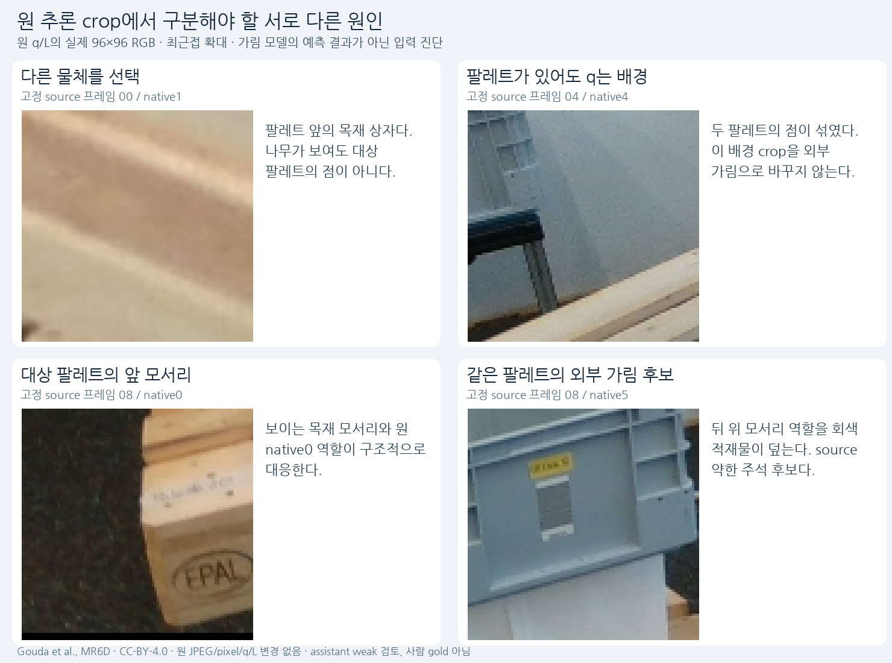
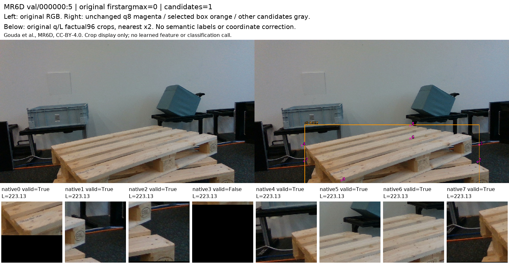
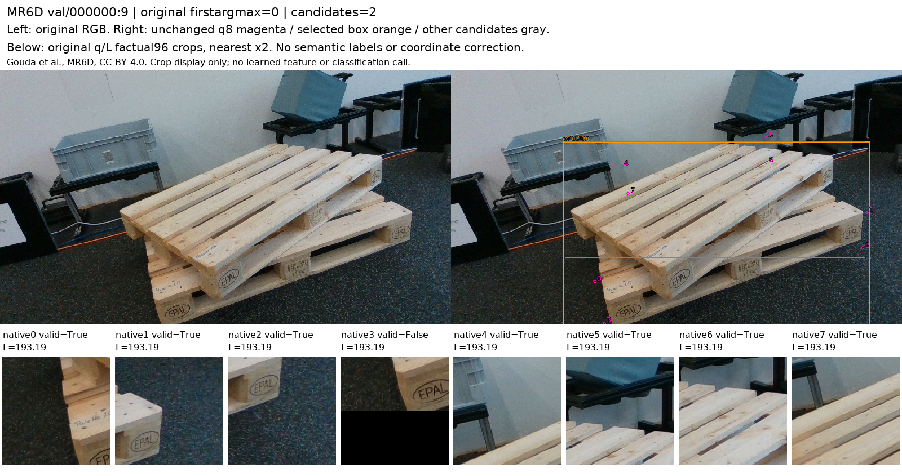
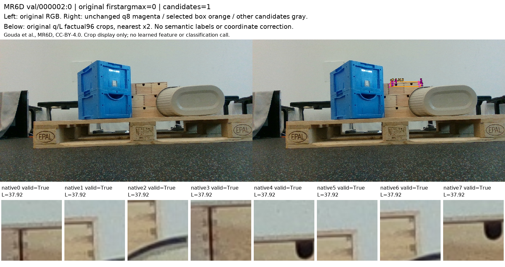
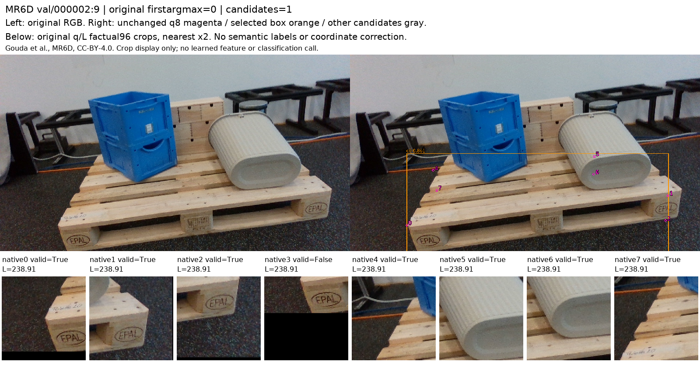
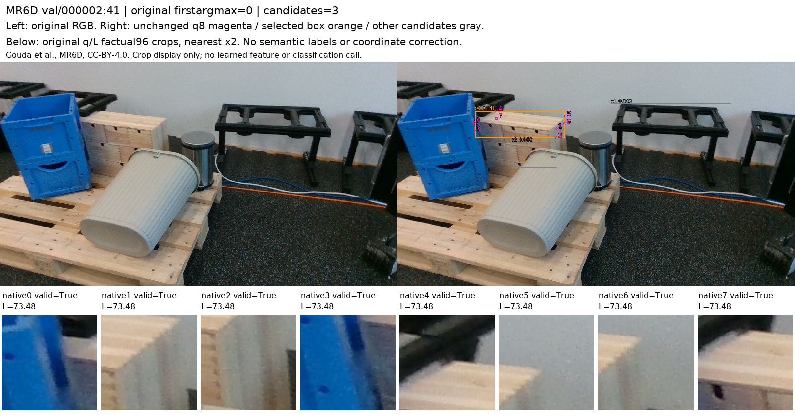
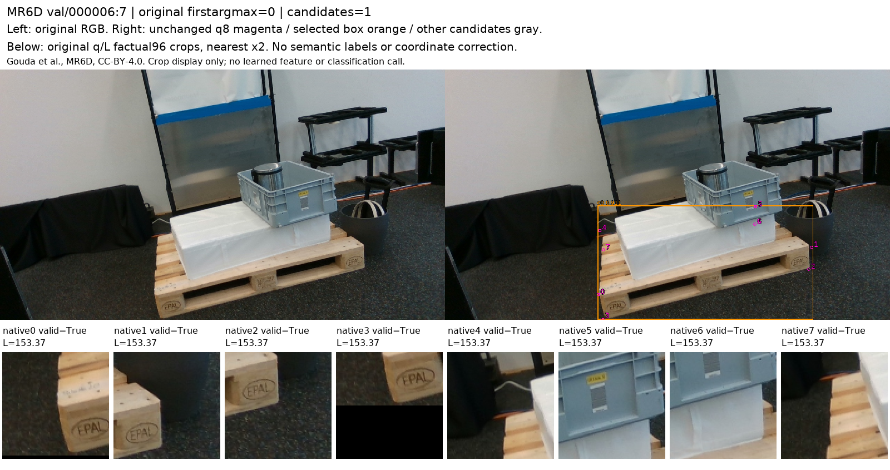
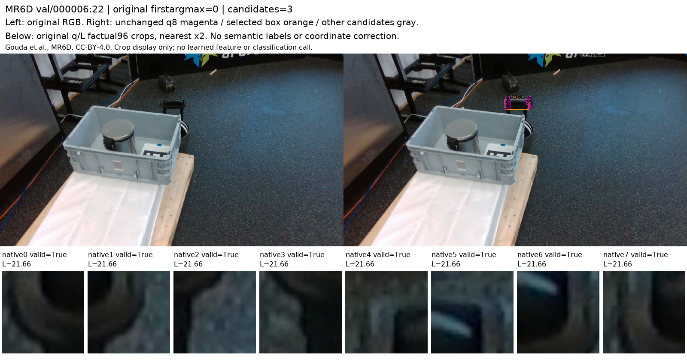

# V152 원 추론과 보임·가림 정답 연결 진단

원문: [query_visibility_mr6d_actual_query_bridge_20261024_v152/provenance/BEFORE_PARTIAL_ROLE_ADJUDICATION/ROOT_READOUT_KO.html](../../archive/task-2/pallet-keypoint-visibility/query_visibility_mr6d_actual_query_bridge_20261024_v152/provenance/BEFORE_PARTIAL_ROLE_ADJUDICATION/ROOT_READOUT_KO.html)

원 HTML SHA256: `40995c6e36bd3788eadf22f694fc80b27b49ae6a29385d030433e969e40b8b27`

원 img ordinal 1–11 / 11. 원 순서 유지; 이미지 pixel decode/모델/평가 재실행 없음.

## 원 이미지 1

원문 직전 heading

```text
같은 “안 보임”으로 묶으면 안 되는 실제 crop
```



## 원 이미지 2

원문 직전 heading

```text
모든 원 q/L crop 보기
```

경로 대응 참고: 보존 HTML의 상대 src를 원 상위 폴더들에 대입했을 때 C manifest에서 유일하게 일치한 파일입니다. 원 HTML은 바꾸지 않았으며, 과거 HTML 작성 시점의 별도 이미지 bytes까지 인증했다는 뜻은 아닙니다. 원 경로·대응 근거·현재 source SHA는 추가 manifest에 남겼습니다.


## 원 이미지 3

원문 직전 heading

```text
모든 원 q/L crop 보기
```

경로 대응 참고: 보존 HTML의 상대 src를 원 상위 폴더들에 대입했을 때 C manifest에서 유일하게 일치한 파일입니다. 원 HTML은 바꾸지 않았으며, 과거 HTML 작성 시점의 별도 이미지 bytes까지 인증했다는 뜻은 아닙니다. 원 경로·대응 근거·현재 source SHA는 추가 manifest에 남겼습니다.


## 원 이미지 4

원문 직전 heading

```text
모든 원 q/L crop 보기
```

경로 대응 참고: 보존 HTML의 상대 src를 원 상위 폴더들에 대입했을 때 C manifest에서 유일하게 일치한 파일입니다. 원 HTML은 바꾸지 않았으며, 과거 HTML 작성 시점의 별도 이미지 bytes까지 인증했다는 뜻은 아닙니다. 원 경로·대응 근거·현재 source SHA는 추가 manifest에 남겼습니다.


## 원 이미지 5

원문 직전 heading

```text
모든 원 q/L crop 보기
```

경로 대응 참고: 보존 HTML의 상대 src를 원 상위 폴더들에 대입했을 때 C manifest에서 유일하게 일치한 파일입니다. 원 HTML은 바꾸지 않았으며, 과거 HTML 작성 시점의 별도 이미지 bytes까지 인증했다는 뜻은 아닙니다. 원 경로·대응 근거·현재 source SHA는 추가 manifest에 남겼습니다.



## 원 이미지 6

원문 직전 heading

```text
모든 원 q/L crop 보기
```

경로 대응 참고: 보존 HTML의 상대 src를 원 상위 폴더들에 대입했을 때 C manifest에서 유일하게 일치한 파일입니다. 원 HTML은 바꾸지 않았으며, 과거 HTML 작성 시점의 별도 이미지 bytes까지 인증했다는 뜻은 아닙니다. 원 경로·대응 근거·현재 source SHA는 추가 manifest에 남겼습니다.



## 원 이미지 7

원문 직전 heading

```text
모든 원 q/L crop 보기
```

경로 대응 참고: 보존 HTML의 상대 src를 원 상위 폴더들에 대입했을 때 C manifest에서 유일하게 일치한 파일입니다. 원 HTML은 바꾸지 않았으며, 과거 HTML 작성 시점의 별도 이미지 bytes까지 인증했다는 뜻은 아닙니다. 원 경로·대응 근거·현재 source SHA는 추가 manifest에 남겼습니다.



## 원 이미지 8

원문 직전 heading

```text
모든 원 q/L crop 보기
```

경로 대응 참고: 보존 HTML의 상대 src를 원 상위 폴더들에 대입했을 때 C manifest에서 유일하게 일치한 파일입니다. 원 HTML은 바꾸지 않았으며, 과거 HTML 작성 시점의 별도 이미지 bytes까지 인증했다는 뜻은 아닙니다. 원 경로·대응 근거·현재 source SHA는 추가 manifest에 남겼습니다.



## 원 이미지 9

원문 직전 heading

```text
모든 원 q/L crop 보기
```

경로 대응 참고: 보존 HTML의 상대 src를 원 상위 폴더들에 대입했을 때 C manifest에서 유일하게 일치한 파일입니다. 원 HTML은 바꾸지 않았으며, 과거 HTML 작성 시점의 별도 이미지 bytes까지 인증했다는 뜻은 아닙니다. 원 경로·대응 근거·현재 source SHA는 추가 manifest에 남겼습니다.



## 원 이미지 10

원문 직전 heading

```text
모든 원 q/L crop 보기
```

경로 대응 참고: 보존 HTML의 상대 src를 원 상위 폴더들에 대입했을 때 C manifest에서 유일하게 일치한 파일입니다. 원 HTML은 바꾸지 않았으며, 과거 HTML 작성 시점의 별도 이미지 bytes까지 인증했다는 뜻은 아닙니다. 원 경로·대응 근거·현재 source SHA는 추가 manifest에 남겼습니다.



## 원 이미지 11

원문 직전 heading

```text
모든 원 q/L crop 보기
```

경로 대응 참고: 보존 HTML의 상대 src를 원 상위 폴더들에 대입했을 때 C manifest에서 유일하게 일치한 파일입니다. 원 HTML은 바꾸지 않았으며, 과거 HTML 작성 시점의 별도 이미지 bytes까지 인증했다는 뜻은 아닙니다. 원 경로·대응 근거·현재 source SHA는 추가 manifest에 남겼습니다.


