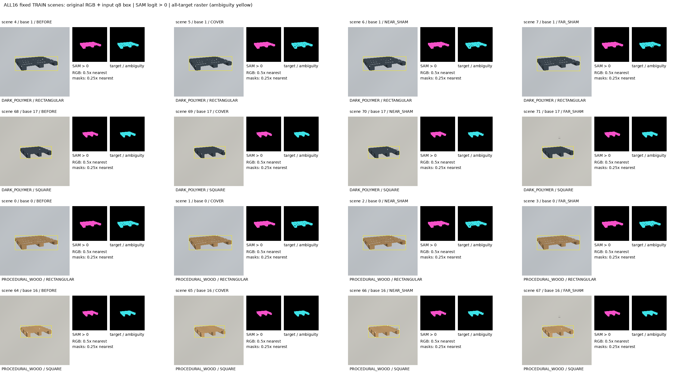
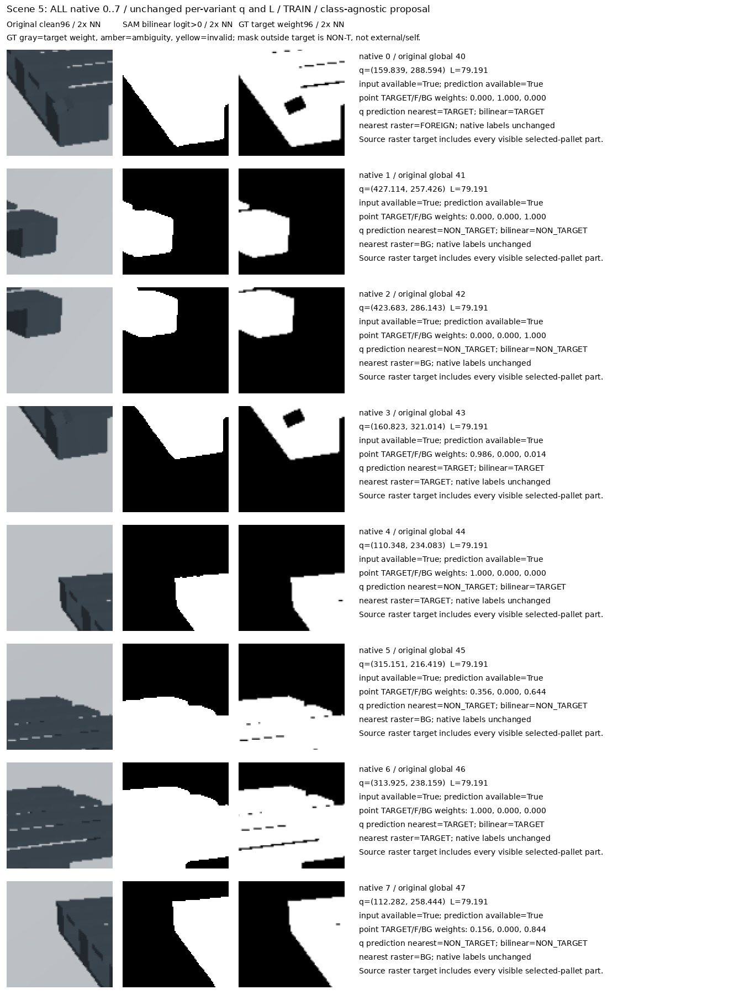
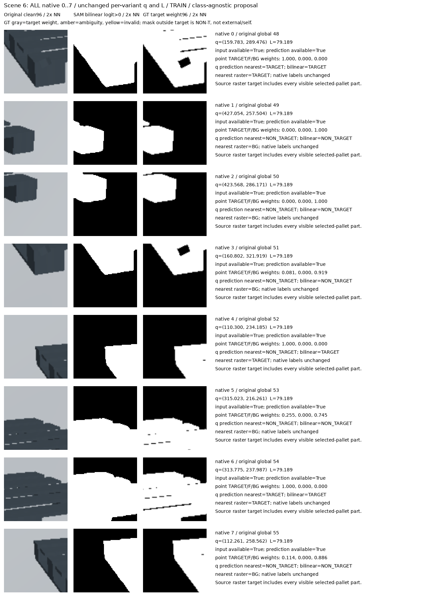
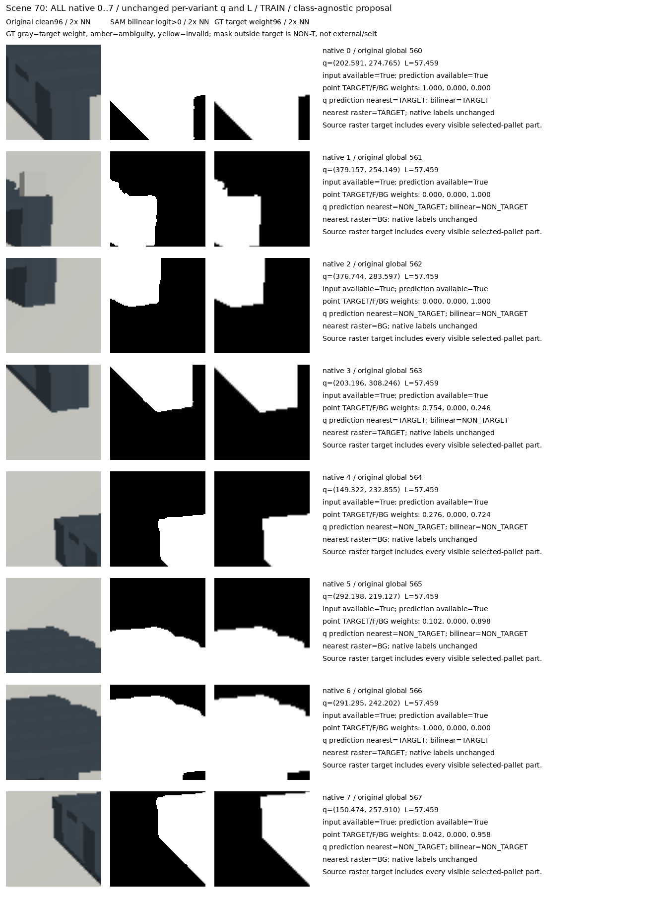
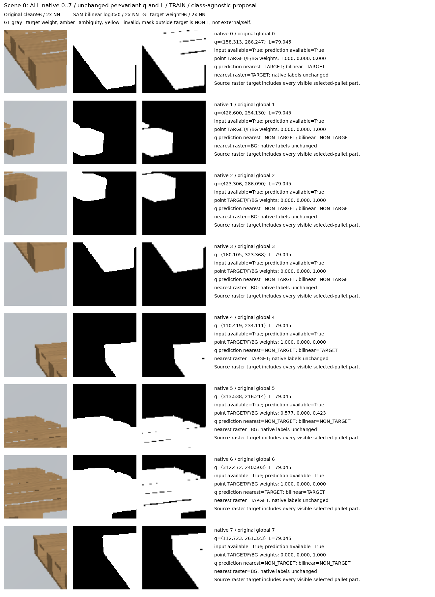
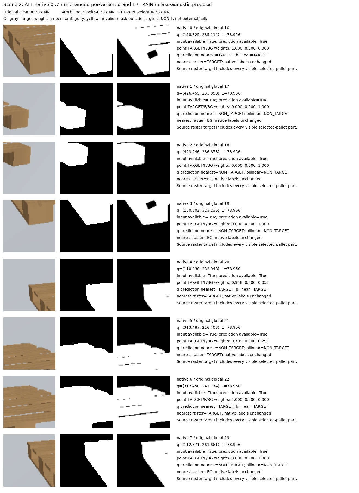
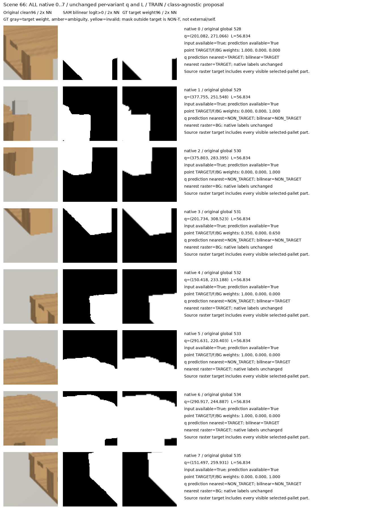

# V180 fixed source SAM diagnostics

원문: [query_visibility_frozen_sam_source_baseline_20261024_v180/saved_sam_allTRAIN4096_evaluation_c_v3/index.html](../../archive/task-2/pallet-keypoint-visibility/query_visibility_frozen_sam_source_baseline_20261024_v180/saved_sam_allTRAIN4096_evaluation_c_v3/index.html)

원 HTML SHA256: `fc163c0cfb167caad2afb3188a0320f55aa1c761dc51572d8de0919da5e43285`

원 img ordinal 1–17 / 17. 원 순서 유지; 이미지 pixel decode/모델/평가 재실행 없음.

## 원 이미지 1

원문 직전 heading

```text
Fixed source TRAIN SAM smoke diagnostics
```



## 원 이미지 2

원문 직전 heading

```text
Scene 4: all native8
```


## 원 이미지 3

원문 직전 heading

```text
Scene 5: all native8
```



## 원 이미지 4

원문 직전 heading

```text
Scene 6: all native8
```



## 원 이미지 5

원문 직전 heading

```text
Scene 7: all native8
```


## 원 이미지 6

원문 직전 heading

```text
Scene 68: all native8
```


## 원 이미지 7

원문 직전 heading

```text
Scene 69: all native8
```


## 원 이미지 8

원문 직전 heading

```text
Scene 70: all native8
```



## 원 이미지 9

원문 직전 heading

```text
Scene 71: all native8
```


## 원 이미지 10

원문 직전 heading

```text
Scene 0: all native8
```



## 원 이미지 11

원문 직전 heading

```text
Scene 1: all native8
```


## 원 이미지 12

원문 직전 heading

```text
Scene 2: all native8
```



## 원 이미지 13

원문 직전 heading

```text
Scene 3: all native8
```


## 원 이미지 14

원문 직전 heading

```text
Scene 64: all native8
```


## 원 이미지 15

원문 직전 heading

```text
Scene 65: all native8
```


## 원 이미지 16

원문 직전 heading

```text
Scene 66: all native8
```



## 원 이미지 17

원문 직전 heading

```text
Scene 67: all native8
```


