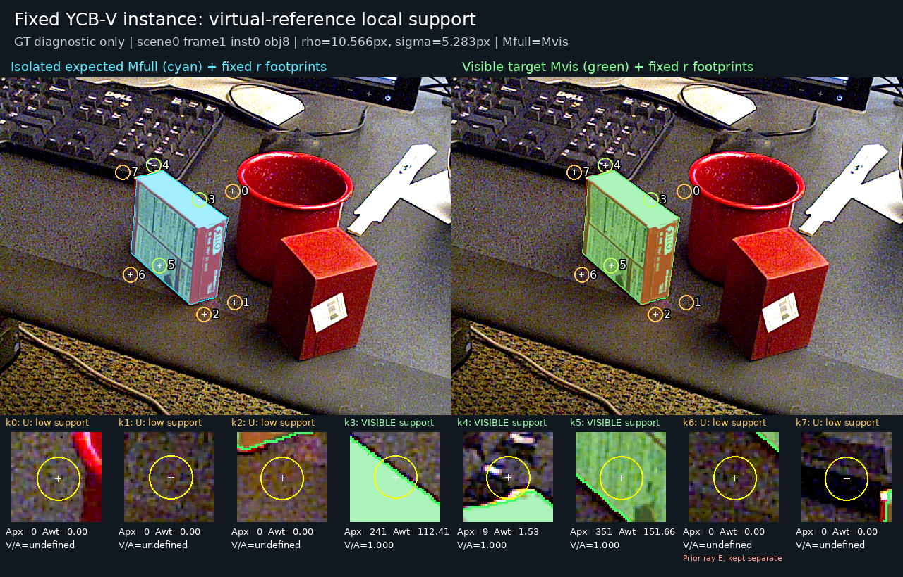

# V76 공개 실사·합성 support 감독 준비

원문: [query_visibility_reference_local_support_20261023_v76/DATA_READY_KO.html](../../archive/task-2/pallet-keypoint-visibility/query_visibility_reference_local_support_20261023_v76/DATA_READY_KO.html)

원 HTML SHA256: `797839fe3d5b8f5af88f4f522c82f8cd1fd73b4dede118dcacd747f1f473c0c7`

원 img ordinal 1–1 / 1. 원 순서 유지; 이미지 pixel decode/모델/평가 재실행 없음.

## 원 이미지 1

원문 직전 heading

```text
보이는 대상에 잘못된 negative를 주지 않도록 한 규칙
```


