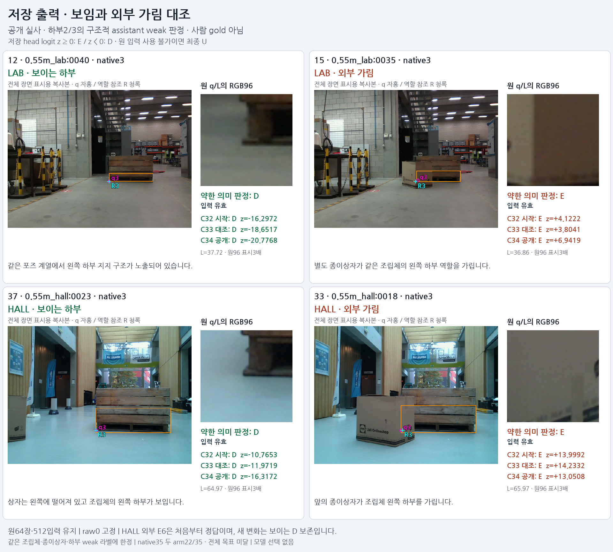
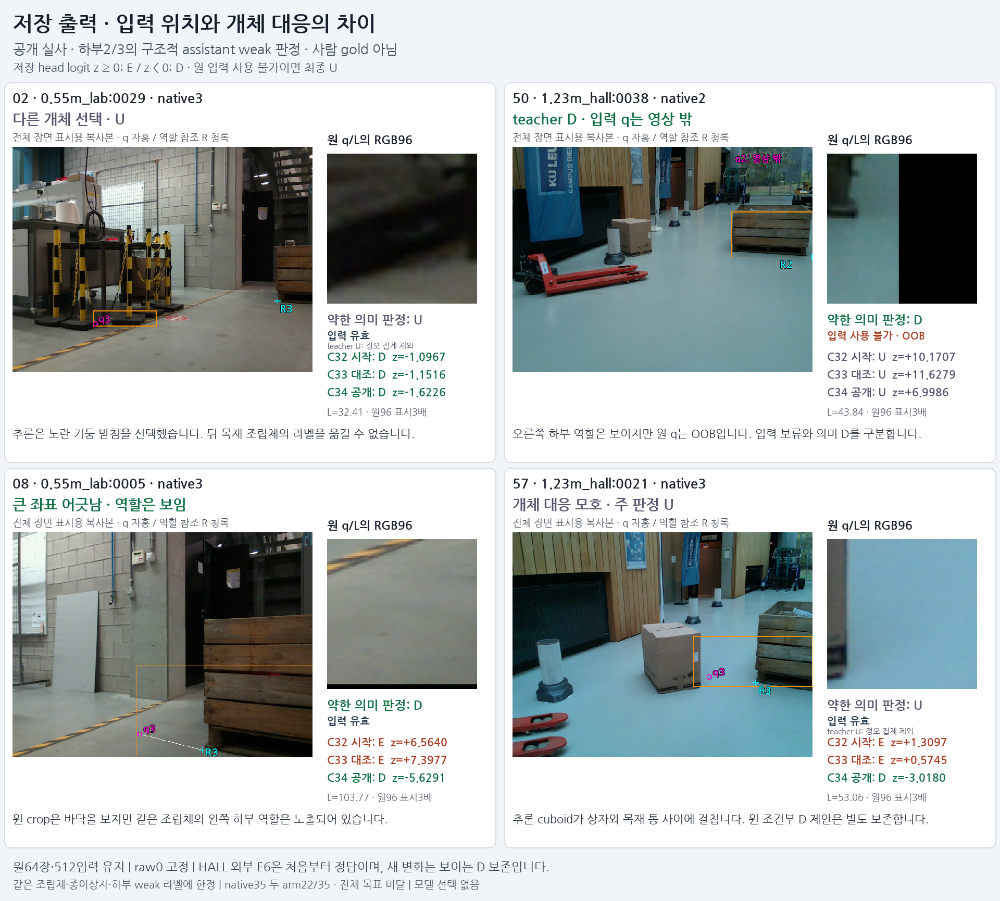

# V148 공개 source 하부 가림 학습 결과

원문: [query_visibility_public_native_supervision_control_20261024_v148/ROOT_READOUT_KO.html](../../archive/task-2/pallet-keypoint-visibility/query_visibility_public_native_supervision_control_20261024_v148/ROOT_READOUT_KO.html)

원 HTML SHA256: `6763cac779424a40830dd17f2a1599e5250e9251f99f1f97839617bb118173ba`

원 img ordinal 1–2 / 2. 원 순서 유지; 이미지 pixel decode/모델/평가 재실행 없음.

## 원 이미지 1

원문 직전 heading

```text
같은 포즈 계열의 보임·외부 가림 대조
```

원 alt

```text
LAB12와15, HALL37과33의 보임 외부가림 대조와 세 모델 저장 점수
```



## 원 이미지 2

원문 직전 heading

```text
개체 대응·입력 보류·역할 보임은 따로 봅니다
```

원 alt

```text
다른 개체 U, 입력 OOB D, 큰 좌표 어긋남 D, 대응 모호 U와 세 모델 저장 점수
```


