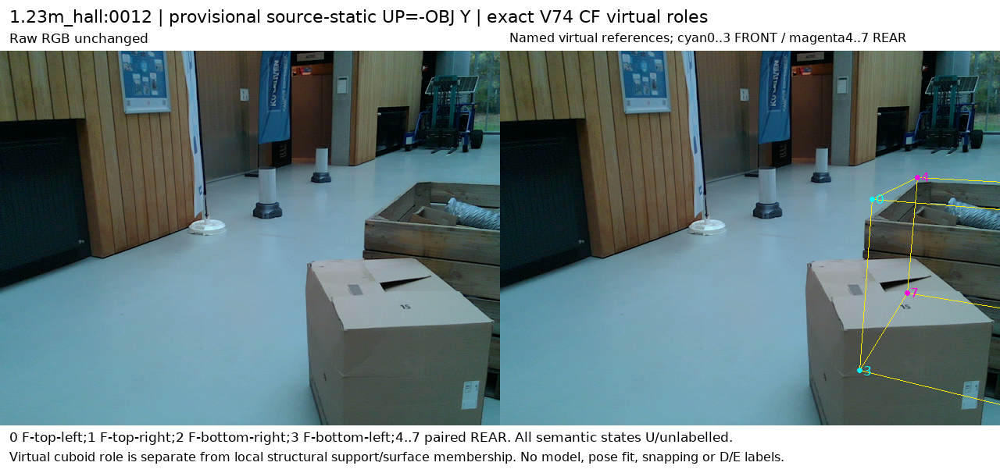
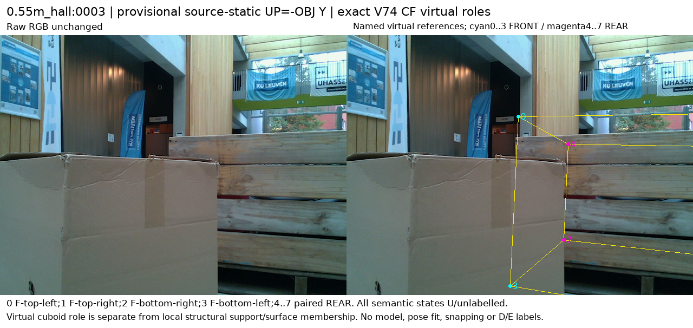

# 공개 실사 참조·가림 주석 가능성

원문: [query_visibility_public_native_reference_feasibility_20261024_v140/ROOT_READOUT_KO.html](../../archive/task-2/pallet-keypoint-visibility/query_visibility_public_native_reference_feasibility_20261024_v140/ROOT_READOUT_KO.html)

원 HTML SHA256: `4ef8c09e846fef86cb8d511fc624308c0333aefa17aca1d91b2cd836672c8b15`

원 img ordinal 1–6 / 6. 원 순서 유지; 이미지 pixel decode/모델/평가 재실행 없음.

## 원 이미지 1

원문 직전 heading

```text
LOCO: 주석용 확대, 모델 입력 아님
```

원 alt

```text
LOCO: 주석용 확대, 모델 입력 아님
```


## 원 이미지 2

원문 직전 heading

```text
공개 Pallox 원본 mesh의 세 방향
```

원 alt

```text
공개 Pallox 원본 mesh의 세 방향
```


## 원 이미지 3

원문 직전 heading

```text
1.23m_lab:0034 — 원본과 가상 역할 투영
```

원 alt

```text
1.23m_lab:0034 — 원본과 가상 역할 투영
```


## 원 이미지 4

원문 직전 heading

```text
0.55m_lab:0017 — 원본과 가상 역할 투영
```

원 alt

```text
0.55m_lab:0017 — 원본과 가상 역할 투영
```


## 원 이미지 5

원문 직전 heading

```text
1.23m_hall:0012 — 원본과 가상 역할 투영
```

원 alt

```text
1.23m_hall:0012 — 원본과 가상 역할 투영
```



## 원 이미지 6

원문 직전 heading

```text
0.55m_hall:0003 — 원본과 가상 역할 투영
```

원 alt

```text
0.55m_hall:0003 — 원본과 가상 역할 투영
```


