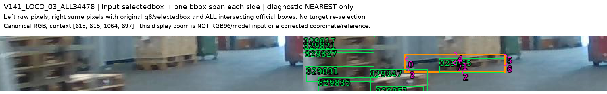
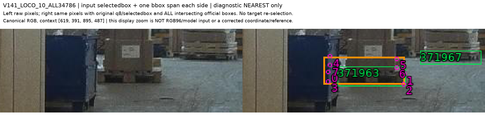

# V144 · 공개 실사의 실제 선택 대상과 native 역할 연결

원문: [query_visibility_public_selected_native_labels_20261024_v144/ROOT_READOUT_KO.html](../../archive/task-2/pallet-keypoint-visibility/query_visibility_public_selected_native_labels_20261024_v144/ROOT_READOUT_KO.html)

원 HTML SHA256: `431dc18824fb7b7611090a22e7d2f6a1d10ce44da5ab2fd1f0c05662fea94866`

원 img ordinal 1–6 / 6. 원 순서 유지; 이미지 pixel decode/모델/평가 재실행 없음.

## 원 이미지 1

원문 직전 heading

```text
같은 조립체 하부의 보임 / 외부 가림
```

원 alt

```text
공개 Pallox 원 영상과 초기 query crop
```


## 원 이미지 2

원문 직전 heading

```text
같은 조립체 하부의 보임 / 외부 가림
```

원 alt

```text
공개 Pallox 원 영상과 초기 query crop
```


## 원 이미지 3

원문 직전 heading

```text
같은 조립체 하부의 보임 / 외부 가림
```

원 alt

```text
공개 Pallox 원 영상과 초기 query crop
```


## 원 이미지 4

원문 직전 heading

```text
불확실한 역할을 강제로 E로 만들지 않음
```

원 alt

```text
원래 선택 대상의 진단용 확대
```


## 원 이미지 5

원문 직전 heading

```text
불확실한 역할을 강제로 E로 만들지 않음
```

원 alt

```text
원래 선택 대상의 진단용 확대
```



## 원 이미지 6

원문 직전 heading

```text
불확실한 역할을 강제로 E로 만들지 않음
```

원 alt

```text
원래 선택 대상의 진단용 확대
```


