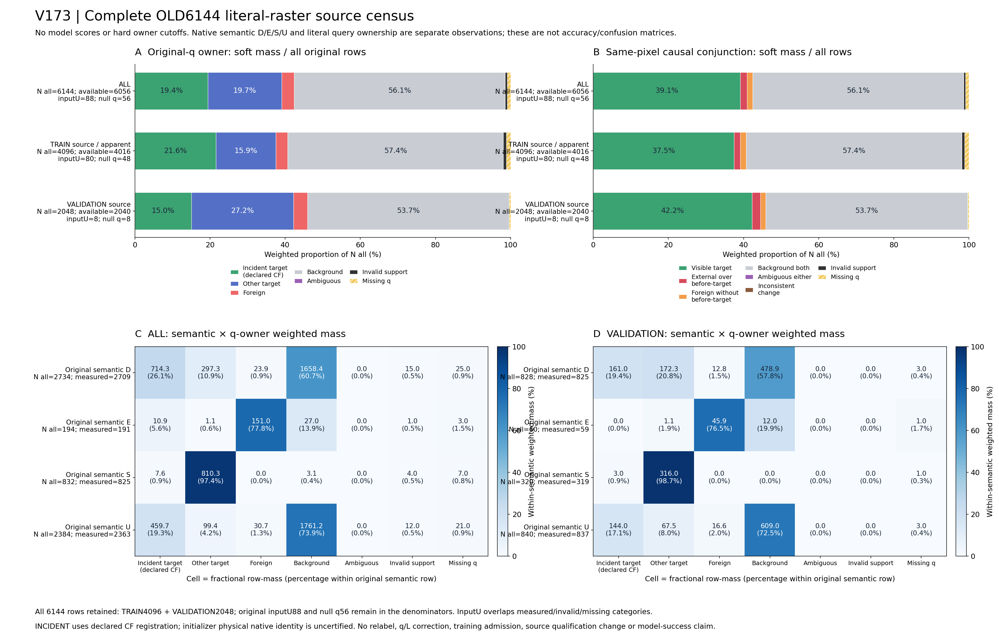

# V173 전체 source query census

원문: [query_visibility_full_source_query_causal_census_20261024_v173/provenance/BEFORE_FINAL_AUDIT_AND_ROOT_V2_QA_BINDING/ROOT_READOUT_KO.html](../../archive/task-2/pallet-keypoint-visibility/query_visibility_full_source_query_causal_census_20261024_v173/provenance/BEFORE_FINAL_AUDIT_AND_ROOT_V2_QA_BINDING/ROOT_READOUT_KO.html)

원 HTML SHA256: `2bf06c34f12559efc083c2b2b33dc329b69f366c7c7ae88fa6ef36ac85c8b47c`

원 img ordinal 1–1 / 1. 원 순서 유지; 이미지 pixel decode/모델/평가 재실행 없음.

## 원 이미지 1

원문 직전 heading

```text
V173 · 원 합성 source6144 전수 query 진단
```

원 alt

```text
전체 및 분할별 q-owner causal7 soft 분포와 원semantic 교차표
```

경로 대응 참고: 보존 HTML의 상대 src를 원 상위 폴더들에 대입했을 때 C manifest에서 유일하게 일치한 파일입니다. 원 HTML은 바꾸지 않았으며, 과거 HTML 작성 시점의 별도 이미지 bytes까지 인증했다는 뜻은 아닙니다. 원 경로·대응 근거·현재 source SHA는 추가 manifest에 남겼습니다.


