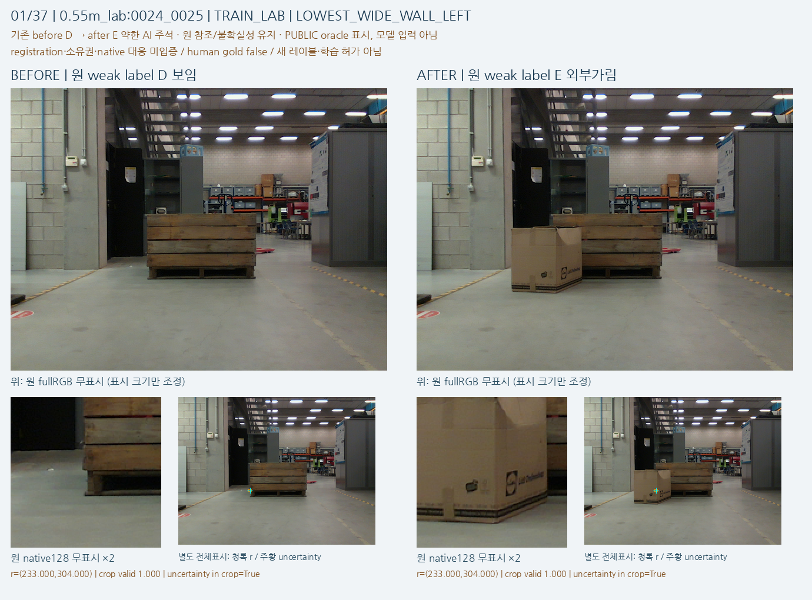

# 실제 crop의 공통 실패와 공개 실사 단서

원문: [query_visibility_natural_pallet_cue_intake_20261023_v120/ROOT_READOUT_KO.html](../../archive/task-2/pallet-keypoint-visibility/query_visibility_natural_pallet_cue_intake_20261023_v120/ROOT_READOUT_KO.html)

원 HTML SHA256: `6e01e417588e017655371dcd6ccd094713ceff5a72cf1359c7e2330a23fdd328`

원 img ordinal 1–2 / 2. 원 순서 유지; 이미지 pixel decode/모델/평가 재실행 없음.

## 원 이미지 1

원문 직전 heading

```text
1. 현재 평가 영상의 실제 성공·실패
```

원 alt

```text
기존 C13 저장 crop의 성공2와 실패2. C14도 같은 네 판단.
```


## 원 이미지 2

원문 직전 heading

```text
2. 공개 실사에서 더 직접 확인되는 구분
```

원 alt

```text
공개 실사의 목재 구조 단서 before와 전경 상자 after
```


