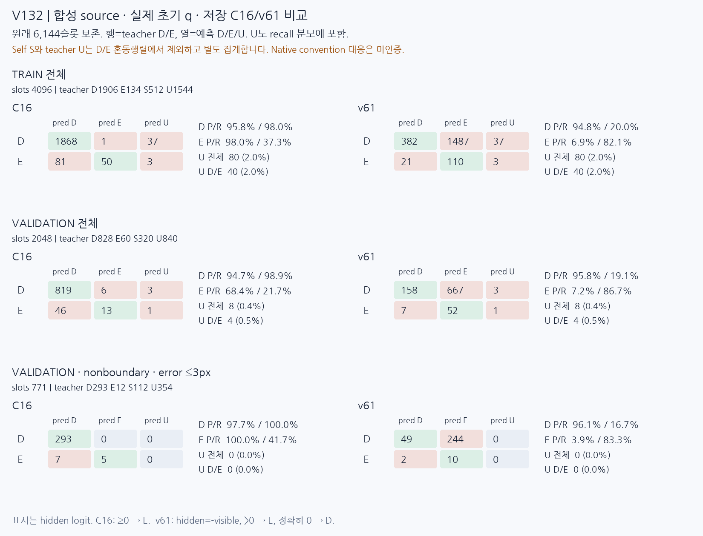
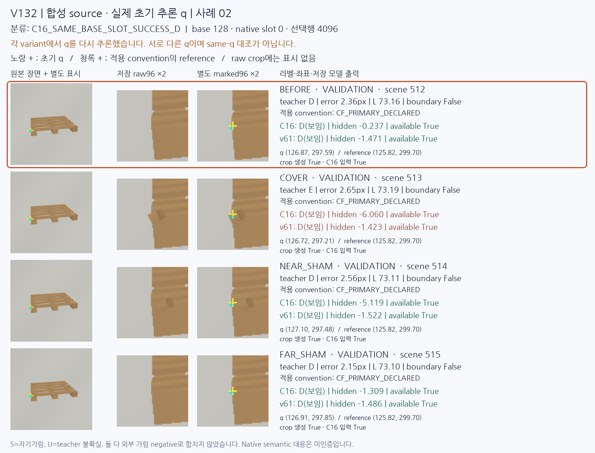
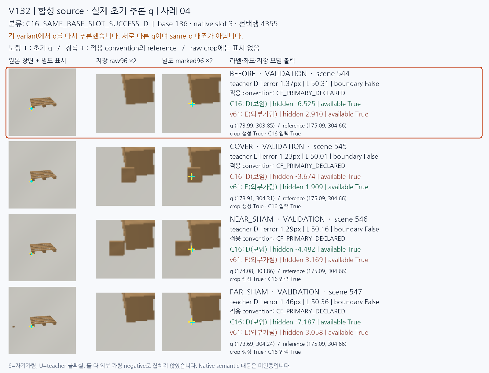
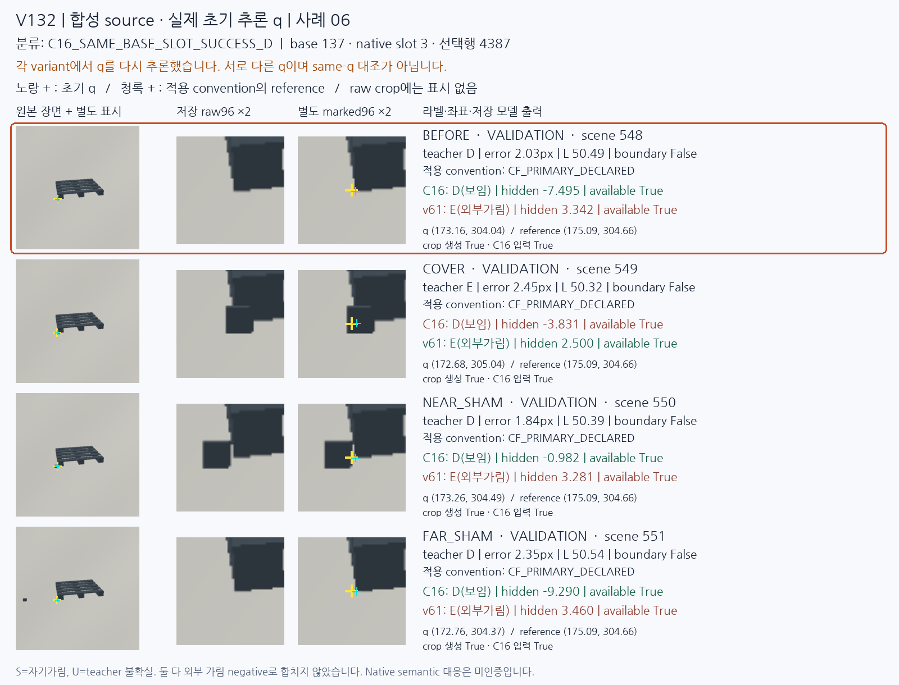
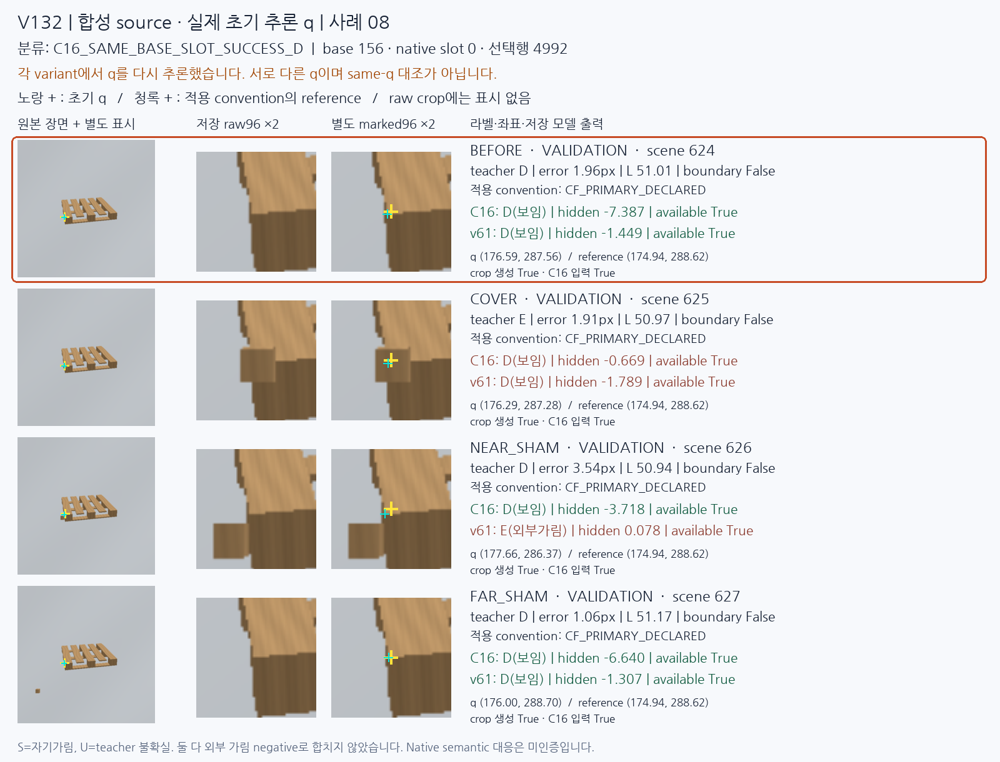

# V132 실제 초기 q 합성 진단

원문: [query_visibility_actual_initializer_source_20261024_v132/saved_visibility_visual_report_v1/READOUT_DRAFT_KO.html](../../archive/task-2/pallet-keypoint-visibility/query_visibility_actual_initializer_source_20261024_v132/saved_visibility_visual_report_v1/READOUT_DRAFT_KO.html)

원 HTML SHA256: `a04fc46d75348b16ed6ac757b8c9bd746fb24a5c66c1f7b4a4e072f97ad07869`

원 img ordinal 1–9 / 9. 원 순서 유지; 이미지 pixel decode/모델/평가 재실행 없음.

## 원 이미지 1

원문 직전 heading

```text
V132: 실제 초기 q에서 보임·가림 판단
```



## 원 이미지 2

원문 직전 heading

```text
C16_E_AS_D_LE3_NONBOUNDARY
```


## 원 이미지 3

원문 직전 heading

```text
C16_SAME_BASE_SLOT_SUCCESS_D
```



## 원 이미지 4

원문 직전 heading

```text
C16_E_AS_D_LE3_NONBOUNDARY
```


## 원 이미지 5

원문 직전 heading

```text
C16_SAME_BASE_SLOT_SUCCESS_D
```



## 원 이미지 6

원문 직전 heading

```text
C16_E_AS_D_LE3_NONBOUNDARY
```


## 원 이미지 7

원문 직전 heading

```text
C16_SAME_BASE_SLOT_SUCCESS_D
```



## 원 이미지 8

원문 직전 heading

```text
C16_E_AS_D_LE3_NONBOUNDARY
```


## 원 이미지 9

원문 직전 heading

```text
C16_SAME_BASE_SLOT_SUCCESS_D
```


