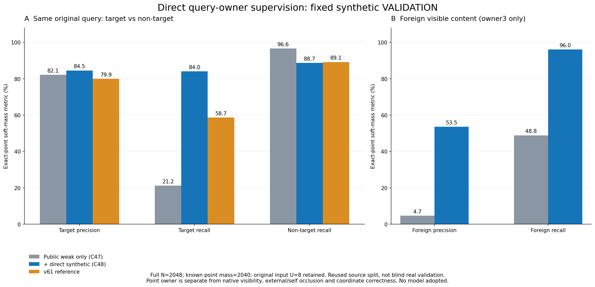

# V175 source query-owner control

원문: [query_visibility_direct_query_owner_control_20261024_v175/ROOT_READOUT_KO.html](../../archive/task-2/pallet-keypoint-visibility/query_visibility_direct_query_owner_control_20261024_v175/ROOT_READOUT_KO.html)

원 HTML SHA256: `6cf626b977dd4e724d88f14c6418fb56d2f1c940936cd1b37f7a5631fea2362c`

원 img ordinal 1–1 / 1. 원 순서 유지; 이미지 pixel decode/모델/평가 재실행 없음.

## 원 이미지 1

원문 직전 heading

```text
고정 source VALIDATION2048
```

원 alt

```text
고정 source VAL에서 target precision recall non-target recall 및 foreign precision recall 비교
```


