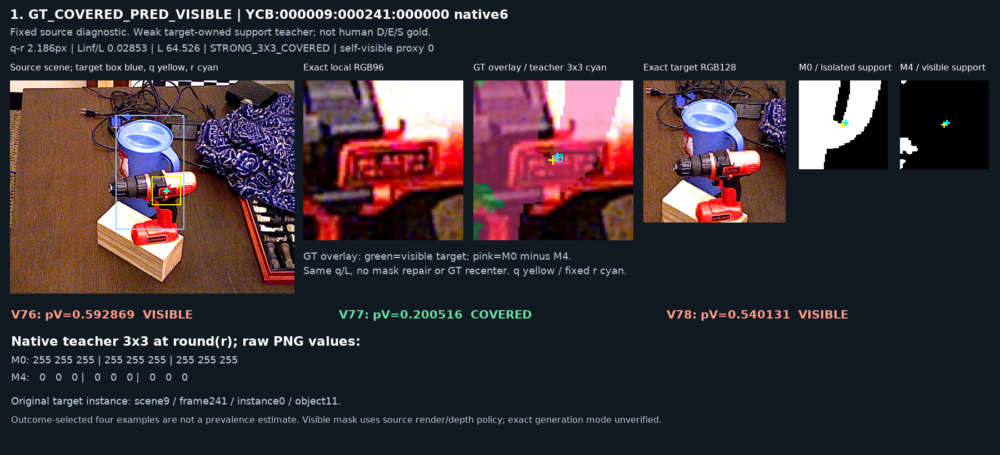
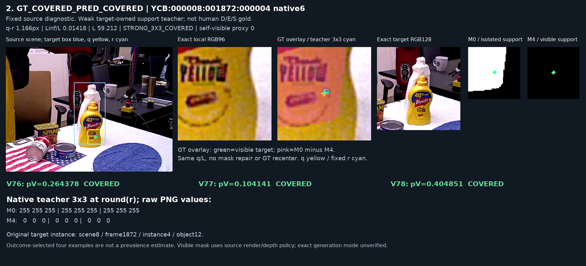
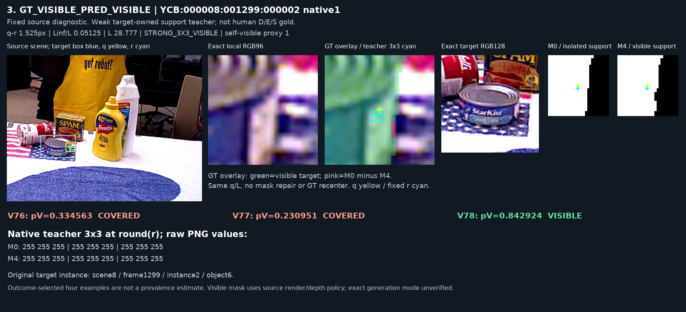
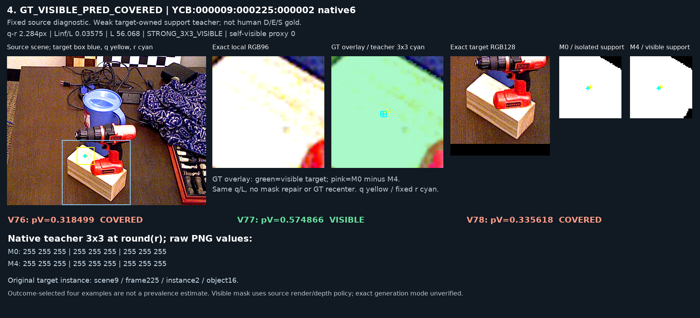

# V79 자연 가림 오류 진단

원문: [query_visibility_natural_occlusion_audit_20261023_v79/RESULTS_KO.html](../../archive/task-2/pallet-keypoint-visibility/query_visibility_natural_occlusion_audit_20261023_v79/RESULTS_KO.html)

원 HTML SHA256: `bbb7d444970025edb4ccb5734bd91f74ee3d9649e3b4ae91cda345b1269b54c5`

원 img ordinal 1–4 / 4. 원 순서 유지; 이미지 pixel decode/모델/평가 재실행 없음.

## 원 이미지 1

원문 직전 heading

```text
1. 파란 주전자의 해당 위치는 빨간 드릴에 가려져 있습니다. q-r 2.19px인데 V78 pV=.540으로 visible을 출력했습니다. target128 안에 주전자와 드릴이 함께 있습니다.
```

원 alt

```text
source RGB/crop/GT mask case1
```



## 원 이미지 2

원문 직전 heading

```text
2. 흰 세정제를 겨자병이 가린 위치입니다. q-r 1.17px, 세 후보 모두 covered로 맞혔습니다.
```

원 alt

```text
source RGB/crop/GT mask case2
```



## 원 이미지 3

원문 직전 heading

```text
3. 참치캔의 해당 위치가 보입니다. q-r 1.53px, V78은 visible로 맞혔지만 V76/V77은 covered였습니다.
```

원 alt

```text
source RGB/crop/GT mask case3
```



## 원 이미지 4

원문 직전 heading

```text
4. 나무블록 윗면의 해당 위치가 보입니다. q-r 2.28px, V78 pV=.336으로 covered를 출력했습니다. V77은 visible을 맞혔습니다.
```

원 alt

```text
source RGB/crop/GT mask case4
```


