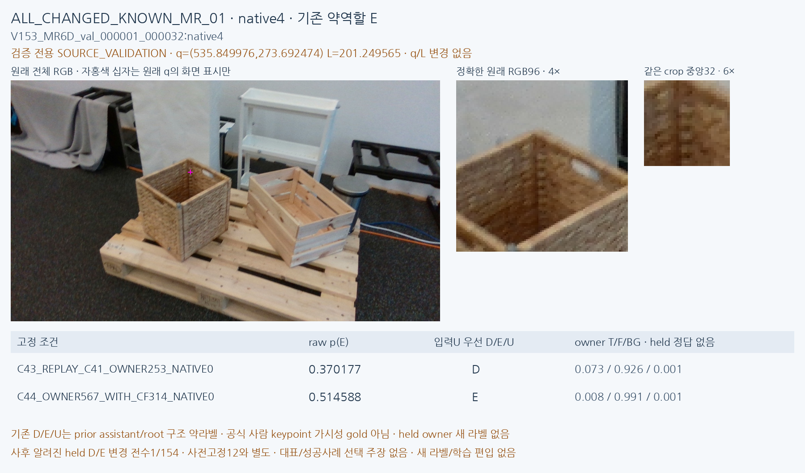

# All changed known MR

원문: [query_visibility_counterfactual_frozen_features_20261024_v162/controlled_source_visual_all_changed_mr_v1/index.html](../../archive/task-2/pallet-keypoint-visibility/query_visibility_counterfactual_frozen_features_20261024_v162/controlled_source_visual_all_changed_mr_v1/index.html)

원 HTML SHA256: `11dc295aadabfb0ba42b3bb872250833854efe837d9a3b09f0e2ab2cff3c39da`

원 img ordinal 1–1 / 1. 원 순서 유지; 이미지 pixel decode/모델/평가 재실행 없음.

## 원 이미지 1

원문 직전 heading

```text
ALL_CHANGED_KNOWN_MR · 사후 변경 전수 진단
```

원 alt

```text
all changed known MR
```


