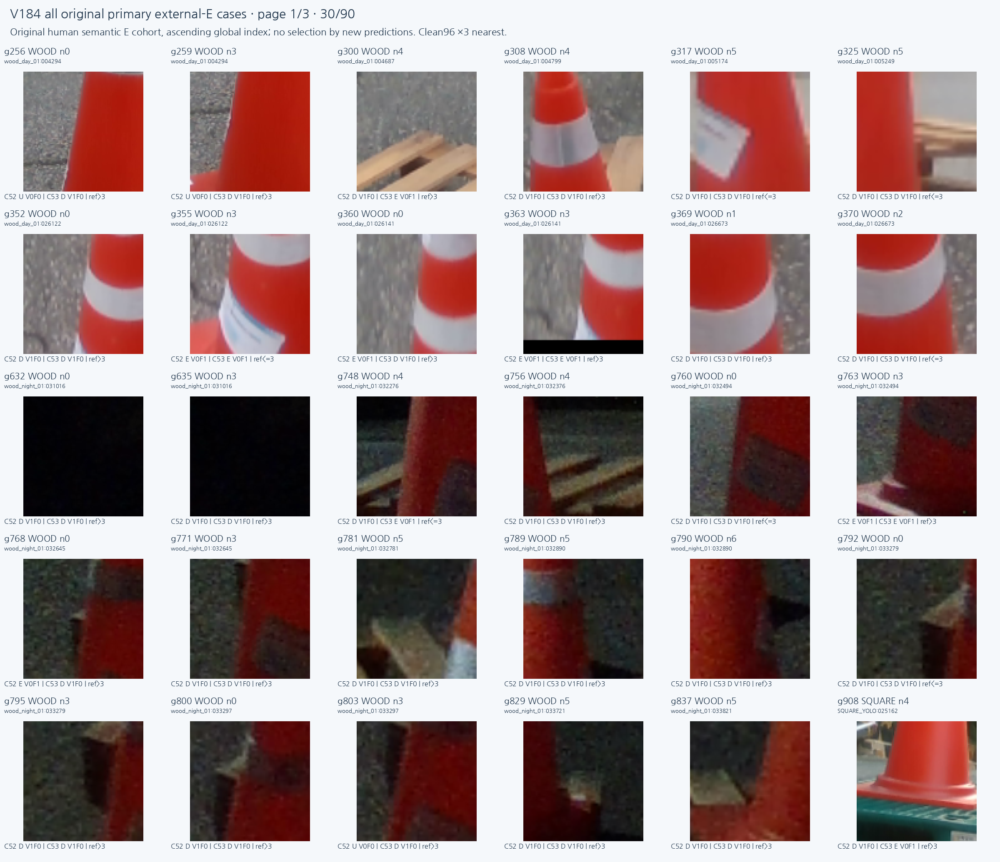
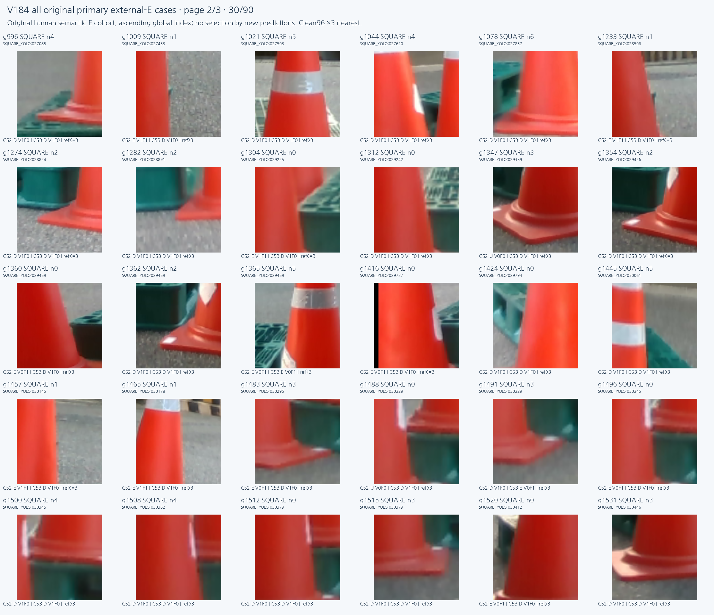
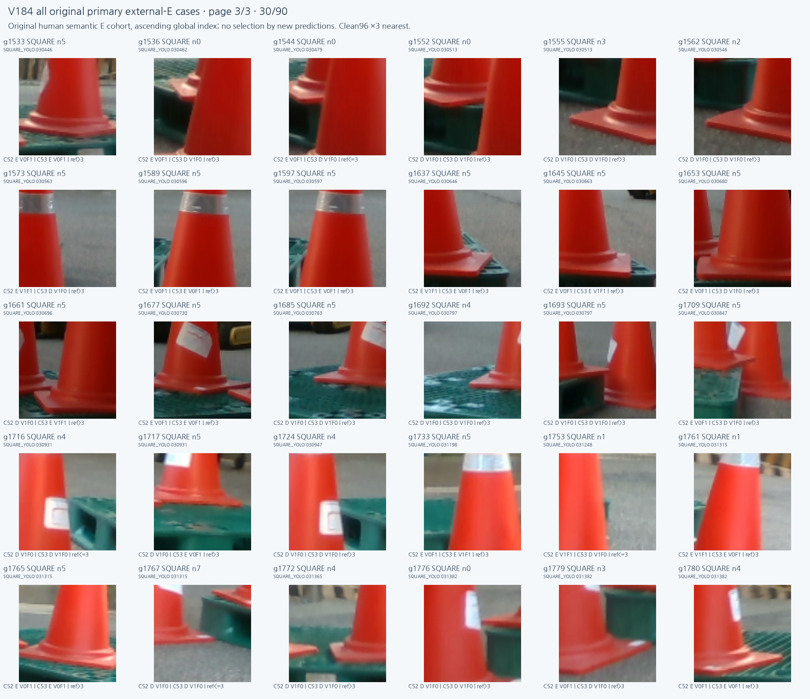

# V184 동결 두 모델 실사 비교

원문: [query_visibility_jitter_heads_frozen_real_benchmark_20261024_v184/ROOT_READOUT_KO.html](../../archive/task-2/pallet-keypoint-visibility/query_visibility_jitter_heads_frozen_real_benchmark_20261024_v184/ROOT_READOUT_KO.html)

원 HTML SHA256: `07f374d4194a6e5aece6cfc9df1b5246bd613921f5e8bab90ca7ec25a8c206c3`

원 img ordinal 1–4 / 4. 원 순서 유지; 이미지 pixel decode/모델/평가 재실행 없음.

## 원 이미지 1

원문 직전 heading

```text
실제 crop으로 확인
```

원 alt

```text
저장 실사 수치 비교
```


## 원 이미지 2

원문 직전 heading

```text
실제 crop으로 확인
```

원 alt

```text
외부 가림 원 crop 전체
```



## 원 이미지 3

원문 직전 heading

```text
실제 crop으로 확인
```

원 alt

```text
외부 가림 원 crop 전체
```



## 원 이미지 4

원문 직전 heading

```text
실제 crop으로 확인
```

원 alt

```text
외부 가림 원 crop 전체
```


