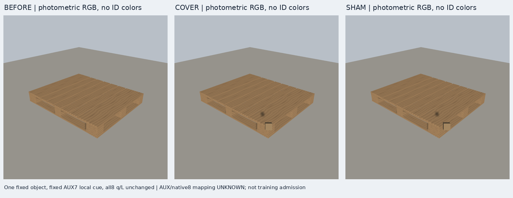
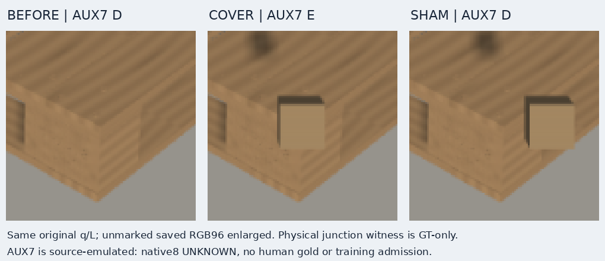

# V98 C4 소스 실패와 별도 단서 렌더

원문: [query_visibility_C1_warmstart_20261023_v98/ROOT_READOUT_KO.html](../../archive/task-2/pallet-keypoint-visibility/query_visibility_C1_warmstart_20261023_v98/ROOT_READOUT_KO.html)

원 HTML SHA256: `8e47b4611683eb0233f7a3b204fab8276c9035a7048d9889e0d34740c46723f7`

원 img ordinal 1–2 / 2. 원 순서 유지; 이미지 pixel decode/모델/평가 재실행 없음.

## 원 이미지 1

원문 직전 heading

```text
별도 V97: 같은 q에서 실제 RGB 단서 가림·보존 구성
```

원 alt

```text
V97 실제 full triplet
```



## 원 이미지 2

원문 직전 heading

```text
별도 V97: 같은 q에서 실제 RGB 단서 가림·보존 구성
```

원 alt

```text
V97 고정 AUX7 unmarked crop triplet
```


