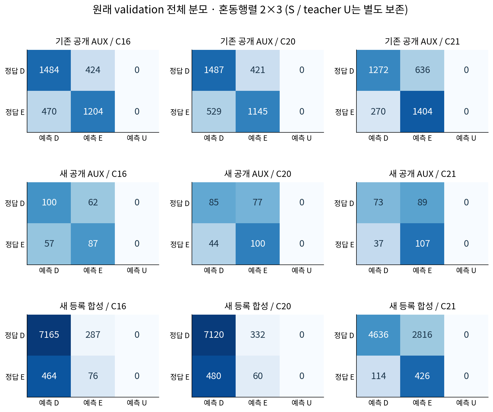

# V129 source control 결과 초안

원문: [query_visibility_registered_native_diversity_20261023_v129/postfit_report/provenance/PRE_TAKE_GROUP_CLARIFICATION/REPORT_DRAFT_KO.html](../../archive/task-2/pallet-keypoint-visibility/query_visibility_registered_native_diversity_20261023_v129/postfit_report/provenance/PRE_TAKE_GROUP_CLARIFICATION/REPORT_DRAFT_KO.html)

원 HTML SHA256: `0b5aa25a86803a5a7533a522d8b03b40048f6858321ee5d6e64220488b960966`

원 img ordinal 1–2 / 2. 원 순서 유지; 이미지 pixel decode/모델/평가 재실행 없음.

## 원 이미지 1

원문 직전 heading

```text
V129: 등록 합성 source 추가는 외부 가림을 더 잡았지만,보이는 cue 보존과 새 공개 실사 조건을 함께 통과하지 못했습니다
```

원 alt

```text
세 source validation cohort의 C16 C20 C21 D E recall
```


## 원 이미지 2

원문 직전 heading

```text
같은 validation 행의 혼동행렬·precision·recall
```

원 alt

```text
세 cohort 세 모델의 2x3 confusion matrices
```


