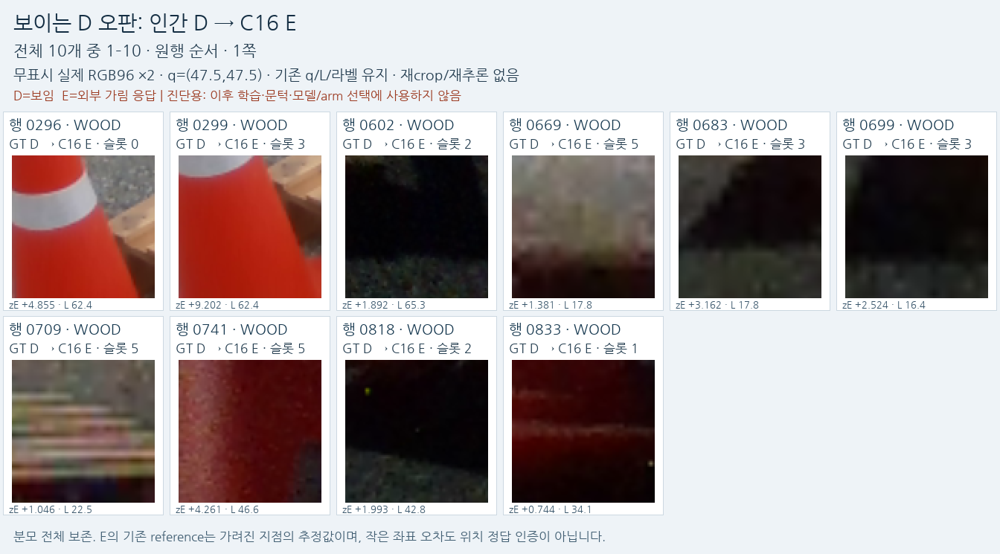
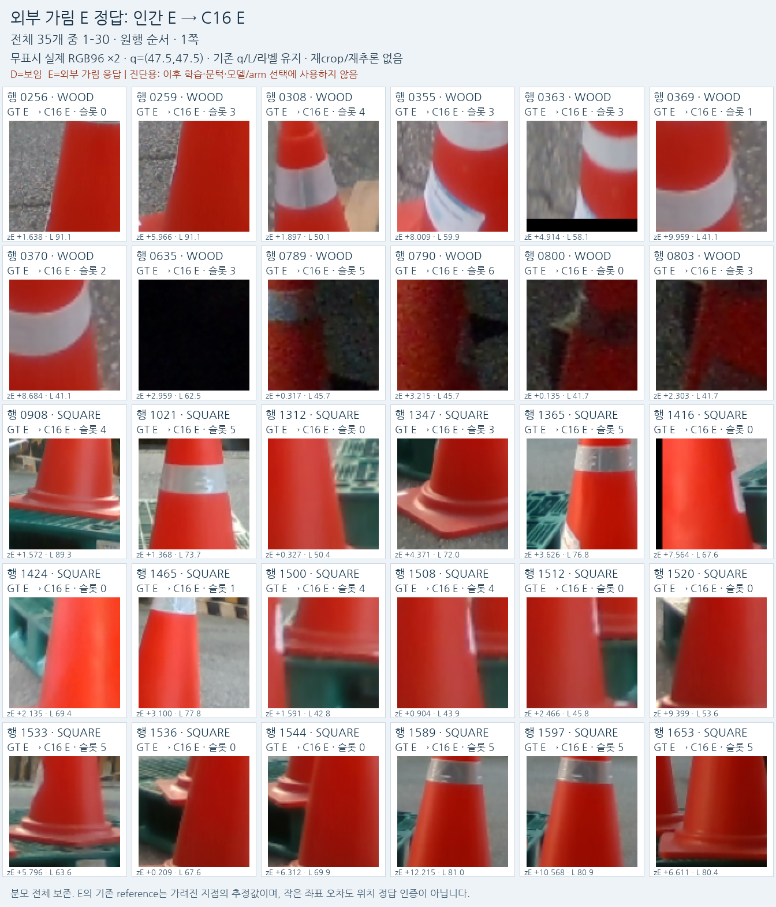
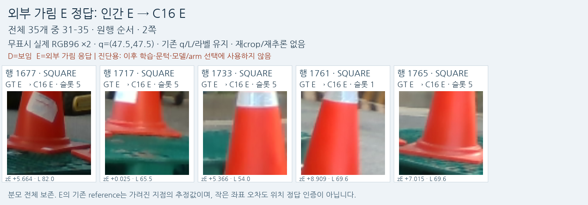
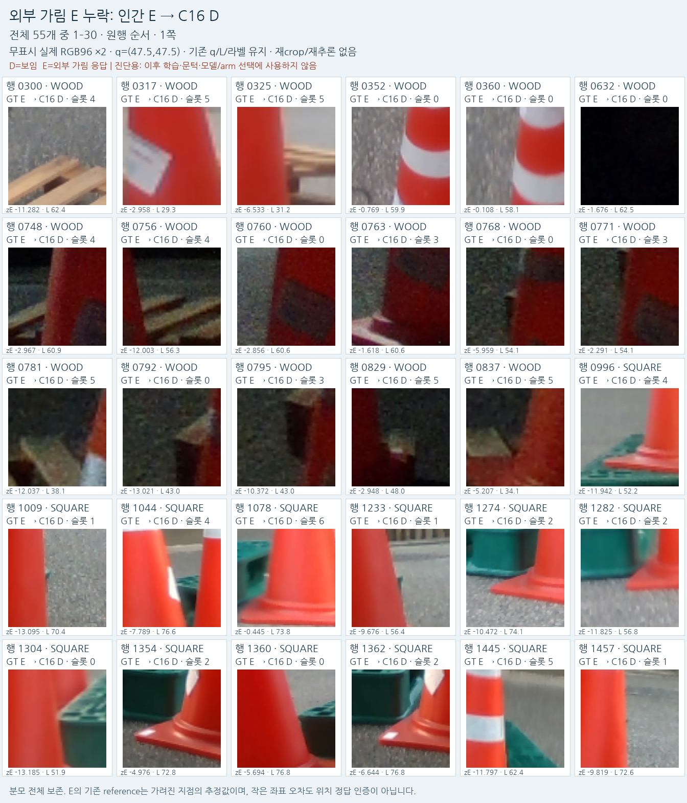
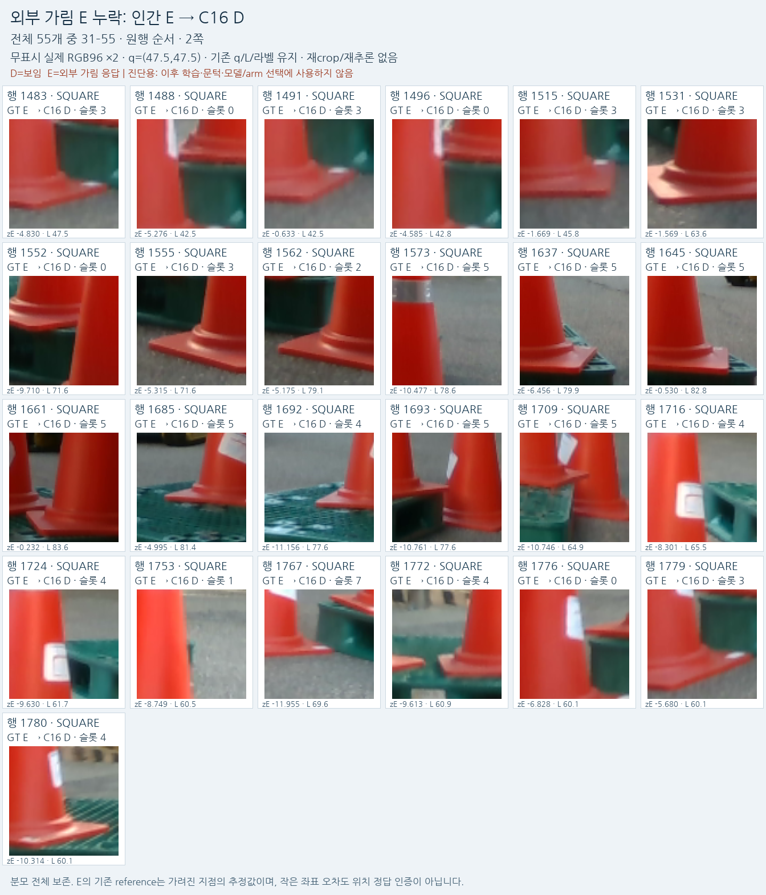

# C16 실제 crop 성공·실패와 남은 문제

원문: [query_visibility_training_duration_control_20261023_v124/ROOT_READOUT_KO.html](../../archive/task-2/pallet-keypoint-visibility/query_visibility_training_duration_control_20261023_v124/ROOT_READOUT_KO.html)

원 HTML SHA256: `426ffa8355d237b44b570fcfc6b719e34998f80de7b9bf0c8161eca172a9ff15`

원 img ordinal 1–9 / 9. 원 순서 유지; 이미지 pixel decode/모델/평가 재실행 없음.

## 원 이미지 1

원문 직전 heading

```text
같은 네 사례, 현재 모델의 판정
```

원 alt

```text
원 q/L을 유지한 실제 저장 RGB. 왼쪽 아래는 남은 외부 가림 실패, 오른쪽 아래는 과거 실패에서 현재 성공으로 바뀐 사례.
```

원 HTML caption

```text
원 q/L을 유지한 실제 저장 RGB. 왼쪽 아래는 남은 외부 가림 실패, 오른쪽 아래는 과거 실패에서 현재 성공으로 바뀐 사례.
```


## 원 이미지 2

원문 직전 heading

```text
같은 네 사례, 현재 모델의 판정
```

원 alt

```text
같은 고정4사례의 전체 원본, raw crop, 표시 복사본과 저장 점수.
```

원 HTML caption

```text
같은 고정4사례의 전체 원본, raw crop, 표시 복사본과 저장 점수.
```


## 원 이미지 3

원문 직전 heading

```text
학습을 더 오래 하면 해결되는가
```

원 alt

```text
데이터·head·학습률·문턱을 고정한 기간 대조. 공개 검증으로4500회 모델 선택. 총8000회까지 반복해도 잔여 가림의 개선은 제한적이다.
```

원 HTML caption

```text
데이터·head·학습률·문턱을 고정한 기간 대조. 공개 검증으로4500회 모델 선택. 총8000회까지 반복해도 잔여 가림의 개선은 제한적이다.
```


## 원 이미지 4

원문 직전 heading

```text
공개 학습 자료에서 직접 확인한 빈틈
```

원 alt

```text
실제 사용한 공개 배경 기반 BEFORE / COVER / SHAM 예시. COVER는 기준 단서와 q를 덮고 SHAM은 단서를 보존한다.
```

원 HTML caption

```text
실제 사용한 공개 배경 기반 BEFORE / COVER / SHAM 예시. COVER는 기준 단서와 q를 덮고 SHAM은 단서를 보존한다.
```


## 원 이미지 5

원문 직전 heading

```text
전체 외부 가림90개와 보임 오판10개
```

원 alt

```text
D_FALSE_E_01.png
```

원 HTML caption

```text
D_FALSE_E_01.png
```



## 원 이미지 6

원문 직전 heading

```text
전체 외부 가림90개와 보임 오판10개
```

원 alt

```text
E_CORRECT_01.png
```

원 HTML caption

```text
E_CORRECT_01.png
```



## 원 이미지 7

원문 직전 heading

```text
전체 외부 가림90개와 보임 오판10개
```

원 alt

```text
E_CORRECT_02.png
```

원 HTML caption

```text
E_CORRECT_02.png
```



## 원 이미지 8

원문 직전 heading

```text
전체 외부 가림90개와 보임 오판10개
```

원 alt

```text
E_MISSED_01.png
```

원 HTML caption

```text
E_MISSED_01.png
```



## 원 이미지 9

원문 직전 heading

```text
전체 외부 가림90개와 보임 오판10개
```

원 alt

```text
E_MISSED_02.png
```

원 HTML caption

```text
E_MISSED_02.png
```


