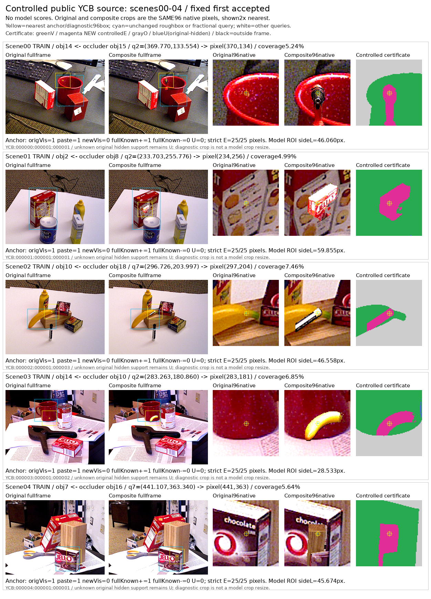
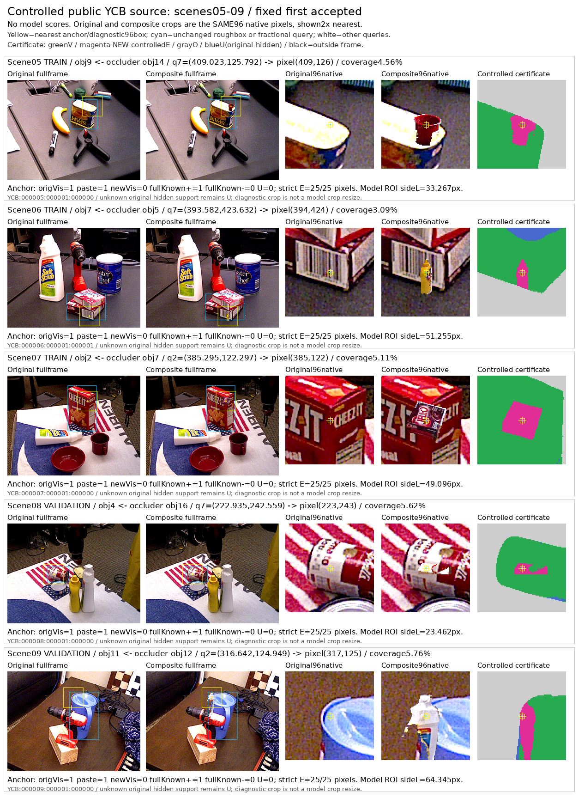

# v66 데이터 준비와 검산 | 팔레트 query 가림

원문: [query_visibility_controlled_real_20261022_v66/source_audit/DATA_PREPARATION_REPORT/CONTROLLED_QA.html](../../archive/task-2/pallet-keypoint-visibility/query_visibility_controlled_real_20261022_v66/source_audit/DATA_PREPARATION_REPORT/CONTROLLED_QA.html.parts.json)

원 HTML SHA256: `8cafff2d835fa3107413196dc7e8ea2dd9c9f8c79dd9792e678745dba98b680e`

원 img ordinal 1–2 / 2. 원 순서 유지; 이미지 pixel decode/모델/평가 재실행 없음.

## 원 이미지 1

원문 직전 heading

```text
제어 가림: 원 query를 옮기지 않고 RGB만 바꿨습니다
```

원 alt

```text
Scene0–4 원본과 제어 가림 fullframe 및96native crops
```

원 HTML caption

```text
고정 선택: scene별 첫 accepted 타깃, scene 0–4. 같은 query 주변 원본·composite·인증 mask를 정렬했습니다. 모델 점수로 고른 사례가 아닙니다. 좌표·인증 bit와 선택 기록
```



## 원 이미지 2

원문 직전 heading

```text
제어 가림: 원 query를 옮기지 않고 RGB만 바꿨습니다
```

원 alt

```text
Scene5–9 원본 및 제어 가림 crop
```

원 HTML caption

```text
Scene 8–9는 소스 VAL입니다. 이미지와 라벨은 최초 seal 이후 바꾸지 않았습니다. OpenCV distance-transform tie의 실행 환경 차이는 별도 기록했으며, 저장된 anchor·RGB를 재선택하지 않았습니다.
```



원문 HTML이 큰 경우 링크는 원 SHA를 보존하는 무손실 gzip descriptor를 가리킵니다.
